# DOKUMENTASI ALUR PENGGUNA (USER FLOW)
# AKSA NOVA — PERPUSTAKAAN DIGITAL SMK NEGERI 1 RONGGA

---

## DAFTAR ISI
1. [Ringkasan & Konteks Website](#1-ringkasan--konteks-website)
2. [Peta Titik Masuk Pengunjung (Entry Points)](#2-peta-titik-masuk-pengunjung-entry-points)
3. [Alur Pengguna Tamu (Guest Flows)](#3-alur-pengguna-tamu-guest-flows)
   - [3.1 Eksplorasi Katalog & Cek Lokasi Rak Fisik](#31-eksplorasi-katalog--cek-lokasi-rak-fisik)
   - [3.2 Kustomisasi Aksesibilitas & Tampilan (Pintasan Alt+D)](#32-kustomisasi-aksesibilitas--tampilan-pintasan-altd)
   - [3.3 Pendaftaran Akun Mandiri Siswa & Guru](#33-pendaftaran-akun-mandiri-siswa--guru)
   - [3.4 Pemulihan Akun Lupa Sandi/Kartu via OTP Email](#34-pemulihan-akun-lupa-sandikartu-via-otp-email)
4. [Alur Anggota Perpustakaan (Member Flows)](#4-alur-anggota-perpustakaan-member-flows)
   - [4.1 Autentikasi Login & Pengalihan Peran Terisolasi](#41-autentikasi-login--pengalihan-peran-terisolasi)
   - [4.2 Login Cepat via Pemindaian Barcode Meja Kios](#42-login-cepat-via-pemindaian-barcode-meja-kios)
   - [4.3 Penayangan & Pengunduhan Kartu Digital CR80 300 DPI](#43-penayangan--pengunduhan-kartu-digital-cr80-300-dpi)
   - [4.4 Interaksi Sosial Katalog (Like, Bookmark, & Rating)](#44-interaksi-sosial-katalog-like-bookmark--rating)
   - [4.5 Pengajuan Peminjaman Buku Daring (Kolektif s/d 40 Buku)](#45-pengajuan-peminjaman-buku-daring-kolektif-sd-40-buku)
   - [4.6 Pemantauan Dasbor Peminjaman Pribadi & Denda](#46-pemantauan-dasbor-peminjaman-pribadi--denda)
   - [4.7 Pembaruan Profil Mandiri & Ganti Kata Sandi](#47-pembaruan-profil-mandiri--ganti-kata-sandi)
5. [Alur Pustakawan / Administrator (Admin Flows)](#5-alur-pustakawan--administrator-admin-flows)
   - [5.1 Akses Ruang Kerja Terisolasi Dasbor Admin](#51-akses-ruang-kerja-terisolasi-dasbor-admin)
   - [5.2 Pengelolaan Master Data Buku & Auto-Fill ISBN](#52-pengelolaan-master-data-buku--auto-fill-isbn)
   - [5.3 Verifikasi Antrean Pengajuan Daring & Notifikasi Realtime](#53-verifikasi-antrean-pengajuan-daring--notifikasi-realtime)
   - [5.4 Transaksi Peminjaman Meja Sirkulasi Langsung](#54-transaksi-peminjaman-meja-sirkulasi-langsung)
   - [5.5 Pengembalian Buku, Denda Otomatis, & Pelunasan](#55-pengembalian-buku-denda-otomatis--pelunasan)
   - [5.6 Pengiriman Pengingat Denda via WhatsApp Web Link](#56-pengiriman-pengingat-denda-via-whatsapp-web-link)
   - [5.7 Manajemen Anggota, Approval Akun, & Pencairan Kartu Beku](#57-manajemen-anggota-approval-akun--pencairan-kartu-beku)
   - [5.8 Konfigurasi Sistem (Denda, Peta Lokasi, Banner, Musik)](#58-konfigurasi-sistem-denda-peta-lokasi-banner-musik)
   - [5.9 Pelaporan Rekapitulasi & Ekspor Excel (.xls 3-Worksheet)](#59-pelaporan-rekapitulasi--ekspor-excel-xls-3-worksheet)
6. [Matriks Percabangan Keputusan & Titik Akhir Alur](#6-matriks-percabangan-keputusan--titik-akhir-alur)
7. [Daftar Ketetapan Operasional Terkonfirmasi](#7-daftar-ketetapan-operasional-terkonfirmasi)

---

## 1. Ringkasan & Konteks Website
- **Nama Website**: [AKSA NOVA](file:///c:/laragon/www/aksanova/index.php) (Aksara & Informasi Perpustakaan Digital)
- **Jenis Website**: Sistem Informasi Manajemen Perpustakaan Sekolah Berbasis Web
- **Tujuan Utama**: Digitalisasi sirkulasi buku, penelusuran katalog cerdas dengan transparansi nomor rak fisik, penerbitan kartu anggota digital standar CR80 300 DPI ber-Barcode Code 128 SVG, pengajuan peminjaman kolektif kelas hingga 40 eksemplar, pemulihan akun via OTP email 6-digit, serta otomatisasi denda dan ekspor laporan tahunan Excel (.xls 3-worksheet) bagi SMK Negeri 1 Rongga.
- **Target Pengguna**:
  1. *Tamu (Guest)*: Pengunjung umum, siswa/guru yang belum masuk ke akun.
  2. *Anggota (Member)*: Siswa aktif dan Guru SMKN 1 Rongga yang akunnya disetujui (`status = 'approved'`) dan kartunya aktif (`card_status = 'active'`).
  3. *Pustakawan (Admin)*: Petugas pengelola sirkulasi dan master data perpustakaan (`role = 'admin'`).

---

## 2. Peta Titik Masuk Pengunjung (Entry Points)

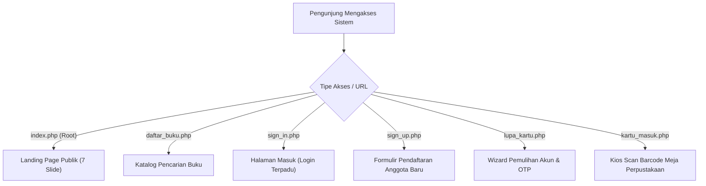

1. **`index.php` (Landing Page Publik)**: Titik masuk utama pengunjung luar, menampilkan banner promosi, 4 buku terbaru, kutipan harian, jam operasional realtime WIB, dan sematan peta Google Maps.
2. **`daftar_buku.php` (Katalog Buku)**: Titik masuk pencarian literasi bagi pengunjung yang ingin langsung mencari ketersediaan stok dan kode penempatan rak buku fisik.
3. **`sign_in.php` (Portal Login Terpadu)**: Titik masuk bagi anggota maupun admin untuk mengotentikasi sesi kerja.
4. **`sign_up.php` (Registrasi Mandiri)**: Titik masuk siswa/guru baru untuk mendaftar akun keanggotaan perpustakaan.
5. **`lupa_kartu.php` (Pemulihan Akun)**: Titik masuk pengguna yang kartu digitalnya hilang atau lupa kata sandi.
6. **`kartu_masuk.php` (Kios Barcode Meja)**: Titik masuk khusus di ruang perpustakaan untuk login instan via pemindai barcode laser/kamera tanpa mengetik sandi.

---

## 3. Alur Pengguna Tamu (Guest Flows)

### 3.1 Eksplorasi Katalog & Cek Lokasi Rak Fisik
Alur ini digunakan pengunjung untuk mencari ketersediaan buku dan mengetahui posisi nomor rak fisik di gedung perpustakaan sebelum berkunjung.

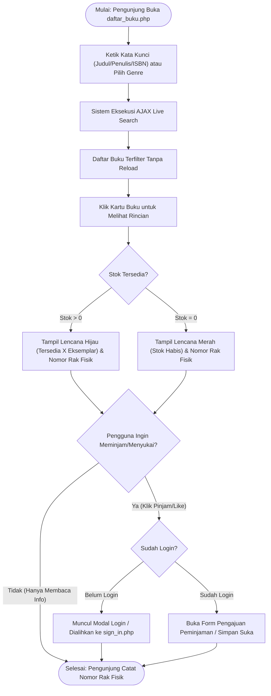

- **Titik Masuk**: Halaman [`daftar_buku.php`](file:///c:/laragon/www/aksanova/daftar_buku.php) atau widget pencarian di [`beranda.php`](file:///c:/laragon/www/aksanova/beranda.php).
- **Langkah-langkah**:
  1. Masukkan kata kunci pada kotak pencarian atau klik salah satu filter kategori genre.
  2. Sistem menjalankan pencarian live AJAX fragmen HTML (`?ajax=1`) dan memperbarui tampilan seketika.
  3. Klik salah satu buku untuk memicu modal detail [`buku_detail.php`](file:///c:/laragon/www/aksanova/buku_detail.php).
  4. Periksa ketersediaan kuantitas stok fisik dan catat kode rak buku (contoh: *"Rak Fiksi 2"*).
- **Titik Akhir**: Tamu mencatat lokasi rak fisik untuk didatangi langsung, atau diarahkan ke login jika mengklik aksi transaksi.

---

### 3.2 Kustomisasi Aksesibilitas & Tampilan (Pintasan Alt+D)
Alur ini memberikan kebebasan kustomisasi visual bagi seluruh pengunjung tanpa memerlukan akun.

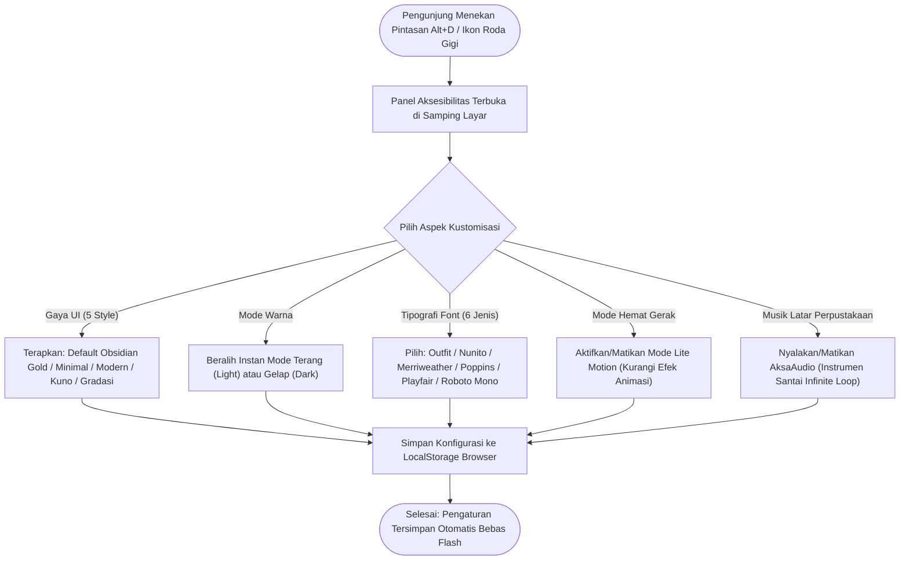

- **Titik Masuk**: Penekanan tombol keyboard `Alt + D` atau `Ctrl + Shift + D` di halaman mana saja, atau klik tombol floating setting.
- **Titik Akhir**: Peramban menyimpan setelan ke `localStorage.aksanova_settings` dan menerapkannya secara global.

---

### 3.3 Pendaftaran Akun Mandiri Siswa & Guru
Alur pendaftaran mandiri untuk memperoleh nomor unik anggota perpustakaan.

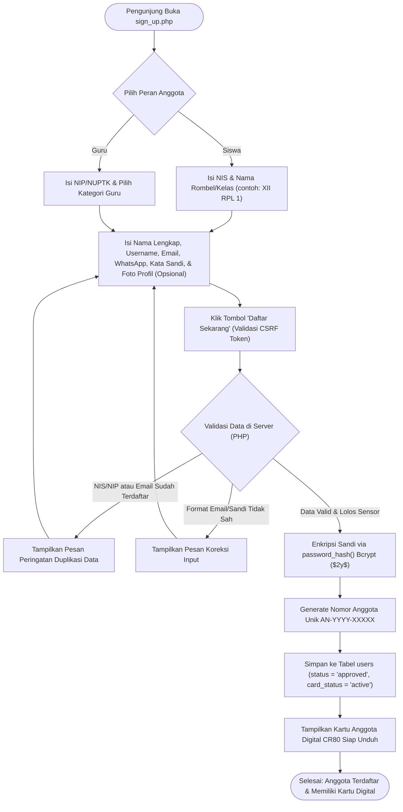

- **Titik Masuk**: Halaman [`sign_up.php`](file:///c:/laragon/www/aksanova/sign_up.php).
- **Titik Akhir**: Akun tersimpan di tabel `users` dengan `role = 'member'`, `status = 'approved'`, `card_status = 'active'`, dan halaman langsung menayangkan kartu digital anggota yang siap diunduh.

---

### 3.4 Pemulihan Akun Lupa Sandi/Kartu via OTP Email
Alur terstruktur 3-langkah pemulihan akun saat kartu fisik/digital hilang atau lupa kata sandi.

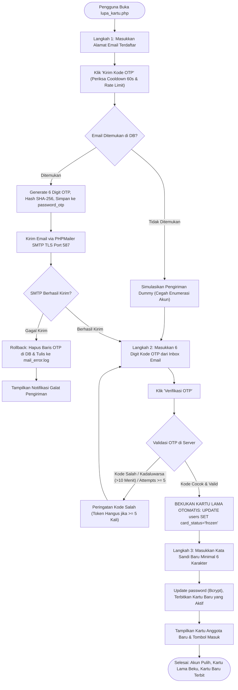

- **Titik Masuk**: Halaman [`lupa_kartu.php`](file:///c:/laragon/www/aksanova/lupa_kartu.php).
- **Titik Akhir**: Kata sandi diperbarui, nomor kartu lama dibekukan secara permanen (`card_status = 'frozen'`), kartu anggota baru diterbitkan, dan sesi diarahkan ke pratinjau kartu.

---

## 4. Alur Anggota Perpustakaan (Member Flows)

### 4.1 Autentikasi Login & Pengalihan Peran Terisolasi

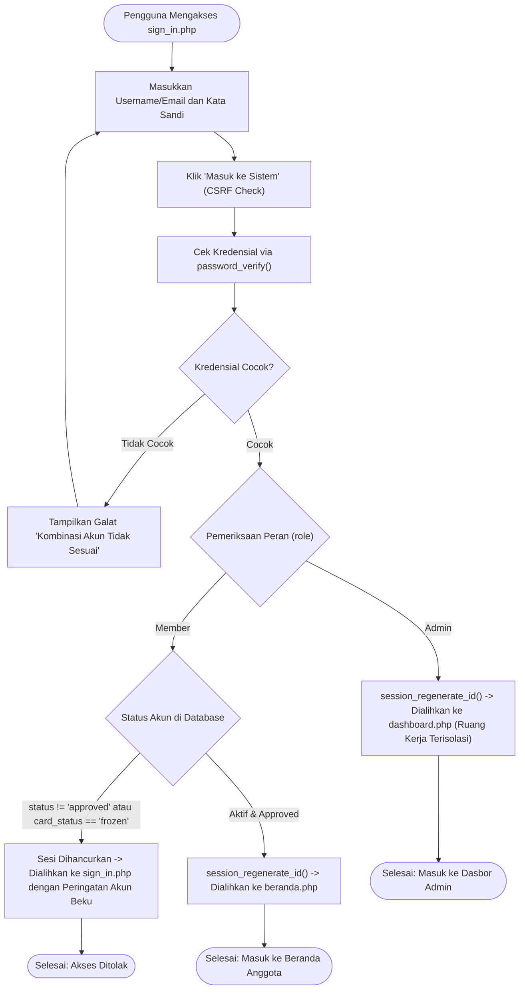

- **Titik Masuk**: Halaman [`sign_in.php`](file:///c:/laragon/www/aksanova/sign_in.php).
- **Titik Akhir**: Anggota aktif masuk ke `beranda.php`, Admin masuk ke `dashboard.php`.

---

### 4.2 Login Cepat via Pemindaian Barcode Meja Kios
Alur tanpa ketik kata sandi khusus saat siswa berada langsung di ruang perpustakaan sekolah.

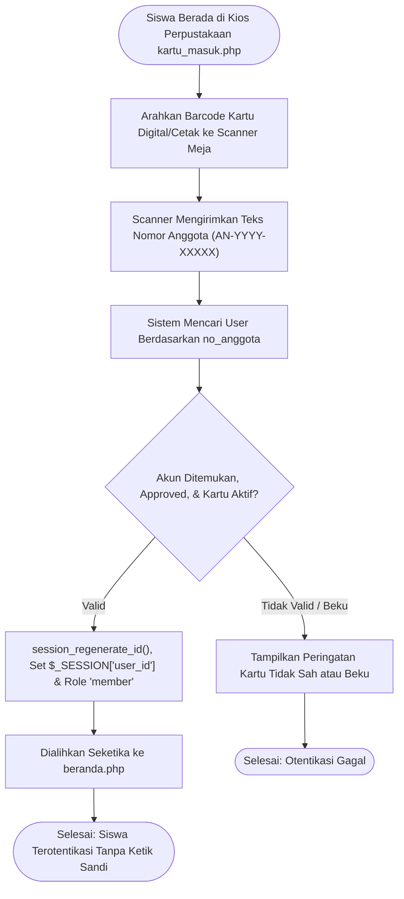

- **Titik Masuk**: Halaman [`kartu_masuk.php`](file:///c:/laragon/www/aksanova/kartu_masuk.php).
- **Titik Akhir**: Sesi anggota aktif dan peramban diarahkan ke katalog anggota.

---

### 4.3 Penayangan & Pengunduhan Kartu Digital CR80 300 DPI

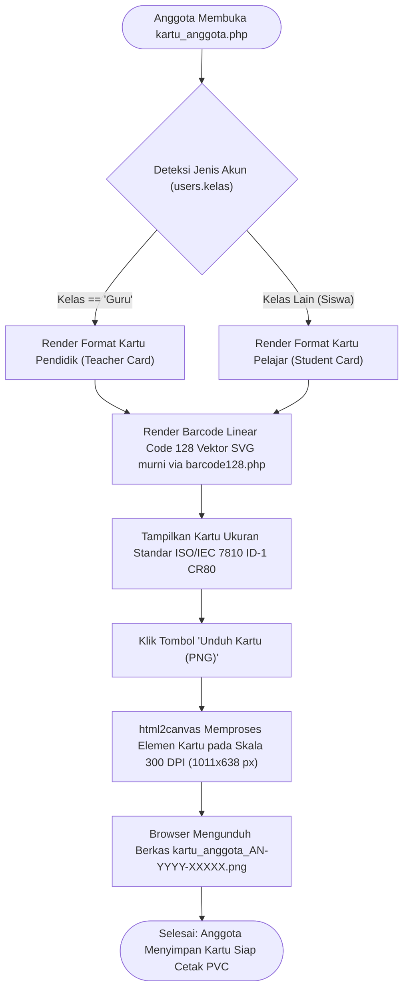

- **Titik Masuk**: Halaman [`kartu_anggota.php`](file:///c:/laragon/www/aksanova/kartu_anggota.php).
- **Titik Akhir**: Berkas citra kartu digital PNG resolusi 300 DPI tersimpan di perangkat pengguna.

---

### 4.4 Interaksi Sosial Katalog (Like, Bookmark, & Rating)

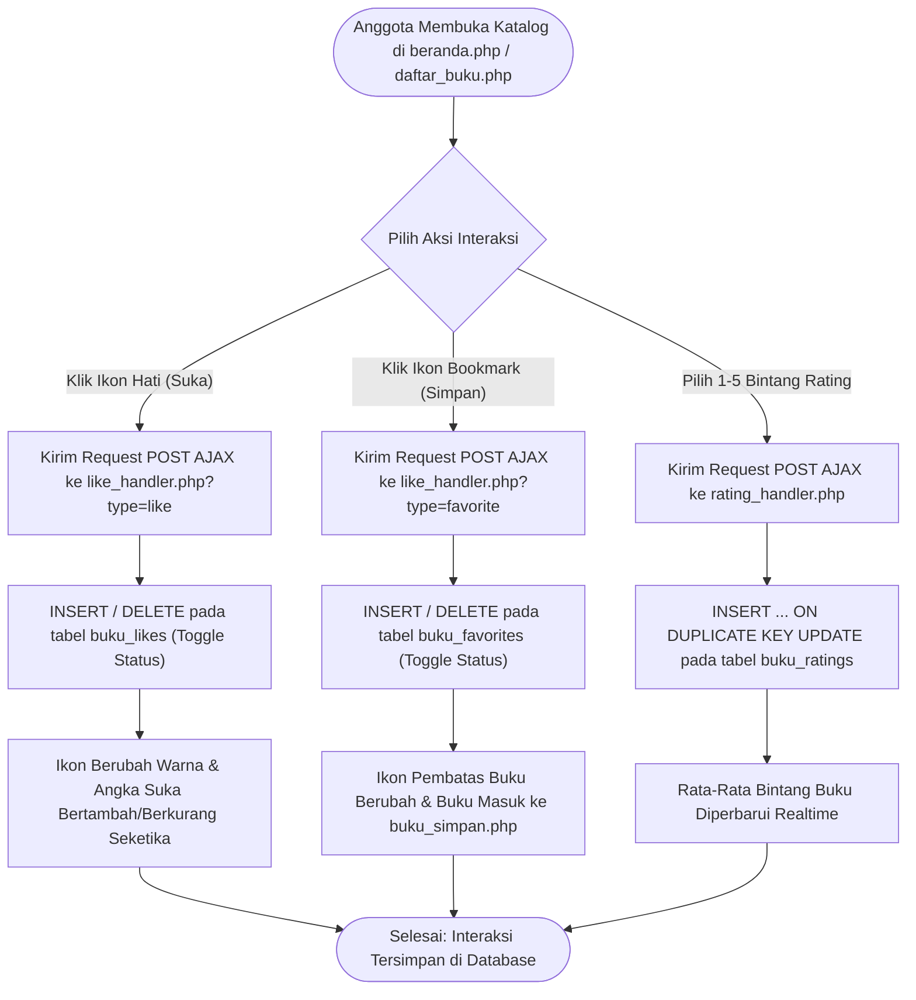

- **Titik Masuk**: Halaman katalog [`beranda.php`](file:///c:/laragon/www/aksanova/beranda.php), [`daftar_buku.php`](file:///c:/laragon/www/aksanova/daftar_buku.php), atau [`buku_detail.php`](file:///c:/laragon/www/aksanova/buku_detail.php).
- **Titik Akhir**: Perubahan status tercatat di tabel `buku_likes`, `buku_favorites`, atau `buku_ratings` secara asinkron tanpa reload halaman.

---

### 4.5 Pengajuan Peminjaman Buku Daring (Kolektif s/d 40 Buku)

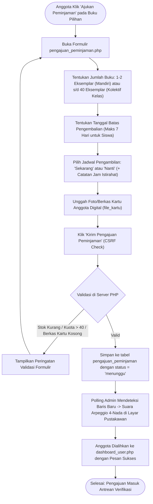

- **Titik Masuk**: Formulir [`pengajuan_peminjaman.php`](file:///c:/laragon/www/aksanova/pengajuan_peminjaman.php).
- **Titik Akhir**: Baris pengajuan berstatus `'menunggu'` tersimpan di tabel `pengajuan_peminjaman` dan peminjam diarahkan ke dasbor riwayat.

---

### 4.6 Pemantauan Dasbor Peminjaman Pribadi & Denda
- **Titik Masuk**: Halaman [`dashboard_user.php`](file:///c:/laragon/www/aksanova/dashboard_user.php).
- **Langkah-langkah**:
  1. Periksa kartu profil mini untuk memastikan status kartu tetap aktif.
  2. Periksa kotak peringatan denda: jika terdapat buku yang terlambat, sistem menampilkan estimasi denda berjalan secara transparan.
  3. Periksa tabel **Peminjaman Aktif**: lihat hitungan hari tersisa sebelum jatuh tempo.
  4. Periksa tabel **Riwayat Pengajuan**: lihat apakah permohonan berstatus *Menunggu*, *Disetujui* (buku siap diambil), atau *Ditolak* (baca alasan penolakan pustakawan).
- **Titik Akhir**: Anggota mengetahui kewajiban pengembalian dan dapat bersiap mengambil buku yang telah disetujui.

---

### 4.7 Pembaruan Profil Mandiri & Ganti Kata Sandi
- **Titik Masuk**: Halaman [`edit_kartu.php`](file:///c:/laragon/www/aksanova/edit_kartu.php).
- **Langkah-langkah**:
  1. Ubah Nama Lengkap, Nomor HP/WhatsApp, Email, atau unggah pasfoto baru.
  2. *Ganti Sandi (Opsional)*: Jika tidak ingin mengganti sandi, kosongkan kolom kata sandi. Jika ingin mengganti, masukkan kata sandi lama dan ketik kata sandi baru.
  3. Klik tombol **"Simpan Perubahan"**.
- **Titik Akhir**: Data diperbarui di tabel `users` dan foto profil baru dicerminkan pada kartu anggota digital.

---

## 5. Alur Pustakawan / Administrator (Admin Flows)

### 5.1 Akses Ruang Kerja Terisolasi Dasbor Admin
- **Titik Masuk**: [`sign_in.php`](file:///c:/laragon/www/aksanova/sign_in.php) dengan akun pustakawan.
- **Pengalihan Otomatis**: Sistem membawa admin ke [`dashboard.php`](file:///c:/laragon/www/aksanova/dashboard.php).
- **Isolasi Lingkungan**: Seluruh navigasi katalog anggota publik disembunyikan. Jika admin mengetik URL `beranda.php`, sistem otomatis memblokir dan mengembalikan peramban ke `dashboard.php`.

---

### 5.2 Pengelolaan Master Data Buku & Auto-Fill ISBN

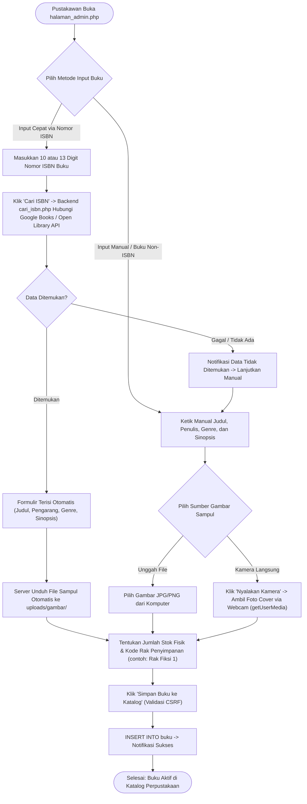

- **Titik Masuk**: Halaman [`halaman_admin.php`](file:///c:/laragon/www/aksanova/halaman_admin.php).
- **Titik Akhir**: Rekaman buku tersimpan di tabel `buku` lengkap dengan gambar sampul dan kode penempatan rak fisik.

---

### 5.3 Verifikasi Antrean Pengajuan Daring & Notifikasi Realtime

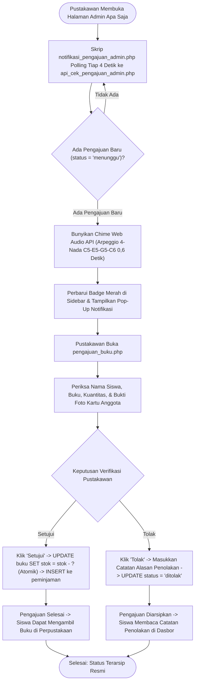

- **Titik Masuk**: Halaman [`pengajuan_buku.php`](file:///c:/laragon/www/aksanova/pengajuan_buku.php) dipicu oleh polling [`notifikasi_pengajuan_admin.php`](file:///c:/laragon/www/aksanova/notifikasi_pengajuan_admin.php).
- **Titik Akhir**: Pengajuan disetujui (stok terpotong dan transaksi peminjaman aktif terbit) atau ditolak dengan catatan alasan.

---

### 5.4 Transaksi Peminjaman Meja Sirkulasi Langsung
- **Titik Masuk**: Halaman [`pinjam_buku.php`](file:///c:/laragon/www/aksanova/pinjam_buku.php).
- **Langkah-langkah**:
  1. Pilih anggota peminjam (ketik nama atau gunakan scanner barcode kartu).
  2. Pilih koleksi buku yang dipinjam (sistem memverifikasi stok > 0).
  3. Tetapkan tanggal jatuh tempo (default 7 hari ke depan).
  4. Klik tombol **"Proses Peminjaman Langsung"**.
- **Titik Akhir**: Stok terpotong 1 eksemplar, transaksi aktif tercatat di tabel `peminjaman`.

---

### 5.5 Pengembalian Buku, Denda Otomatis, & Pelunasan

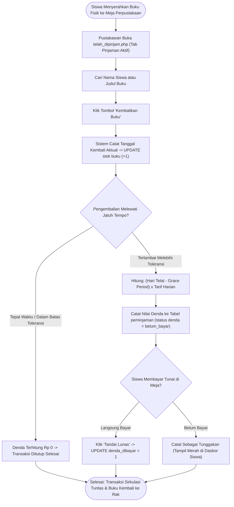

- **Titik Masuk**: Halaman [`telah_dipinjam.php`](file:///c:/laragon/www/aksanova/telah_dipinjam.php).
- **Titik Akhir**: Buku bertambah stoknya, denda dihitung otomatis, dan transaksi diarsipkan.

---

### 5.6 Pengiriman Pengingat Denda via WhatsApp Web Link
- **Titik Masuk**: Tab *Pinjaman Terlambat* pada [`telah_dipinjam.php`](file:///c:/laragon/www/aksanova/telah_dipinjam.php).
- **Langkah-langkah**:
  1. Klik tombol hijau **"Kirim Tagihan WA"** pada baris siswa yang terlambat.
  2. Sistem menyusun parameter teks pesan terformat resmi dan membuka `https://wa.me/[Nomor_Siswa]?text=...`.
  3. Antarmuka WhatsApp Web / Desktop terbuka seketika tanpa perlu menyimpan nomor kontak siswa.
  4. Sistem mencatat log pengiriman ke tabel `reminder_log` (`wa_terkirim = 1`).
- **Titik Akhir**: Siswa menerima pesan pengingat sopan langsung di aplikasi WhatsApp ponselnya.

---

### 5.7 Manajemen Anggota, Approval Akun, & Pencairan Kartu Beku
- **Titik Masuk**: Halaman [`daftar_anggota.php`](file:///c:/laragon/www/aksanova/daftar_anggota.php).
- **Fungsi Utama**:
  - **Persetujuan Pendaftaran Baru**: Klik tombol centang hijau *"Approve"* untuk menyetujui akun siswa/guru baru.
  - **Pencairan Kartu yang Dibekukan (Unfreeze)**: Siswa yang kartunya dibekukan otomatis saat alur lupa kartu dapat diaktifkan kembali dengan mengklik tombol gembok terbuka *"Cairkan Kartu"* (`card_status = 'active'`).
  - **Reset Kata Sandi Manual**: Menetapkan kata sandi baru atau membangkitkan kombinasi sandi acak.
  - **Lihat Kartu Terenkripsi**: Melihat dan mencetak kartu anggota siswa melalui tautan aman `kartu_anggota.php?id=mask_id(...)`.

---

### 5.8 Konfigurasi Sistem (Denda, Peta Lokasi, Banner, Musik)
1. **Pengaturan Denda (`pengaturan_denda.php`)**: Mengubah sakelar denda aktif/nonaktif, tarif denda harian (contoh: Rp 1.500), dan masa toleransi *grace period* dengan penyimpanan otomatis seketika (*instant auto-save*).
2. **Peta Lokasi & Jam Buka (`pengaturan_lokasi.php`)**: Mengatur sematan Google Maps, jadwal buka Senin–Minggu, dan status operasional (Otomatis Jadwal / Buka Manual / Tutup Libur).
3. **Banner Promosi (`kelola_banner.php`)**: Unggah gambar/GIF/video MP4 16:7, atur urutan carousel, dan tentukan wallpaper utama.
4. **Musik Perpustakaan (`pengaturan_musik.php`)**: Unggah file instrumen MP3 lo-fi perpustakaan dan kelola sakelar pemutar audio beranda.

---

### 5.9 Pelaporan Rekapitulasi & Ekspor Excel (.xls 3-Worksheet)
- **Titik Masuk**: Dasbor Admin [`dashboard.php`](file:///c:/laragon/www/aksanova/dashboard.php).
- **Langkah-langkah**:
  1. Pilih filter tahun laporan operasional (contoh: 2026).
  2. Klik tombol **"Ekspor Excel (.xls)"** (`export_excel_dashboard.php`).
  3. Peramban langsung mengunduh berkas SpreadsheetML XML dengan 3 lembar kerja terstruktur:
     - *Sheet 1*: `Rekap Bulanan [Tahun]` (tabel transaksi Januari–Desember).
     - *Sheet 2*: `Ringkasan Perpustakaan` (KPI koleksi, anggota, dan keuangan denda).
     - *Sheet 3*: `Buku Terpopuler` (Top 5 buku paling banyak dipinjam).
- **Titik Akhir**: Pustakawan memegang dokumen laporan resmi untuk diserahkan ke Kepala Sekolah atau Penguji UKK RPL.

---

## 6. Matriks Percabangan Keputusan & Titik Akhir Alur

| Kode Alur | Aksi Pengguna / Stimulus | Kondisi & Percabangan Keputusan | Respon Sistem & Titik Akhir |
|---|---|---|---|
| **FLOW-01** | Pengunjung klik 'Pinjam' di katalog tanpa login | Sesi `$_SESSION['user_id']` belum aktif | Sistem memunculkan dialog `butuhLogin()` dan mengarahkan ke `sign_in.php?redirect=...` |
| **FLOW-02** | Pengguna submit login di `sign_in.php` | `role === 'admin'` | Dialihkan ke ruang kerja terisolasi `dashboard.php` |
| **FLOW-03** | Pengguna submit login di `sign_in.php` | `role === 'member'` & `card_status === 'active'` | Dialihkan ke beranda anggota `beranda.php` |
| **FLOW-04** | Pengguna submit login di `sign_in.php` | `status === 'pending'` atau `card_status === 'frozen'` | Sesi ditolak, tampil peringatan akun belum disetujui atau kartu sedang dibekukan |
| **FLOW-05** | Siswa verifikasi OTP di `lupa_kartu.php` | Kode OTP 6-digit cocok dan masa aktif < 10 menit | Nomor kartu lama otomatis di-freeze (`card_status = 'frozen'`), lanjut langkah 3 sandi baru |
| **FLOW-06** | Siswa verifikasi OTP di `lupa_kartu.php` | Percobaan salah mencapai 5 kali (`attempts >= 5`) | Token OTP hangus otomatis, pengguna wajib meminta OTP baru |
| **FLOW-07** | Anggota submit pengajuan peminjaman | Jumlah buku 1–40 eksemplar & bukti kartu diunggah | Transaksi berstatus `'menunggu'`, suara chime arpeggio 4-nada berbunyi di komputer admin |
| **FLOW-08** | Anggota submit pengajuan peminjaman | Stok buku fisik tersisa 0 eksemplar | Ditolak sistem atomik, tampil pesan stok buku sedang habis |
| **FLOW-09** | Admin menyetujui pengajuan di `pengajuan_buku.php` | Klik tombol 'Setujui' | Stok buku fisik terpotong otomatis, transaksi peminjaman aktif terbit |
| **FLOW-10** | Admin menolak pengajuan di `pengajuan_buku.php` | Klik tombol 'Tolak' & isi alasan | Transaksi berstatus `'ditolak'`, alasan tampil pada dasbor siswa |
| **FLOW-11** | Admin proses pengembalian buku di `telah_dipinjam.php`| Terlambat > Masa Toleransi (*Grace Period*) | Sistem menghitung denda: `(Hari Telat - Grace Period) x Tarif Harian` |
| **FLOW-12** | Admin proses pengembalian buku di `telah_dipinjam.php`| Terlambat <= Masa Toleransi (*Grace Period*) | Denda otomatis Rp 0 (masih dalam masa tenggang toleransi) |

---

## 7. Daftar Ketetapan Operasional Terkonfirmasi
Berdasarkan hasil konfirmasi resmi bersama pihak perpustakaan SMKN 1 Rongga, parameter operasional dan kebijakan sirkulasi telah disepakati dan ditetapkan sebagai berikut:

1. **Jadwal Eksekusi Cron Otomatis (`cron_cek_terlambat.php`)**:  
   *Status*: **Terkonfirmasi Resmi**.  
   *Ketetapan*: Skrip CLI `cron_cek_terlambat.php` dijadwalkan berjalan secara otomatis melalui *scheduler* server setiap hari tepat pukul **00.01 WIB**. Sistem secara otomatis memperbarui status transaksi menjadi `'terlambat'`, membekukan kartu anggota (`card_status = 'frozen'`), dan menghitung akumulasi hari keterlambatan.

2. **Kebijakan Tarif Denda & Masa Toleransi (*Grace Period*)**:  
   *Status*: **Terkonfirmasi Resmi**.  
   *Ketetapan*: Kebijakan tarif denda ditetapkan sebesar **Rp 1.500 per hari** dengan masa tenggang (*grace period*) **2 hari kalender**. Jika buku dikembalikan dalam 2 hari setelah jatuh tempo, denda adalah Rp 0; keterlambatan hari ke-3 dihitung denda penuh sesuai rumus `(hari_telat - 2) * 1500`.

3. **Akun Pengirim Email SMTP Resmi Sekolah**:  
   *Status*: **Terkonfirmasi Resmi**.  
   *Ketetapan*: Pengiriman kode OTP email 6-digit untuk pemulihan akun dan notifikasi resmi menggunakan alamat email institusi **`perpustakaan@smkn1rongga.sch.id`** melalui protokol SMTP TLS port 587.

4. **Batas Durasi Peminjaman Siswa vs. Guru**:  
   *Status*: **Terkonfirmasi Resmi**.  
   *Ketetapan*: Batas waktu peminjaman untuk siswa reguler adalah maksimal **7 hari kalender**, sedangkan untuk Bapak/Ibu Guru diberikan durasi hingga **30 hari (atau 1 semester)** untuk kebutuhan buku pegangan mata pelajaran.

5. **Nomor Kontak WhatsApp Resmi Layanan**:  
   *Status*: **Terkonfirmasi Resmi**.  
   *Ketetapan*: Nomor kontak WhatsApp resmi perpustakaan adalah **`083829165209`**. Tautan notifikasi langsung (*wa.me*) terhubung ke nomor pengelola perpustakaan ini.

6. **Standarisasi Penamaan Kode Rak Buku Fisik**:  
   *Status*: **Terkonfirmasi Resmi**.  
   *Ketetapan*: Penamaan kode rak pada kolom `buku.rak` telah terstandarisasi sesuai denah tata letak dan klasifikasi rak fisik perpustakaan SMKN 1 Rongga (misal: Rak A1, Rak Fiksi, DDC).
