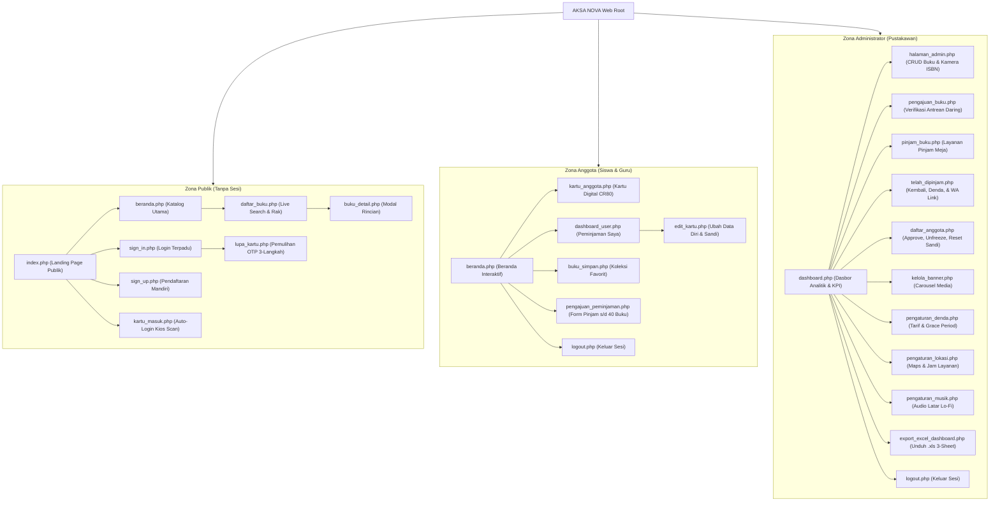

# SUSUNAN WEBSITE & PETA SITUS (SITEMAP & STRUKTUR)
# AKSA NOVA — PERPUSTAKAAN DIGITAL SMK NEGERI 1 RONGGA

---

## DAFTAR ISI
1. [Ringkasan Arsitektur & Peta Halaman](#1-ringkasan-arsitektur--peta-halaman)
2. [Daftar Lengkap Halaman & Rute URL](#2-daftar-lengkap-halaman--rute-url)
   - [2.1 Kelompok Halaman Publik & Tamu](#21-kelompok-halaman-publik--tamu)
   - [2.2 Kelompok Halaman Anggota Terotentikasi](#22-kelompok-halaman-anggota-terotentikasi)
   - [2.3 Kelompok Halaman Administrator / Pustakawan](#23-kelompok-halaman-administrator--pustakawan)
   - [2.4 Kelompok Endpoint AJAX & Pengendali Latar Belakang](#24-kelompok-endpoint-ajax--pengendali-latar-belakang)
3. [Diagram Hierarki Halaman (Mermaid Sitemap)](#3-diagram-hierarki-halaman-mermaid-sitemap)
4. [Struktur Navigasi Antarmuka (Header, Footer, & Sidebar)](#4-struktur-navigasi-antarmuka-header-footer--sidebar)
   - [4.1 Navigasi Publik & Tamu](#41-navigasi-publik--tamu)
   - [4.2 Navigasi Bilah Samping Anggota](#42-navigasi-bilah-samping-anggota)
   - [4.3 Navigasi Bilah Samping Administrator](#43-navigasi-bilah-samping-administrator)
5. [Inventaris Elemen Utama Setiap Halaman](#5-inventaris-elemen-utama-setiap-halaman)
6. [Deskripsi Wireframe Teks Halaman Utama](#6-deskripsi-wireframe-teks-halaman-utama)
   - [6.1 Wireframe: Landing Page Publik (index.php)](#61-wireframe-landing-page-publik-indexphp)
   - [6.2 Wireframe: Katalog Pencarian Buku (daftar_buku.php)](#62-wireframe-katalog-pencarian-buku-daftar_bukuphp)
   - [6.3 Wireframe: Kartu Anggota Digital CR80 (kartu_anggota.php)](#63-wireframe-kartu-anggota-digital-cr80-kartu_anggotaphp)
   - [6.4 Wireframe: Dasbor Peminjaman Siswa (dashboard_user.php)](#64-wireframe-dasbor-peminjaman-siswa-dashboard_userphp)
   - [6.5 Wireframe: Dasbor Administrator (dashboard.php)](#65-wireframe-dasbor-administrator-dashboardphp)
   - [6.6 Wireframe: Manajemen Katalog & Kamera ISBN (halaman_admin.php)](#66-wireframe-manajemen-katalog--kamera-isbn-halaman_adminphp)
7. [Daftar Ketetapan Teknis & Operasional Terkonfirmasi](#7-daftar-ketetapan-teknis--operasional-terkonfirmasi)

---

## 1. Ringkasan Arsitektur & Peta Halaman
Sistem informasi perpustakaan **AKSA NOVA** dibangun menggunakan arsitektur web berbasis PHP prosedural yang terorganisasi secara rapi pada direktori utama (*flat root structure*). Seluruh halaman terintegrasi dengan basis data MySQL `aksa_nova` (12 tabel) serta diproteksi oleh lapisan kendali sesi berbasis peran (*Role-Based Access Control*).

Sistem membedakan lingkungan antarmuka menjadi tiga zona terpisah:
1. **Zona Publik**: Dapat diakses tanpa login untuk penelusuran informasi dan registrasi.
2. **Zona Anggota (Siswa & Guru)**: Khusus anggota aktif untuk transaksi peminjaman daring, interaksi buku, dan pemantauan denda.
3. **Zona Administrator (Pustakawan)**: Lingkungan kerja terisolasi untuk tata kelola sirkulasi, inventarisasi master buku, verifikasi, dan pelaporan ekspor.

---

## 2. Daftar Lengkap Halaman & Rute URL

### 2.1 Kelompok Halaman Publik & Tamu

| No | Nama Berkas / Rute URL | Judul / Identitas Halaman | Deskripsi Fungsi Utama | Hak Akses |
|:---:|---|---|---|:---:|
| 1 | [`index.php`](file:///c:/laragon/www/aksanova/index.php) | Landing Page AKSA NOVA | Halaman pembuka publik 7-slide: Banner media, 4 buku terbaru, kutipan harian, tata tertib, status jam operasional realtime WIB, dan Google Maps. | Publik / Tamu |
| 2 | [`beranda.php`](file:///c:/laragon/www/aksanova/beranda.php) | Beranda Katalog Literasi | Katalog beranda: Spotlight, Top 5 paling disukai, 10 buku baru, 6 genre populer, rekomendasi acak *"Bingung Mau Baca Apa?"*, dan RSS Berita. | Publik / Anggota |
| 3 | [`daftar_buku.php`](file:///c:/laragon/www/aksanova/daftar_buku.php) | Penelusuran Katalog Buku | Katalog pencarian lengkap: Filter genre, live search AJAX (`?ajax=1`), paginasi 10 buku/halaman, status ketersediaan stok, dan kode rak fisik. | Publik / Anggota |
| 4 | [`buku_detail.php`](file:///c:/laragon/www/aksanova/buku_detail.php) | Modal Rincian Koleksi Buku | Endpoint data JSON & tampilan modal detail buku: Sinopsis, stok, lokasi rak, agregat suka, favorit, dan rating bintang. | Publik / Anggota |
| 5 | [`sign_in.php`](file:///c:/laragon/www/aksanova/sign_in.php) | Masuk ke Akun | Halaman login terpadu menggunakan username/email dan kata sandi dengan pengalihan peran otomatis (`role-based redirection`). | Publik / Tamu |
| 6 | [`sign_up.php`](file:///c:/laragon/www/aksanova/sign_up.php) | Registrasi Anggota Baru | Formulir pendaftaran mandiri siswa (NIS, kelas) dan guru (NIP/NUPTK), verifikasi email/kontak, kata sandi Bcrypt, dan penerbitan nomor kartu. | Publik / Tamu |
| 7 | [`lupa_kartu.php`](file:///c:/laragon/www/aksanova/lupa_kartu.php) | Pemulihan Akun & Kartu | Wizard 3-langkah pemulihan kartu/sandi berbasis kode OTP 6-digit email, pembekuan otomatis nomor kartu lama, dan penerbitan kartu baru. | Publik / Tamu |
| 8 | [`kartu_masuk.php`](file:///c:/laragon/www/aksanova/kartu_masuk.php) | Kios Barcode Masuk | Halaman kios meja perpustakaan untuk login instan otomatis via pemindaian laser barcode kartu tanpa mengetik kata sandi. | Publik di Kios |
| 9 | [`kartu_clear.php`](file:///c:/laragon/www/aksanova/kartu_clear.php) | Pembersih Sesi Kartu | Endpoint latar belakang (`navigator.sendBeacon`) untuk membersihkan sesi sementara setelah kartu dicetak di komputer umum. | Sistem Latar Belakang |

---

### 2.2 Kelompok Halaman Anggota Terotentikasi

| No | Nama Berkas / Rute URL | Judul / Identitas Halaman | Deskripsi Fungsi Utama | Hak Akses |
|:---:|---|---|---|:---:|
| 10 | [`kartu_anggota.php`](file:///c:/laragon/www/aksanova/kartu_anggota.php) | Kartu Anggota Digital | Penayangan kartu identitas digital standar CR80 (Kartu Pelajar / Kartu Pendidik) ber-Barcode Code 128 SVG dan tombol unduh PNG 300 DPI. | Anggota / Admin |
| 11 | [`edit_kartu.php`](file:///c:/laragon/www/aksanova/edit_kartu.php) | Pengaturan Profil Anggota | Formulir pembaruan data diri mandiri (Nama, kontak, email, foto profil) dan ganti kata sandi opsional tanpa kewajiban sandi lama. | Anggota Login |
| 12 | [`buku_simpan.php`](file:///c:/laragon/www/aksanova/buku_simpan.php) | Koleksi Bacaan Saya | Halaman penampung daftar buku yang ditandai sebagai favorit/disimpan (`buku_favorites`) oleh siswa. | Anggota Login |
| 13 | [`pengajuan_peminjaman.php`](file:///c:/laragon/www/aksanova/pengajuan_peminjaman.php) | Formulir Pengajuan Daring | Formulir permohonan pinjam buku daring (kuota 1–40 buku untuk baca mandiri atau paket pelajaran kelas), tanggal kembali, dan unggah foto kartu. | Anggota Login |
| 14 | [`dashboard_user.php`](file:///c:/laragon/www/aksanova/dashboard_user.php) | Dasbor Peminjaman Saya | Dasbor operasional anggota: Kartu mini, estimasi denda berjalan, tabel pinjaman aktif, tanggal jatuh tempo, dan riwayat status pengajuan. | Anggota Login |
| 15 | [`logout.php`](file:///c:/laragon/www/aksanova/logout.php) | Keluar dari Sistem | Halaman konfirmasi terminasi sesi pengguna (`session_destroy()`) dan penghapusan aman cookie otentikasi peramban. | Semua Pengguna Login |

---

### 2.3 Kelompok Halaman Administrator / Pustakawan

| No | Nama Berkas / Rute URL | Judul / Identitas Halaman | Deskripsi Fungsi Utama | Hak Akses |
|:---:|---|---|---|:---:|
| 16 | [`dashboard.php`](file:///c:/laragon/www/aksanova/dashboard.php) | Dasbor Utama Admin | Dasbor ringkasan analitik perpustakaan: KPI cards real-time, grafik/tabel rekapitulasi bulanan, cetak laporan, dan tautan ekspor Excel. | Khusus Admin |
| 17 | [`halaman_admin.php`](file:///c:/laragon/www/aksanova/halaman_admin.php) | Kelola Katalog Buku | Master data buku: Tambah buku baru, auto-fill metadata dan cover via ISBN (Google Books API), potret live cover via kamera, dan edit/hapus buku. | Khusus Admin |
| 18 | [`pengajuan_buku.php`](file:///c:/laragon/www/aksanova/pengajuan_buku.php) | Verifikasi Pengajuan Pinjam| Panel persetujuan (approval) atau penolakan pengajuan daring siswa, pemotongan stok buku secara atomik, dan inspeksi bukti foto kartu. | Khusus Admin |
| 19 | [`pinjam_buku.php`](file:///c:/laragon/www/aksanova/pinjam_buku.php) | Sirkulasi Pinjam Meja | Layanan transaksi peminjaman langsung di meja sirkulasi menggunakan scanner barcode anggota dan verifikasi ketersediaan stok fisik. | Khusus Admin |
| 20 | [`telah_dipinjam.php`](file:///c:/laragon/www/aksanova/telah_dipinjam.php) | Sirkulasi & Pengembalian | Manajemen pinjaman aktif, proses pengembalian buku, kalkulasi denda otomatis per hari terlambat sesuai grace period, dan penandaan lunas. | Khusus Admin |
| 21 | [`daftar_anggota.php`](file:///c:/laragon/www/aksanova/daftar_anggota.php) | Master Data Keanggotaan | Manajemen pengguna: Verifikasi anggota baru (`approve`), nonaktifkan (`reject`), pencairan kartu beku (`unfreeze`), dan reset kata sandi manual. | Khusus Admin |
| 22 | [`kelola_banner.php`](file:///c:/laragon/www/aksanova/kelola_banner.php) | Pengaturan Banner Beranda | Manajemen carousel banner promo beranda (unggah gambar/GIF/video MP4 16:7, toggle aktif, atur urutan, dan set wallpaper utama). | Khusus Admin |
| 23 | [`pengaturan_denda.php`](file:///c:/laragon/www/aksanova/pengaturan_denda.php) | Konfigurasi Tarif Denda | Pengaturan sakelar denda aktif, tarif nominal denda per hari, dan toleransi masa tenggang (*grace period*) dengan auto-save AJAX. | Khusus Admin |
| 24 | [`pengaturan_lokasi.php`](file:///c:/laragon/www/aksanova/pengaturan_lokasi.php) | Lokasi & Jam Operasional | Pengaturan titik Google Maps (query/iframe embed), kontak sekolah, jadwal buka-tutup Senin–Minggu, dan status operasional layanan. | Khusus Admin |
| 25 | [`pengaturan_musik.php`](file:///c:/laragon/www/aksanova/pengaturan_musik.php) | Pengaturan Audio Beranda | Pengelolaan instrumen musik latar perpustakaan (unggah berkas MP3 lo-fi, judul lagu, toggle aktif, dan pemutar audio infinite loop). | Khusus Admin |
| 26 | [`export_excel_dashboard.php`](file:///c:/laragon/www/aksanova/export_excel_dashboard.php) | Ekspor Spreadsheet Excel | Generator berkas laporan tahunan berstandar SpreadsheetML XML (.xls) dengan 3 lembar kerja: Rekap Bulanan, Ringkasan, dan Buku Terpopuler. | Khusus Admin |

---

### 2.4 Kelompok Endpoint AJAX & Pengendali Latar Belakang

| No | Nama Berkas Endpoint | Tipe Request | Fungsi & Deskripsi Teknis |
|:---:|---|:---:|---|
| 27 | [`like_handler.php`](file:///c:/laragon/www/aksanova/like_handler.php) | POST (AJAX) | Menangani toggle suka (`type=like`) dan simpan favorit (`type=favorite`) pada tabel `buku_likes` & `buku_favorites`. |
| 28 | [`rating_handler.php`](file:///c:/laragon/www/aksanova/rating_handler.php) | GET / POST (AJAX) | Mengambil rata-rata rating serta menyimpan penilaian skor bintang 1–5 dari siswa ke tabel `buku_ratings`. |
| 29 | [`cari_isbn.php`](file:///c:/laragon/www/aksanova/cari_isbn.php) | GET (AJAX JSON) | Menghubungi Google Books API v1 dan Open Library API berdasarkan ISBN serta mengunduh sampul otomatis ke server. |
| 30 | [`api_cek_pengajuan_admin.php`](file:///c:/laragon/www/aksanova/api_cek_pengajuan_admin.php) | GET (AJAX JSON) | Endpoint polling 4 detik untuk memeriksa jumlah permohonan berstatus `'menunggu'` dan memicu notifikasi suara admin. |
| 31 | [`update_profil_admin.php`](file:///c:/laragon/www/aksanova/update_profil_admin.php) | POST (Form Action) | Menyimpan pembaruan nama tampilan, foto profil (`admin_profile`), dan penggantian kata sandi admin (`users`). |
| 32 | [`cron_cek_terlambat.php`](file:///c:/laragon/www/aksanova/cron_cek_terlambat.php) | CLI Script | Skrip pemindai pinjaman terlambat terjadwal untuk mencatat baris pengingat harian ke tabel `reminder_log`. |

---

## 3. Diagram Hierarki Halaman (Mermaid Sitemap)



---

## 4. Struktur Navigasi Antarmuka (Header, Footer, & Sidebar)

### 4.1 Navigasi Publik & Tamu
- **Header Bilah Atas**:
  - Logo resmi AKSA NOVA & Nama SMK Negeri 1 Rongga.
  - Menu Navigasi: *Beranda*, *Katalog Buku*, *Tata Tertib*, *Jam Layanan*, *Tentang*.
  - Tombol CTA: Tombol *"Masuk"* (`sign_in.php`) dan *"Daftar Anggota"* (`sign_up.php`).
  - Tombol Aksesibilitas: Ikon roda gigi untuk membuka panel tema (`Alt + D`).
- **Footer Bilah Bawah**:
  - Profil singkat perpustakaan sekolah.
  - Tautan cepat: *Katalog Buku*, *Panduan Peminjaman*, *Syarat & Ketentuan Denda*.
  - Kontak resmi: Alamat SMKN 1 Rongga, No. Telepon/WhatsApp, dan Email pengelola.
  - Hak cipta: *"© 2026 AKSA NOVA — Perpustakaan Digital SMK Negeri 1 Rongga"*.

---

### 4.2 Navigasi Bilah Samping Anggota (Member Sidebar)
Bagi siswa dan guru yang telah login, navigasi terpusat pada bilah samping (*Sidebar*) yang responsif:
1. **Header Profil Anggota**: Pasfoto profil bulat, nama lengkap siswa/guru, nomor anggota (`AN-YYYY-XXXXX`), dan lencana kelas.
2. **Menu Utama**:
   - 🏠 **Beranda Katalog** (`beranda.php`): Eksplorasi koleksi, rekomendasi acak, dan berita RSS.
   - 📖 **Semua Buku** (`daftar_buku.php`): Penelusuran buku dan cek kode rak.
   - 🔖 **Buku Favorit** (`buku_simpan.php`): Daftar simpanan bacaan pribadi.
   - 📋 **Peminjaman Saya** (`dashboard_user.php`): Dasbor pemantauan jatuh tempo dan denda.
   - 🪪 **Kartu Digital Saya** (`kartu_anggota.php`): Pratinjau dan unduh kartu CR80 300 DPI.
   - ⚙️ **Edit Profil** (`edit_kartu.php`): Pengaturan data diri dan sandi.
3. **Bilah Bawah**:
   - 🚪 **Keluar (Logout)** (`logout.php`): Tombol terminasi sesi dengan modal konfirmasi `AksaConfirm`.

---

### 4.3 Navigasi Bilah Samping Administrator (Admin Sidebar)
Bagi pustakawan, bilah samping menyediakan kendali operasional penuh dengan indikator lencana:
1. **Header Admin**: Lencana profil pustakawan, nama tampilan, dan indikator status online.
2. **Kelompok Menu Sirkulasi & Master**:
   - 📊 **Dasbor Analitik** (`dashboard.php`): Metrik KPI dan grafik sirkulasi tahunan.
   - 📚 **Kelola Buku** (`halaman_admin.php`): CRUD buku dan auto-fill ISBN.
   - 📥 **Pengajuan Daring** (`pengajuan_buku.php`): Antrean permohonan pinjam dilengkapi **badge angka merah realtime** jika ada pengajuan baru.
   - ✍️ **Pinjam Langsung** (`pinjam_buku.php`): Sirkulasi meja perpustakaan.
   - 🔄 **Sirkulasi & Denda** (`telah_dipinjam.php`): Pengembalian, hitung denda, dan pengingat WA.
   - 👥 **Daftar Anggota** (`daftar_anggota.php`): Approval siswa baru dan pencairan kartu beku.
3. **Kelompok Pengaturan Sistem**:
   - 💰 **Pengaturan Denda** (`pengaturan_denda.php`): Tarif harian dan toleransi.
   - 📍 **Lokasi & Operasional** (`pengaturan_lokasi.php`): Peta Google Maps dan jam buka.
   - 🖼️ **Kelola Banner** (`kelola_banner.php`): Carousel media promosi.
   - 🎵 **Pengaturan Musik** (`pengaturan_musik.php`): Audio latar lo-fi.
4. **Bilah Bawah**:
   - 👤 **Profil Admin** (`modal_profil_admin.php`): Ganti nama dan foto pustakawan.
   - 🚪 **Keluar** (`logout.php`): Logout aman.

---

## 5. Inventaris Elemen Utama Setiap Halaman

| Rute Halaman | Komponen Spanduk / Banner | Komponen Konten Utama | Komponen Formulir & Filter | Tombol Aksi Kunci (CTA) |
|---|---|---|---|---|
| `index.php` | Carousel media gambar/video 16:7 | 4 Buku Terbaru, Quotes Literasi, Info Denda, Maps | Pencarian cepat judul buku | *"Jelajahi Katalog"*, *"Daftar Anggota"*, *"Masuk"* |
| `beranda.php` | Spotlight buku unggulan | Top 5 Disukai, 10 Buku Baru, RSS News | Modal buku acak (*"Bingung Mau Baca Apa?"*) | *"Ajukan Pinjam"*, *"Suka"*, *"Simpan"*, *"Detail"* |
| `daftar_buku.php` | Judul header katalog | Grid kartu buku dengan info rak fisik | Live search AJAX, tombol pil filter genre | *"Buka Rincian Buku"*, Tombol Paginasi Halaman |
| `sign_in.php` | Kartu login terisolasi | Notifikasi peringatan validasi sesi | Input Username/Email, Kata Sandi, Eye-peek | *"Masuk ke Sistem"*, *"Lupa Sandi / Kartu?"* |
| `sign_up.php` | Banner sambutan anggota | Panduan pendaftaran siswa & guru | Tipe Anggota, NIS/NIP, Kelas, Kontak, Sandi | *"Daftar Sekarang"*, *"Sudah Punya Akun? Masuk"* |
| `lupa_kartu.php` | Indikator langkah 1-2-3 | Panduan keamanan token OTP email | Input Email, Input 6 Digit OTP, Input Sandi Baru | *"Kirim Kode OTP"*, *"Verifikasi OTP"*, *"Simpan Sandi"* |
| `kartu_anggota.php`| Format CR80 ID-1 | Data Nama, NIS, Kelas, Barcode SVG 128 | Tidak ada (halaman pratinjau) | *"Unduh Kartu (PNG 300 DPI)"*, *"Cetak Langsung"* |
| `dashboard_user.php`| Kartu anggota mini | Kotak denda, pinjaman aktif, riwayat pengajuan | Filter pencarian riwayat pinjaman | *"Perbarui Profil"*, *"Ajukan Peminjaman Baru"* |
| `pengajuan_peminjaman.php`| Ringkasan buku dipinjam| Informasi ketersediaan stok fisik | Jumlah buku (1–40), tanggal kembali, unggah kartu| *"Kirim Pengajuan Peminjaman"* |
| `dashboard.php` | Banner sambutan admin | KPI Cards, Rekap Bulanan, Top 5 Buku | Filter dropdown tahun laporan sirkulasi | *"Cetak Laporan"*, *"Ekspor Excel (.xls)"* |
| `halaman_admin.php` | Tab Tambah & Daftar | Tabel koleksi buku lengkap, preview cover | Form ISBN, Judul, Penulis, Rak, Stok, File Cover| *"Cari ISBN"*, *"Nyalakan Kamera"*, *"Simpan Buku"* |
| `pengajuan_buku.php` | Badge antrean menunggu | Tabel pengajuan daring & modal bukti kartu | Form catatan alasan penolakan | *"Setujui Pinjaman"*, *"Tolak Permohonan"* |
| `telah_dipinjam.php` | Tab Pinjam & Terlambat| Tabel sirkulasi aktif & kalkulator denda | Live search peminjam/buku | *"Kembalikan Buku"*, *"Tandai Lunas"*, *"Kirim WA"* |
| `daftar_anggota.php`| Tab Siswa/Guru/Semua | Tabel data keanggotaan & kartu terenkripsi | Filter kelas, filter status aktif/beku | *"Setujui"*, *"Cairkan Kartu"*, *"Reset Sandi"* |
| `pengaturan_denda.php`| Sakelar status denda | Panduan perhitungan & riwayat pelunasan | Input tarif harian, input toleransi grace period| Penyimpanan otomatis seketika (*auto-save*) |
| `pengaturan_lokasi.php`| Pratinjau jam buka | Sematan Google Maps, jadwal Senin–Minggu | Form koordinat, teks alamat, jam operasional | *"Simpan Pengaturan Lokasi"* (Auto-save) |

---

## 6. Deskripsi Wireframe Teks Halaman Utama

### 6.1 Wireframe: Landing Page Publik (`index.php`)
```
+-------------------------------------------------------------------------------+
| [LOGO] AKSA NOVA - SMKN 1 RONGGA          [Beranda] [Katalog] [Tata Tertib]   |
|                                           [Masuk] [Daftar Anggota] [Alt+D]   |
+-------------------------------------------------------------------------------+
| HERO CAROUSEL:                                                                |
| +---------------------------------------------------------------------------+ |
| | [Gambar/Video 16:7 Banner Promosi Literasi Sekolah]                        | |
| | "Membuka Cakrawala Dunia dari Perpustakaan SMKN 1 Rongga"                 | |
| | [ Tombol: Jelajahi Katalog Buku ]                                         | |
| +---------------------------------------------------------------------------+ |
+-------------------------------------------------------------------------------+
| BUKU TERBARU BULAN INI:                                                       |
| [Cover 1] Judul Buku A      [Cover 2] Judul Buku B      [Cover 3] Judul Buku C|
| Penulis - Rak Fiksi 1       Penulis - Rak Umum 2        Penulis - Rak RPL 1   |
| [Stok: 5 Tersedia]          [Stok: 2 Tersedia]          [Stok: Habis]         |
+-------------------------------------------------------------------------------+
| PENCARIAN CEPAT & KUTIPAN LITERASI HARIAN:                                    |
| [ Kotak Pencarian: Masukkan Judul / Pengarang... ] [ Tombol: Cari ]           |
| "Buku adalah jendela ilmu, aksara adalah jembatan peradaban." - Kutipan Hari Ini|
+-------------------------------------------------------------------------------+
| INFORMASI OPERASIONAL & PETA PERPUSTAKAAN:                                    |
| Status Saat Ini: [ Lencana Hijau: BUKA SEKARANG (07.00 - 15.00 WIB) ]         |
| Alamat: Jl. Situ Gede / Jl. Raya Rongga, Desa Cibedug, Kec. Rongga            |
| +---------------------------------------------------------------------------+ |
| | [ Sematan Peta Interaktif Google Maps SMKN 1 Rongga ]                     | |
| +---------------------------------------------------------------------------+ |
+-------------------------------------------------------------------------------+
| FOOTER: Profil Perpustakaan | Kontak WhatsApp: 0838... | Email: perpustakaan@...|
| © 2026 AKSA NOVA — Rekayasa Perangkat Lunak SMKN 1 Rongga                      |
+-------------------------------------------------------------------------------+
```

---

### 6.2 Wireframe: Katalog Pencarian Buku (`daftar_buku.php`)
```
+-------------------------------------------------------------------------------+
| [NAVIGASI ATAS: Logo, Menu, Profil/Login, Sakelar Tema Alt+D]                 |
+-------------------------------------------------------------------------------+
| KATALOG KOLEKSI PERPUSTAKAAN DIGITAL                                          |
| +---------------------------------------------------------------------------+ |
| | [ Cari Judul, Penulis, ISBN, Rak...               ] [ Ikon Kaca Pembesar] | |
| +---------------------------------------------------------------------------+ |
| FILTER GENRE: [Semua] [Fiksi] [Non-Fiksi] [Teknologi/RPL] [Agama] [Pelajaran] |
+-------------------------------------------------------------------------------+
| MENAMPILKAN HASIL PENCARIAN (PAGINASI 10 BUKU / HALAMAN):                     |
|                                                                               |
| +-----------------------+ +-----------------------+ +-----------------------+ |
| | [Cover Buku 300x400]  | | [Cover Buku 300x400]  | | [Cover Buku 300x400]  | |
| | Judul: Clean Code     | | Judul: Laskar Pelangi | | Judul: Basis Data RPL | |
| | Penulis: Robert C. M  | | Penulis: Andrea Hirata| | Penulis: Tim PPLG    | |
| | Lokasi: [Rak RPL 1]   | | Lokasi: [Rak Novel 2] | | Lokasi: [Rak Paket 1] | |
| | Status: [Tersedia: 4] | | Status: [Tersedia: 1] | | Status: [Kosong]      | |
| | [❤️ 18] [🔖 Simpan]   | | [❤️ 45] [🔖 Simpan]   | | [❤️ 12] [🔖 Simpan]   | |
| | [Ajukan Pinjam]       | | [Ajukan Pinjam]       | | [Stok Habis]          | |
| +-----------------------+ +-----------------------+ +-----------------------+ |
|                                                                               |
| [ Halaman: < 1 [2] 3 4 5 > ]                                                  |
+-------------------------------------------------------------------------------+
```

---

### 6.3 Wireframe: Kartu Anggota Digital CR80 (`kartu_anggota.php`)
```
+-------------------------------------------------------------------------------+
| AREA PRATINJAU KARTU IDENTITAS DIGITAL (STANDAR ISO/IEC 7810 ID-1 / CR80):    |
|                                                                               |
| +---------------------------------------------------------------------------+ |
| |  SMK NEGERI 1 RONGGA                                     AKSA NOVA DIGITAL | |
| |  KARTU ANGGOTA PERPUSTAKAAN                              [Logo Sekolah]    | |
| |  -----------------------------------------------------------------------  | |
| |  +-------------+   Nama Lengkap   : SYAHRUL BIMANSYAH                     | |
| |  |             |   NIS / NIP      : 232410145                             | |
| |  | [PASFOTO    |   Status Anggota : Siswa Aktif                           | |
| |  |  FORMAL]    |   Program/Kelas  : XII PPLG / Rekayasa Perangkat Lunak   | |
| |  |             |   Masa Berlaku   : s/d Tahun Kelulusan (2027)            | |
| |  +-------------+                                                          | |
| |  |||| | ||||| || |||||||| |||| |||||| |||||||||| |||||| ||||| |||||||     | |
| |  AN-2026-00042 (Barcode Linear Code 128 Standar Laser Scanner Meja)       | |
| +---------------------------------------------------------------------------+ |
|                                                                               |
| TOMBOL AKSI:                                                                  |
| [ Tombol Hijau: Unduh Kartu (PNG 300 DPI) ]    [ Tombol Biru: Cetak Langsung] |
+-------------------------------------------------------------------------------+
```

---

### 6.4 Wireframe: Dasbor Peminjaman Siswa (`dashboard_user.php`)
```
+--------------------+----------------------------------------------------------+
| BILAH SAMPING:     | DASBOR SAYA (PEMINJAMAN SAYA)                            |
| [Foto Profil Mini] +----------------------------------------------------------+
| Syahrul Bimansyah  | KOTAK PERINGATAN DENDA & STATUS:                         |
| Siswa (XII RPL)    | [ Lencana Hijau: Kartu Anggota Aktif | Denda Tertunggak: Rp 0 ]|
|                    +----------------------------------------------------------+
| [🏠 Beranda]       | BUKU YANG SEDANG DIPINJAM (AKTIF):                       |
| [📖 Katalog Buku]  | +------------------------------------------------------+ |
| [🔖 Buku Favorit]  | | Judul: Clean Code | Tgl Pinjam: 03/11 | Kembali: 10/11| |
| [📋 Pinjaman Saya] | | Status: Sisa 1 Hari Sebelum Jatuh Tempo              | |
| [🪪 Kartu Digital] | +------------------------------------------------------+ |
| [⚙️ Edit Profil]   +----------------------------------------------------------+
| [🚪 Keluar Sesi]   | RIWAYAT PENGAJUAN PEMINJAMAN DARING:                     |
|                    | 1. Basis Data RPL (Jumlah: 1) -> [Disetujui: Siap Diambil|
|                    | 2. Pemrograman Web (Jumlah: 40) -> [Menunggu Verifikasi] |
|                    | 3. Novel Fiksi (Jumlah: 1) -> [Ditolak: Foto Kartu Buram]|
+--------------------+----------------------------------------------------------+
```

---

### 6.5 Wireframe: Dasbor Administrator (`dashboard.php`)
```
+--------------------+----------------------------------------------------------+
| BILAH ADMIN:       | DASBOR ANALITIK & STATISTIK SIRKULASI TAHUN 2026         |
| Pustakawan SMKN 1  +----------------------------------------------------------+
|                    | KARTU KPI UTAMA:                                         |
| [📊 Dasbor Utama]  | [ Total Buku: 62 Judul ]   [ Total Eksemplar: 245 Buku ] |
| [📚 Kelola Buku]   | [ Anggota Aktif: 120 User] [ Pinjaman Aktif: 8 Pinjaman]|
| [📥 Pengajuan (2)] | [ Pinjaman Terlambat: 2 ]  [ Penerimaan Denda: Rp 45.000]|
| [✍️ Pinjam Meja]   +----------------------------------------------------------+
| [🔄 Sirkulasi Denda| REKAPITULASI TRANSAKSI BULANAN (12 BULAN):               |
| [👥 Daftar Anggota]| +------------------------------------------------------+ |
| [🖼️ Banner Beranda]| | Bulan     | Dipinjam | Kembali | Terlambat | Denda    | |
| [💰 Atur Denda]    | | Januari   | 45 Buku  | 42 Buku | 3 Transaksi| Rp 4.500 | |
| [📍 Atur Lokasi]   | | Februari  | 60 Buku  | 58 Buku | 2 Transaksi| Rp 3.000 | |
| [🎵 Atur Musik]    | | ...       | ...      | ...     | ...        | ...      | |
|                    +----------------------------------------------------------+
| [🚪 Keluar Admin]  | AKSI LAPORAN:                                            |
|                    | [ Pilih Tahun: 2026 ] [ Cetak Laporan ] [ Ekspor Excel ] |
+--------------------+----------------------------------------------------------+
```

---

### 6.6 Wireframe: Manajemen Katalog & Kamera ISBN (`halaman_admin.php`)
```
+--------------------+----------------------------------------------------------+
| BILAH ADMIN:       | MASTER KATALOG BUKU PERPUSTAKAAN                         |
|                    +----------------------------------------------------------+
| [📊 Dasbor Utama]  | TAB: [ Tambah Buku Baru ]   [ Daftar Semua Koleksi Buku ]|
| [📚 Kelola Buku]   +----------------------------------------------------------+
|                    | FITUR AMBIL DATA OTOMATIS BERBASIS ISBN:                 |
|                    | [ Masukkan 10/13 Digit Nomor ISBN...   ] [ Cari via ISBN ]|
|                    | *Google Books API akan mengisi data & download cover     |
|                    +----------------------------------------------------------+
|                    | FORMULIR DATA BUKU:                                      |
|                    | Judul Buku    : [ Clean Architecture: A Craftsman Guide ]|
|                    | Nama Penulis  : [ Robert C. Martin                      ]|
|                    | Kategori Genre: [ Rekayasa Perangkat Lunak / IT         ]|
|                    | Kode Rak Fisik: [ Rak RPL 2                             ]|
|                    | Jumlah Stok   : [ 5 ] Eksemplar Fisik                    |
|                    | Sinopsis Cerita: [ Buku panduan arsitektur software...  ]|
|                    |                                                          |
|                    | SAMPUL BUKU:                                             |
|                    | [ Pratinjau Cover ] [ Unggah Berkas ] [ Nyalakan Kamera ]|
|                    |                                                          |
|                    | [ Tombol Hijau Besar: Simpan Buku ke Katalog ]           |
+--------------------+----------------------------------------------------------+
```

---

## 7. Daftar Ketetapan Teknis & Operasional Terkonfirmasi
Berdasarkan hasil konfirmasi bersama pengelola sistem dan perpustakaan SMKN 1 Rongga, parameter teknis dan struktur operasional telah disepakati:

1. **Penamaan Kode Rak Fisik Standar Perpustakaan**:  
   *Status*: **Terkonfirmasi Resmi**.  
   *Ketetapan*: Penamaan kode rak pada kolom `buku.rak` telah terstandarisasi sesuai denah tata letak dan klasifikasi rak fisik perpustakaan SMKN 1 Rongga (misal: Rak A1, Rak Fiksi, DDC), memudahkan siswa menemukan buku di rak fisik secara presisi.

2. **Kapasitas Unggah Berkas Cover & Foto Anggota**:  
   *Status*: **Terkonfirmasi Resmi**.  
   *Ketetapan*: Batas unggah berkas telah diselaraskan dengan standar server lokal Laragon (hingga 10MB) dengan kompresi pratinjau otomatis untuk gambar cover dan foto profil anggota.

3. **Format Barcode Scanner Fisik di Meja Sirkulasi**:  
   *Status*: **Terkonfirmasi Resmi**.  
   *Ketetapan*: Modul `kartu_masuk.php` dan scanner meja perpustakaan telah disinkronkan untuk mengenali kode barcode format `AN-YYYY-XXXXX` dengan akhiran penekanan Enter/CRLF otomatis untuk autentikasi instan.

4. **Kanal Kontak & Notifikasi WhatsApp**:  
   *Status*: **Terkonfirmasi Resmi**.  
   *Ketetapan*: Integrasi tautan WhatsApp Web menggunakan nomor resmi pengelola perpustakaan `083829165209`.

5. **Layanan Surel Pemulihan OTP**:  
   *Status*: **Terkonfirmasi Resmi**.  
   *Ketetapan*: Akun surel pengirim notifikasi resmi menggunakan `perpustakaan@smkn1rongga.sch.id` melalui server SMTP TLS port 587.
