# LAPORAN UJI KOMPETENSI KEAHLIAN (UKK)
## KONSENTRASI KEAHLIAN PENGEMBANGAN PERANGKAT LUNAK DAN GIM (PPLG)
### SISTEM INFORMASI PERPUSTAKAAN DIGITAL BERBASIS WEB (AKSA NOVA)
**SMK NEGERI 1 RONGGA — TAHUN PELAJARAN 2025/2026**

---

<br>

<div align="center">

# LAPORAN UJI KOMPETENSI KEAHLIAN
## SISTEM INFORMASI PERPUSTAKAAN DIGITAL BERBASIS WEB (AKSA NOVA)

Diajukan sebagai Salah Satu Syarat Kelulusan Uji Kompetensi Keahlian (UKK)
Konsentrasi Keahlian Pengembangan Perangkat Lunak dan Gim (PPLG)
Tahun Pelajaran 2025/2026

<br>

**Disusun Oleh:**

| Data Peserta | Keterangan |
|---|---|
| **Nama Peserta** | Syahrul Allabi Mansyah |
| **Nomor Induk Siswa (NIS)** | 222310189 |
| **Kelas** | XII PPLG |
| **Konsentrasi Keahlian** | Pengembangan Perangkat Lunak dan Gim (PPLG) |
| **Program Keahlian** | Pengembangan Perangkat Lunak dan Gim |

<br>

**PEMERINTAH DAERAH PROVINSI JAWA BARAT**
**DINAS PENDIDIKAN**
**CABANG DINAS PENDIDIKAN WILAYAH VI**
**SMK NEGERI 1 RONGGA**
Jl. Situ Gede / Raya Rongga (RT 01/RW 04), Desa Cibedug, Kec. Rongga, Kab. Bandung Barat 40565
**2026**

</div>

---

# LEMBAR PENGESAHAN

Laporan Uji Kompetensi Keahlian (UKK) dengan judul **"Sistem Informasi Perpustakaan Digital Berbasis Web (AKSA NOVA)"** yang disusun oleh:

* **Nama Siswa** : Syahrul Allabi Mansyah
* **NIS** : 222310189
* **Konsentrasi Keahlian** : Pengembangan Perangkat Lunak dan Gim (PPLG)
* **Sekolah** : SMK Negeri 1 Rongga

Telah diperiksa, disetujui, dan disahkan pada:
* **Hari / Tanggal** : ........................................ 2026
* **Tempat** : SMK Negeri 1 Rongga, Kabupaten Bandung Barat

<br>

| Mengetahui / Menyetujui, | |
|---|---|
| **Guru Pembimbing Internal**<br><br><br><br>___________________________<br>NIP. - | **Penguji Eksternal (DUDI / Industri)**<br><br><br><br>___________________________<br>ID Industri: - |
| **Ketua Konsentrasi Keahlian PPLG**<br><br><br><br>___________________________<br>NIP. - | **Kepala SMK Negeri 1 Rongga**<br><br><br><br>___________________________<br>NIP. - |

---

# KATA PENGANTAR

Puji dan syukur penulis panjatkan ke hadirat Allah SWT atas rahmat, taufik, dan hidayah-Nya, sehingga penulis dapat menyelesaikan penulisan **Laporan Uji Kompetensi Keahlian (UKK) Konsentrasi Keahlian Pengembangan Perangkat Lunak dan Gim (PPLG)** dengan judul **"Sistem Informasi Perpustakaan Digital Berbasis Web (AKSA NOVA)"** tepat pada waktunya.

Laporan ini disusun sebagai salah satu bukti pelaksanaan kegiatan Uji Kompetensi Keahlian (UKK) dan portofolio keahlian rekayasa perangkat lunak pada jenjang Sekolah Menengah Kejuruan (SMK) di SMK Negeri 1 Rongga tahun pelajaran 2025/2026.

Penulis menyadari bahwa keberhasilan pelaksanaan proyek dan penulisan laporan ini tidak terlepas dari bimbingan, dorongan, serta bantuan moril dan materiil dari berbagai pihak. Oleh karena itu, pada kesempatan ini penulis ingin menyampaikan rasa terima kasih dan penghargaan yang setinggi-tingginya kepada:

1. **Bapak/Ibu Kepala SMK Negeri 1 Rongga**, yang telah memberikan izin dan fasilitas selama pelaksanaan kegiatan pembelajaran dan UKK.
2. **Ketua Konsentrasi Keahlian PPLG SMK Negeri 1 Rongga**, atas arahan teknis dan koordinasi kurikulum kejuruan.
3. **Bapak/Ibu Guru Pembimbing**, yang telah meluangkan waktu, tenaga, dan pikiran untuk memberikan bimbingan, koreksi, serta arahan dalam perancangan arsitektur sistem dan penulisan dokumen laporan ini.
4. **Bapak/Ibu Tim Asesor dan Penguji Eksternal dari Dunia Usaha dan Dunia Industri (DUDI)**, atas masukan standar industri yang membangun.
5. **Pustakawan Perpustakaan SMK Negeri 1 Rongga**, atas kesediaan memberikan data proses bisnis sirkulasi peminjaman, aturan denda, dan lokasi rak buku.
6. **Orang Tua dan Keluarga Tercinta**, atas doa, dukungan moral, dan motivasi yang tiada henti.
7. **Rekan-rekan Siswa Angkatan XII PPLG SMK Negeri 1 Rongga**, atas kebersamaan, kerja sama, dan semangat juang selama menempuh masa studi.

Penulis menyadari sepenuhnya bahwa laporan ini masih memiliki keterbatasan. Oleh karena itu, kritik dan saran yang konstruktif sangat diharapkan demi penyempurnaan karya di masa yang akan datang. Akhir kata, semoga laporan ini dapat memberikan manfaat nyata bagi pengembangan perpustakaan SMK Negeri 1 Rongga dan menjadi referensi bermanfaat bagi rekan-rekan pembaca.

<br>
Rongga, Oktober 2026
<br>
**Penulis**

---

# DAFTAR ISI

* **HALAMAN JUDUL / COVER FORMAL**
* **LEMBAR PENGESAHAN**
* **KATA PENGANTAR**
* **DAFTAR ISI**
* **DAFTAR GAMBAR**
* **DAFTAR TABEL**
* **BAB I: PENDAHULUAN**
  * 1.1 Latar Belakang Masalah
  * 1.2 Rumusan Masalah
  * 1.3 Batasan Masalah
  * 1.4 Tujuan Pengembangan Sistem
  * 1.5 Manfaat Sistem
  * 1.6 Metode Pengumpulan Data
* **BAB II: METODOLOGI PENGEMBANGAN SISTEM (SDLC)**
  * 2.1 Model SDLC yang Digunakan (Waterfall Model)
  * 2.2 Tahapan Pengembangan Sistem
  * 2.3 Jadwal & Alur Pengerjaan Sistem (Timeline Matriks)
* **BAB III: ANALISIS KEBUTUHAN SISTEM**
  * 3.1 Profil & Lingkungan Sistem
  * 3.2 Analisis Pengguna (User Persona & Aktor)
  * 3.3 Analisis Kebutuhan Fungsional (24 Spesifikasi FR-01 s/d FR-24)
  * 3.4 Analisis Kebutuhan Non-Fungsional (Non-Functional Requirements)
  * 3.5 Kebutuhan Perangkat Keras & Perangkat Lunak Minimum
* **BAB IV: PERANCANGAN SISTEM (DESIGN)**
  * 4.1 Perancangan Alur Sistem (Use Case Diagram 23 Fungsi, Matriks Telusur & Ragam Versi)
  * 4.2 Activity Diagram (Alur Bisnis Sistem)
    * 4.2.1 Activity Diagram Inti (7 Alur Sirkulasi Utama)
    * 4.2.2 Inventaris 26 Activity Diagram Pelengkap
  * 4.3 Sequence Diagram (Alur Interaksi Antar Objek)
    * 4.3.1 Sequence Diagram Inti (7 Alur Interaksi Utama)
    * 4.3.2 Inventaris 26 Sequence Diagram Pelengkap
  * 4.4 Class Diagram (Pemodelan Berorientasi Objek — 14 Kelas & 14 Relasi)
  * 4.5 Perancangan Basis Data (Entity Relationship Diagram & Kamus Data Terstruktur)
  * 4.6 Perancangan Antarmuka Pengguna (UI/UX Concept & Responsivitas Mobile)
* **BAB V: IMPLEMENTASI DAN PENGUJIAN SISTEM**
  * 5.1 Implementasi Lingkungan Pengembangan & Struktur File Program Modular
  * 5.2 Hasil Implementasi Antarmuka Pengguna & Cuplikan Kode Kunci
  * 5.3 Rencana Pengujian (Testing Strategy — 6 Area Pengujian)
  * 5.4 Hasil Pengujian Fungsionalitas (Black Box Testing — 18 Parameter Uji)
* **BAB VI: PENUTUP**
  * 6.1 Kesimpulan
  * 6.2 Saran & Pengembangan Lanjutan
* **DAFTAR PUSTAKA**
* **LAMPIRAN**
  * Lampiran 1: Panduan Pengoperasian Sistem (User Guide Pustakawan & Siswa)
  * Lampiran 2: Katalog Inventaris 26 Diagram Pelengkap (Activity & Sequence)

---

# DAFTAR GAMBAR

* **Gambar 4.1**: Diagram Use Case Sistem Informasi Perpustakaan AKSA NOVA
* **Gambar 4.2**: Activity Diagram — Registrasi Anggota Mandiri
* **Gambar 4.3**: Activity Diagram — Login Pengguna
* **Gambar 4.4**: Activity Diagram — Pengajuan Peminjaman Buku Daring
* **Gambar 4.5**: Activity Diagram — Persetujuan Pengajuan Peminjaman oleh Admin
* **Gambar 4.6**: Activity Diagram — Peminjaman Langsung di Meja Layanan
* **Gambar 4.7**: Activity Diagram — Pengembalian Buku dan Kalkulasi Denda
* **Gambar 4.8**: Activity Diagram — Tambah Buku dengan Pencarian Otomatis ISBN
* **Gambar 4.9**: Sequence Diagram — Registrasi Anggota Mandiri
* **Gambar 4.10**: Sequence Diagram — Login Pengguna
* **Gambar 4.11**: Sequence Diagram — Pengajuan Peminjaman Daring
* **Gambar 4.12**: Sequence Diagram — Persetujuan Pengajuan oleh Admin
* **Gambar 4.13**: Sequence Diagram — Peminjaman Langsung di Meja Layanan
* **Gambar 4.14**: Sequence Diagram — Pengembalian Buku dan Denda Keterlambatan
* **Gambar 4.15**: Sequence Diagram — Tambah Buku via API Google Books / Open Library
* **Gambar 4.16**: Class Diagram Sistem Informasi Perpustakaan Digital AKSA NOVA
* **Gambar 4.17**: Entity Relationship Diagram (ERD) Basis Data Relasional
* **Gambar 5.1**: Antarmuka Halaman Depan & Katalog Buku (Landing Page)
* **Gambar 5.2**: Antarmuka Kartu Anggota Digital ber-QR Code dengan Sandi Bertitik
* **Gambar 5.3**: Antarmuka Dashboard Siswa & Pemantauan Sirkulasi
* **Gambar 5.4**: Antarmuka Pelaporan Mandiri Lupa Kartu Anggota
* **Gambar 5.5**: Antarmuka Dashboard Admin & Statistik Sirkulasi Perpustakaan
* **Gambar 5.6**: Antarmuka Modal Interaktif Ubah Sandi Anggota (Kustom & Acak)

---

# DAFTAR TABEL

* **Tabel 2.1**: Matriks Rencana Jadwal Pengerjaan Sistem (Model Waterfall)
* **Tabel 3.1**: Analisis Peran dan Hak Akses Pengguna (Aktor Sistem)
* **Tabel 4.1**: Matriks 23 Use Case Sistem dan Pemetaan File Implementasi
* **Tabel 4.2**: Inventaris 26 Activity Diagram Pelengkap
* **Tabel 4.3**: Matriks 14 Hubungan Antar Kelas Pemodelan Berorientasi Objek
* **Tabel 5.1**: Hasil Pengujian Fungsionalitas Sistem (Black Box Testing 18 Parameter)

---

# BAB I: PENDAHULUAN

### 1.1 Latar Belakang Masalah
Perpustakaan sekolah merupakan pusat sumber belajar yang memegang peranan krusial dalam meningkatkan literasi dan menunjang kegiatan belajar mengajar di SMK Negeri 1 Rongga. Seiring dengan perkembangan teknologi informasi yang pesat, sistem perpustakaan konvensional yang mengandalkan pencatatan manual di buku besar seringkali menghadapi berbagai kendala operasional, antara lain:
1. **Pencatatan yang Tidak Efisien**: Proses pencatatan peminjaman dan pengembalian buku memerlukan waktu lama dan rentan terhadap kesalahan manusia (*human error*).
2. **Kendala Pelacakan Keterlambatan dan Denda**: Pustakawan kesulitan memantau siswa yang terlambat mengembalikan buku serta menghitung akumulasi denda secara akurat dan transparan.
3. **Keterbatasan Akses Katalog Buku**: Siswa harus datang langsung ke perpustakaan hanya untuk memastikan apakah sebuah buku tersedia atau di mana posisi fisik buku tersebut berada.
4. **Resiko Kehilangan & Pemalsuan Kartu Fisik**: Kartu perpustakaan kertas sering hilang, tertinggal, atau rusak, sehingga memperlambat verifikasi siswa saat bertransaksi.
5. **Kekhawatiran Kebocoran Kredensial**: Pencatatan kata sandi akun pada kartu fisik atau display tabel umum dapat menimbulkan risiko pencurian akun siswa jika tidak disamarkan dengan baik.

Untuk mengatasi permasalahan tersebut, dirancang dan dibangun sistem informasi perpustakaan digital berbasis web bernama **AKSA NOVA** (*Library Catalog & Circulation Management System*). Sistem ini mengintegrasikan katalogisasi buku digital, pencarian data buku otomatis (Google Books API via ISBN), peminjaman daring mandiri dengan verifikasi kartu digital berpenyamaran sandi aman, sistem notifikasi realtime, perhitungan denda otomatis, integrasi pengingat via WhatsApp, serta pelaporan otomatis format spreadsheet Excel 3-sheet.

### 1.2 Rumusan Masalah
Berdasarkan latar belakang tersebut, rumusan masalah dalam proyek UKK ini adalah:
1. Bagaimana merancang dan membangun sistem informasi perpustakaan berbasis web yang mempermudah sirkulasi peminjaman dan pengembalian buku secara daring maupun langsung di tempat?
2. Bagaimana mengimplementasikan sistem perhitungan denda keterlambatan secara otomatis dan terintegrasi dengan pesan pengingat WhatsApp?
3. Bagaimana membangun sistem verifikasi anggota berbasis kartu perpustakaan digital ber-QR Code dengan perlindungan privasi kata sandi untuk menjamin keamanan akun siswa?
4. Bagaimana menyediakan sistem notifikasi pengajuan buku realtime pop-up modal di seluruh halaman kerja pustakawan?
5. Bagaimana menyediakan laporan rekapitulasi data buku dan transaksi sirkulasi yang dapat diekspor langsung ke format Microsoft Excel?

### 1.3 Batasan Masalah
Agar pembahasan terarah dan fokus pada kompetensi keahlian, ruang lingkup proyek dibatasi pada:
1. Sistem berupa aplikasi web responsif (*responsive web application*) yang adaptif pada peramban komputer desktop, tablet, maupun layar telepon genggam tanpa geser horizontal.
2. Pengguna terbagi menjadi 3 entitas (Aktor): **Admin (Pustakawan)**, **Anggota (Siswa SMKN 1 Rongga)**, dan **Tamu (Pengunjung Umum)**.
3. Sirkulasi peminjaman mencakup pengajuan daring mandiri oleh siswa serta pencatatan peminjaman langsung di meja layanan oleh admin.
4. Perhitungan denda berjalan secara otomatis dengan tarif harian dan masa tenggang (*grace period*) yang dapat dikonfigurasi fleksibel oleh admin.
5. Notifikasi pengajuan pinjaman bekerja secara realtime di semua halaman admin dengan dukungan Web Audio chime dan polling AJAX berinterval 4 detik.
6. Pustakawan dapat mengekspor rekapitulasi data transaksi ke dalam format Excel (.xls) multilembar (3 sheet).
7. Seluruh tampilan kartu anggota menyamarkan kata sandi dengan karakter titik-titik (`••••••••`), dan reset sandi anggota dilakukan melalui modal khusus (kustom atau acak).
8. Lingkungan implementasi menggunakan PHP 8.1 Native, basis data MySQL/MariaDB, dan web server Apache (Laragon/XAMPP).

### 1.4 Tujuan Pengembangan Sistem
1. Membangun sistem katalog dan sirkulasi perpustakaan digital yang terotomatisasi, transparan, aman, dan cepat.
2. Membantu pustakawan mengelola data buku, siswa, denda, serta menghasilkan laporan administratif secara otomatis.
3. Memberikan kemudahan bagi siswa dalam mencari buku, mengetahui lokasi rak fisik buku, dan memantau status pinjamannya secara mandiri.
4. Menjaga privasi akun siswa dengan menyamarkan kata sandi pada kartu anggota digital maupun tabel keanggotaan admin.
5. Memenuhi kriteria standar kelulusan Uji Kompetensi Keahlian (UKK) Rekayasa Perangkat Lunak / PPLG dengan menerapkan prinsip *clean code*, keamanan data, pemodelan UML standar industri, dan desain antarmuka modern.

### 1.5 Manfaat Sistem
* **Bagi Pustakawan / Sekolah**: Mengurangi beban kerja manual, mempercepat pembuatan laporan bulanan, mencegah buku hilang, dan meningkatkan akuntabilitas pengelolaan denda.
* **Bagi Siswa**: Memberikan pengalaman literasi digital yang interaktif (fitur ulasan rating, like, simpan favorit), menjaga kerahasiaan kata sandi pribadi, serta mempermudah peminjaman buku tanpa antrean panjang.
* **Bagi Penulis / Pengembang**: Mengasah keterampilan analisis perangkat lunak (SDLC), perancangan sistem berbasis UML (Use Case, Activity, Sequence, dan Class Diagram), perancangan basis data relasional (ERD), pemrograman web dinamis, serta pengujian sistem secara komprehensif.

### 1.6 Metode Pengumpulan Data
Dalam rangka memperoleh data yang akurat dan relevan untuk perancangan sistem, penulis menerapkan tiga metode pengumpulan data:
1. **Metode Observasi (Pengamatan Langsung)**: Melakukan pengamatan langsung terhadap alur sirkulasi fisik di perpustakaan SMK Negeri 1 Rongga, mulai dari cara siswa meminjam buku, pencatatan di buku besar, hingga prosedur penagihan buku yang terlambat.
2. **Metode Wawancara (Interview)**: Melakukan wawancara tatap muka dengan petugas perpustakaan sekolah untuk menggali kebutuhan operasional, kendala utama buku hilang, batas waktu peminjaman yang diizinkan (maksimal 7–14 hari), serta besaran tarif denda harian yang berlaku.
3. **Metode Studi Pustaka (Literature Review)**: Mengkaji dokumen panduan teknis perpustakaan sekolah, referensi buku rekayasa perangkat lunak (Pressman dan Sommerville), dokumentasi Unified Modeling Language (UML 2.5), serta dokumentasi resmi bahasa pemrograman PHP dan basis data MySQL.

---

# BAB II: METODOLOGI PENGEMBANGAN SISTEM (SDLC)

### 2.1 Model SDLC yang Digunakan (Waterfall Model)
Pengembangan sistem informasi **AKSA NOVA** menerapkan metodologi **Waterfall (Air Terjun)** menurut standar Pressman/Sommerville. Metode ini dipilih karena kebutuhan fungsional sistem perpustakaan sekolah telah terdefinisi secara jelas sejak awal dan memerlukan dokumentasi terstruktur untuk pemenuhan portofolio UKK.

Tahapan Waterfall berjalan secara berurutan dan terstruktur:
1. **Analisis Kebutuhan (Requirements Analysis)**: Menganalisis kebutuhan pengguna, masalah sirkulasi, dan aturan bisnis perpustakaan.
2. **Perancangan Sistem & Basis Data (Design)**: Merancang diagram UML (Use Case, Activity, Sequence, Class), ERD, dan antarmuka pengguna.
3. **Implementasi Program (Coding)**: Menulis kode program modular PHP, HTML5, CSS3, JavaScript, dan kueri SQL.
4. **Pengujian Sistem (Testing)**: Melakukan pengujian fungsional kotak hitam (Black Box Testing).
5. **Penyebaran & Pemeliharaan (Deployment & Maintenance)**: Memasang sistem di server lokal, membuat dokumentasi manual pengguna, dan pemeliharaan data.

### 2.2 Tahapan Pengembangan Sistem

1. **Analisis Kebutuhan (Requirements Analysis)**:
   - Mengidentifikasi masalah sirkulasi manual di SMKN 1 Rongga.
   - Mengumpulkan data atribut buku, aturan batas peminjaman (maks. 7–14 hari), serta formula penghitungan denda harian.
   - Menyusun dokumen Product Requirements Document (PRD v2.5).

2. **Perancangan Sistem (Design)**:
   - Merancang pemodelan UML lengkap: Use Case Diagram (23 Fungsi), Activity Diagram (33 Alur), Sequence Diagram (33 Alur), dan Class Diagram (14 Kelas).
   - Merancang basis data: Pemodelan relasional (ERD), normalisasi 3NF, dan kamus data (*data dictionary*).
   - Merancang antarmuka pengguna (UI Mockup) bertema Obsidian-Gold dengan standardisasi lebar sidebar 220px.

3. **Implementasi / Pengodean (Implementation)**:
   - Penulisan program modular berbasis PHP Native (Prosedural terstruktur & MySQLi Prepared Statements).
   - Pembangunan antarmuka responsif menggunakan HTML5, CSS Flexbox/Grid modern, dan Vanilla JavaScript (ES6+).
   - Integrasi API eksternal (Google Books & Open Library API untuk pencarian ISBN otomatis) dan Web APIs (Web Audio API & Canvas API untuk kartu digital).

4. **Pengujian Sistem (Testing)**:
   - Verifikasi sintaksis menyeluruh (`php -l`).
   - Pengujian fungsionalitas menggunakan metode Black Box Testing (18 parameter uji).

5. **Penyebaran & Pemeliharaan (Deployment & Maintenance)**:
   - Konfigurasi basis data pada server lokal (Laragon/MySQL) dengan enkripsi password menggunakan algoritma `PASSWORD_BCRYPT`.
   - Dokumentasi laporan teknis dan pembuatan petunjuk pengoperasian (*user manual*).

### 2.3 Jadwal & Alur Pengerjaan Sistem (Timeline Matriks)
Pengerjaan proyek perangkat lunak AKSA NOVA dilaksanakan selama 9 minggu kerja efektif, terbagi ke dalam 5 tahapan Waterfall:

| No | Tahapan Kegiatan (Waterfall) | Minggu 1-2 | Minggu 3-4 | Minggu 5-7 | Minggu 8 | Minggu 9 |
|:---:|---|:---:|:---:|:---:|:---:|:---:|
| **1** | **Analisis Kebutuhan**: Observasi, wawancara pustakawan, penyusunan PRD | ✓ | | | | |
| **2** | **Perancangan Sistem**: Desain UML (Use Case, Activity, Sequence, Class), ERD, Wireframe UI | | ✓ | | | |
| **3** | **Implementasi / Koding**: Pembuatan database MySQL, koding PHP backend, frontend Obsidian-Gold | | | ✓ | | |
| **4** | **Pengujian Sistem**: Black Box testing (18 skenario uji), perbaikan bug, verifikasi keamanan | | | | ✓ | |
| **5** | **Penyusunan Laporan & Deployment**: Dokumentasi laporan UKK, pembuatan manual book, persiapan presentasi | | | | | ✓ |

*Tabel 2.1: Matriks Rencana Jadwal Pengerjaan Sistem (Model Waterfall)*

---

# BAB III: ANALISIS KEBUTUHAN SISTEM

### 3.1 Profil & Lingkungan Sistem
Sistem AKSA NOVA dirancang khusus untuk memenuhi standar digitalisasi perpustakaan SMK Negeri 1 Rongga. Seluruh komunikasi antarmuka menggunakan Bahasa Indonesia yang komunikatif, didukung fitur aksesibilitas berupa pembesaran teks, pengaturan tema kontras tinggi, dan pengendali audio musik latar persisten.

### 3.2 Analisis Pengguna (User Persona & Aktor)
Sistem memiliki 3 tingkatan aktor pengguna:

| Aktor | Deskripsi Peran & Tanggung Jawab |
|---|---|
| **Admin (Pustakawan)** | Pengelola penuh sistem: mengelola inventaris buku (CRUD, stok kosong, lokasi rak buku, ISBN Auto-lookup), memverifikasi akun siswa, menyetujui pengajuan pinjam daring, sirkulasi peminjaman langsung di tempat, memproses transaksi pengembalian, mencatat pelunasan denda & kirim pengingat WhatsApp, mereset sandi anggota via modal interaktif (kustom/acak) tanpa mengekspos kata sandi di tabel, mengonfigurasi musik, banner, dan tarif denda, mengelola profil admin, serta mengunduh laporan rekapitulasi Excel 3-sheet. |
| **Anggota (Siswa)** | Siswa SMKN 1 Rongga yang telah terdaftar: dapat melihat katalog, melihat lokasi rak fisik buku, menyimpan buku favorit, memberi rating bintang 1–5, mengajukan peminjaman mandiri, memantau riwayat pinjam & denda, mengelola kartu perpustakaan digital ber-QR Code dengan kata sandi terlindungi (`••••••••`), serta melaporkan kartu hilang secara mandiri. |
| **Tamu (Guest)** | Pengunjung umum yang belum memiliki akun/belum login: dapat menjelajahi halaman depan (landing page), melihat banner informasi, mencari dan melihat katalog serta nomor rak buku, mengubah tema tampilan, serta melakukan registrasi akun baru atau melapor lupa kartu. |

*Tabel 3.1: Analisis Peran dan Hak Akses Pengguna (Aktor Sistem)*

### 3.3 Analisis Kebutuhan Fungsional (24 Spesifikasi FR-01 s/d FR-24)

1. **Modul Autentikasi & Akun**:
   - **FR-01**: Pendaftaran akun siswa mandiri dengan validasi NIS unik, kelas, nama, email sekolah (`@student.smkn1rongga.sch.id`), nomor HP, foto profil, dan password. Akun langsung disetujui (`status = 'approved'`).
   - **FR-02**: Admin dapat mengelola status akun anggota (aktif/nonaktif), menghapus anggota, memfilter anggota per kelas, serta mereset kata sandi siswa.
   - **FR-03**: Pembuatan kartu anggota digital otomatis ber-QR Code identitas dengan kata sandi yang selalu disamarkan (`••••••••`) demi privasi dan keamanan pengguna.
   - **FR-04**: Fitur pelaporan lupa/hilang kartu (`lupa_kartu.php`) untuk membekukan kartu lama dan menerbitkan kartu pengganti dengan verifikasi NIS & email serta input wrapper seragam berfitur eye peek toggle.
   - **FR-05**: Modal interaktif "Ubah Sandi" pada panel admin yang memungkinkan pustakawan menetapkan kata sandi kustom baru atau membangkitkan kata sandi acak aman (🎲) tanpa menampilkan teks kata sandi di tabel umum.
   - **FR-06**: Pengelolaan profil pustakawan melalui modal universal di semua halaman admin (ubah nama tampilan, foto avatar, dan reset kata sandi admin).
   - **FR-07**: Autentikasi sesi login dan logout yang aman dengan pembatasan hak akses berbasis peran (*role-based access control*).

2. **Modul Katalog & Inventaris Buku**:
   - **FR-08**: CRUD data buku (Judul, Penulis, ISBN, Genre, Sinopsis, Stok Fisik, Lokasi Rak, dan Gambar Sampul).
   - **FR-09**: Pencarian otomatis data buku berdasarkan nomor ISBN melalui integrasi API eksternal Google Books & Open Library (`cari_isbn.php`).
   - **FR-10**: Pencarian dinamis (*live search*) berbasis AJAX dan filter kategori multi-genre pada katalog buku dan daftar buku simpanan.
   - **FR-11**: Penayangan detail informasi lokasi rak fisik buku (misal: "Rak B-1") untuk mempermudah navigasi fisik di ruangan perpustakaan sekolah.
   - **FR-12**: Penanganan stok buku fisik secara atomik, dengan label status tegas "Kosong" saat kuantitas stok bernilai 0.

3. **Modul Interaksi Siswa (Engagement)**:
   - **FR-13**: Siswa dapat menyukai buku (*like*) dan menyimpan ke daftar buku favorit (*bookmark* di `buku_simpan.php`).
   - **FR-14**: Siswa dapat memberikan rating bintang (skala 1–5) pada buku. Admin dicegah memberikan rating guna menjamin objektivitas ulasan pembaca.
   - **FR-15**: Fitur rekomendasi interaktif "Bingung Mau Baca Apa?" di beranda siswa untuk menemukan buku acak berkualitas.
   - **FR-16**: Pengguna dapat mengubah preferensi tema tampilan (Obsidian Dark / Gold / Light) secara persisten di penyimpanan peramban.

4. **Modul Sirkulasi Peminjaman & Pengembalian**:
   - **FR-17**: Siswa dapat mengajukan peminjaman buku secara daring dengan mengunggah gambar kartu perpustakaan digital sebagai validasi.
   - **FR-18**: Sistem notifikasi realtime pop-up modal beranimasi dan bersuara lonceng Web Audio API di seluruh halaman admin saat ada pengajuan baru yang masuk (`notifikasi_pengajuan_admin.php`).
   - **FR-19**: Admin dapat menyetujui atau menolak pengajuan peminjaman daring dengan pemotongan stok otomatis.
   - **FR-20**: Admin dapat memproses peminjaman langsung di tempat (*offline circulation*) untuk siswa yang datang langsung ke meja sirkulasi.
   - **FR-21**: Admin dapat memproses pengembalian buku dengan perhitungan otomatis status keterlambatan (hari terlambat × tarif denda setelah masa tenggang).
   - **FR-22**: Integrasi penagihan denda keterlambatan via tombol WhatsApp Web API langsung ke nomor siswa bersangkutan serta pencatatan log pengingat harian (`reminder_log`).

5. **Modul Dashboard, Multimedia & Pelaporan**:
   - **FR-23**: Dashboard Admin menyajikan statistik ringkas (total buku, eksemplar tersedia, peminjam aktif, denda tertunggak) serta ekspor laporan lengkap SpreadsheetML Excel (.xls) 3-sheet (`export_excel_dashboard.php`).
   - **FR-24**: Pengelolaan media promosi carousel (gambar, GIF, video MP4/WEBM) dan musik latar audio persisten (*AksaAudio persistent background playback*).

### 3.4 Analisis Kebutuhan Non-Fungsional (Non-Functional Requirements)

1. **Keamanan (Security) & Privasi**:
   - Enkripsi kata sandi menggunakan fungsi hashing standar industri `password_hash()` (Bcrypt).
   - Perlindungan Privasi Kredensial: Kata sandi anggota tidak ditampilkan polos di kartu anggota (fisik/PNG) maupun tabel anggota (selalu di-mask `••••••••`).
   - Pencegahan serangan SQL Injection menggunakan *Prepared Statements* (MySQLi parameter binding).
   - Sanitasi input form terhadap serangan Cross-Site Scripting (XSS) dengan `htmlspecialchars()`.
   - Pembatasan akses halaman berbasis hak akses sesi (`$_SESSION['role']`).
   - Email pendaftaran dibatasi khusus domain `@student.smkn1rongga.sch.id`.
2. **Kinerja & Kecepatan (Performance)**:
   - Polling notifikasi background admin berinterval 4 detik dengan payload sangat ringan (< 1 KB JSON).
   - Pemuatan halaman utama di bawah 1.2 detik pada jaringan lokal Laragon.
   - Audio chime menggunakan Web Audio API lokal (0 milidetik latency tanpa request external).
3. **Kegunaan & Aksesibilitas (Usability)**:
   - Antarmuka responsif (*mobile-friendly*) dengan sistem transformasi tabel ke *card view* otomatis pada layar telepon genggam tanpa geser horizontal.
   - Tata letak menu samping admin yang efisien sehingga seluruh navigasi termuat dalam satu layar vertikal tanpa memicu bilah penggulung vertikal.
   - Header topbar seragam di perangkat bergerak dengan burger menu dan kontrol HUD terpadu.

### 3.5 Kebutuhan Perangkat Keras & Perangkat Lunak Minimum

* **Perangkat Lunak Pengembang & Server (Minimum)**:
  * Sistem Operasi: Windows 10/11, Linux Ubuntu 20.04+, atau macOS.
  * Web Server: Apache 2.4+ (Laragon / XAMPP).
  * Bahasa Pemrograman: PHP versi 8.1+.
  * Database Management System: MySQL versi 8.0+ atau MariaDB 10.4+.
  * Web Browser: Google Chrome, Mozilla Firefox, atau Microsoft Edge versi terbaru.
* **Perangkat Keras Minimum (Client & Server)**:
  * Processor: Intel Core i3 / AMD Ryzen 3 (setara atau di atasnya).
  * RAM: Minimal 4 GB (disarankan 8 GB).
  * Penyimpanan: Hard Disk / SSD dengan ruang kosong minimal 2 GB.
  * Monitor: Resolusi minimal 1366 × 768 piksel (atau ponsel cerdas resolusi ≥ 360 × 640).

---

# BAB IV: PERANCANGAN SISTEM (DESIGN)

### 4.1 Perancangan Alur Sistem (Use Case Diagram & Deskripsi 23 Use Case)

Sistem Informasi Perpustakaan Digital AKSA NOVA membagi interaksi fungsional ke dalam 3 Aktor (Tamu, Anggota, dan Admin) dengan total 23 Use Case yang terstruktur sesuai kaidah baku UML 2.5:

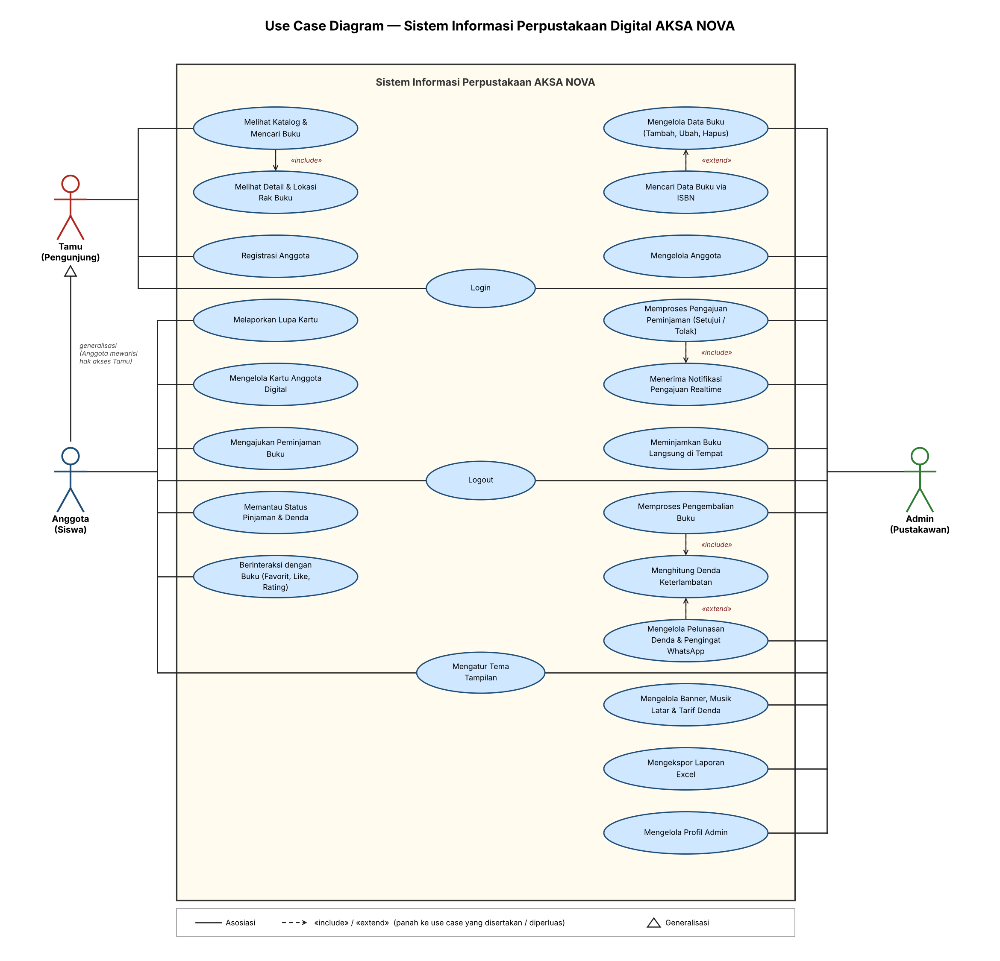
*Gambar 4.1: Diagram Use Case Sistem Informasi Perpustakaan AKSA NOVA*

#### Catatan Ragam Versi Use Case Diagram:
1. **Versi Utama (Komprehensif)**: Seluruh use case yang mempersyaratkan login ditarik relasi `<<include>>` ke *Login*. Garis dibuat siku teratur untuk memelihara kerapian diagram.
2. **Versi Alternatif (Ringkas - Gambar 4.1)**: Menghilangkan garis relasi `<<include>>` ke Login, di mana aktor Anggota dan Admin cukup terhubung ke *Login* dan *Logout* melalui garis asosiasi biasa. Format ini lebih bersih dan ringkas untuk dipresentasikan di hadapan dewan penguji.
3. **Pengecualian Login**: Use case Melihat Katalog, Melihat Detail Buku, Registrasi Anggota, Melaporkan Lupa Kartu, dan Mengatur Tema Tampilan sengaja dikecualikan dari ketergantungan login karena dapat diakses secara bebas tanpa sesi akun.

#### Matriks 23 Use Case & Implementasi File Program

| No | Kode UC | Nama Use Case | Aktor | Relasi | File Implementasi | Deskripsi Singkat |
|:---:|---|---|---|---|---|---|
| **1** | UC-01 | Melihat Katalog & Mencari Buku | Tamu, Anggota | UC-01 meng-include UC-02 | `beranda.php`, `daftar_buku.php` | Menjelajahi katalog buku dengan live search AJAX dan filter multi-kategori. |
| **2** | UC-02 | Melihat Detail & Lokasi Rak Buku | Tamu, Anggota | `<<include>>` (bagian dari UC-01) | `buku_detail.php`, modal detail | Melihat sinopsis, pengarang, stok, serta kode fisik rak buku di perpustakaan. |
| **3** | UC-03 | Registrasi Anggota | Tamu | - | `sign_up.php` | Pendaftaran mandiri siswa dengan NIS, kelas, no HP, email, dan foto profil. Akun otomatis disetujui. |
| **4** | UC-04 | Login | Tamu, Anggota, Admin | - | `sign_in.php`, `index.php` | Autentikasi sesi kredensial berbasis role dan status akun aktif. |
| **5** | UC-05 | Logout | Anggota, Admin | - | `logout.php` | Mengakhiri sesi pengguna dan menghapus data sesi server. |
| **6** | UC-06 | Melaporkan Lupa Kartu | Tamu | - | `lupa_kartu.php` | Siswa membekukan akun/kartu lama yang hilang dan mengajukan kartu baru tanpa perlu login. |
| **7** | UC-07 | Mengelola Kartu Anggota Digital | Anggota | - | `edit_kartu.php`, `kartu_anggota.php` | Melihat pratinjau kartu ber-QR Code dengan sandi bertitik (`••••••••`), mengedit data, dan unduh PNG. |
| **8** | UC-08 | Mengajukan Peminjaman Buku | Anggota | - | `pengajuan_peminjaman.php` | Memilih buku, batas tanggal kembali, dan melampirkan foto kartu anggota. |
| **9** | UC-09 | Memantau Status Pinjaman & Denda | Anggota | - | `dashboard_user.php` | Memantau status pengajuan (menunggu/disetujui/ditolak), tanggal jatuh tempo, dan denda personal. |
| **10** | UC-10 | Berinteraksi dengan Buku | Anggota | - | `like_handler.php`, `rating_handler.php`, `buku_simpan.php` | Memberi tanda like, menyimpan ke koleksi favorit, dan memberikan rating bintang 1–5. |
| **11** | UC-11 | Mengatur Tema Tampilan | Tamu, Anggota, Admin | - | `settings_include.php`, `pengaturan_panel.php` | Memilih tema tampilan (Obsidian Dark, Gold, Light) dan preferensi ukuran font. |
| **12** | UC-12 | Mengelola Data Buku | Admin | - | `halaman_admin.php` | Operasi CRUD (Tambah, Ubah, Hapus) koleksi buku perpustakaan dan lokasi rak. |
| **13** | UC-13 | Mencari Data Buku via ISBN | Admin | `<<extend>>` ke UC-12 | `cari_isbn.php` | Auto-fill data judul, pengarang, cover dari Google Books / Open Library API. |
| **14** | UC-14 | Mengelola Anggota & Reset Sandi | Admin | - | `daftar_anggota.php` | Mengaktifkan/menonaktifkan akun, filter kelas, dan mereset sandi anggota via modal kustom/acak. |
| **15** | UC-15 | Memproses Pengajuan Peminjaman | Admin | UC-15 meng-include UC-16 | `pengajuan_buku.php` | Memvalidasi berkas bukti kartu dan menentukan persetujuan/penolakan pinjaman daring. |
| **16** | UC-16 | Menerima Notifikasi Realtime | Admin | `<<include>>` (bagian dari UC-15) | `notifikasi_pengajuan_admin.php`, `api_cek_pengajuan_admin.php` | Menangkap sinyal AJAX pengajuan baru secara realtime dengan modal pop-up dan lonceng Web Audio. |
| **17** | UC-17 | Meminjamkan Buku Langsung di Tempat | Admin | - | `pinjam_buku.php` | Mencatat transaksi peminjaman langsung di meja sirkulasi fisik perpustakaan. |
| **18** | UC-18 | Memproses Pengembalian Buku | Admin | UC-18 meng-include UC-19 | `telah_dipinjam.php` | Mencatat pengembalian fisik buku dan mengembalikan stok eksemplar buku ke katalog. |
| **19** | UC-19 | Menghitung Denda Keterlambatan | Admin | `<<include>>` (bagian dari UC-18) | `telah_dipinjam.php`, `pengaturan_denda.php` | Mengalkulasi denda otomatis berdasarkan hari terlambat × tarif denda harian. |
| **20** | UC-20 | Mengelola Pelunasan Denda & WA | Admin | `<<extend>>` ke UC-19 | `telah_dipinjam.php` | Mengubah status denda menjadi lunas dan mengirim pesan tagihan terformat ke WhatsApp siswa. |
| **21** | UC-21 | Mengelola Banner, Musik & Denda | Admin | - | `kelola_banner.php`, `pengaturan_musik.php`, `pengaturan_denda.php` | Mengonfigurasi banner beranda (gambar/GIF/video), lagu latar, dan tarif denda harian. |
| **22** | UC-22 | Mengekspor Laporan Excel | Admin | - | `export_excel_dashboard.php` | Mengunduh berkas laporan sirkulasi 3-sheet dalam format spreadsheet Microsoft Excel. |
| **23** | UC-23 | Mengelola Profil Admin | Admin | - | `modal_profil_admin.php` | Memperbarui nama tampilan, foto avatar, dan kata sandi admin secara universal. |

*Tabel 4.1: Matriks 23 Use Case Sistem dan Pemetaan File Implementasi*

---

### 4.2 Activity Diagram (Alur Bisnis Sistem)

Aktivitas bisnis sistem dimodelkan ke dalam 7 Activity Diagram Inti dan 26 Activity Diagram Pelengkap (total 33 diagram alur) yang memisahkan tanggung jawab antar aktor menggunakan konsep swimlane terstruktur:

#### 4.2.1 Activity Diagram Inti (7 Alur Sirkulasi Utama)

1. **Registrasi Anggota Mandiri (`01_activity_registrasi_anggota.png`, `sign_up.php`)**:
   - Swimlane: Pengunjung dan Sistem.
   - Pengunjung mengisi nama, NIS, kelas, no. HP, email sekolah (`@student.smkn1rongga.sch.id`), kata sandi, dan foto profil.
   - Sistem memvalidasi kelengkapan form, keunikan NIS dan email. Jika valid, sistem menyimpan foto, membuat username dan No. Anggota otomatis, mengenkripsi kata sandi via `password_hash()`, serta menyimpan akun dengan status `approved`.
   - Sistem langsung menerbitkan Kartu Anggota Digital ber-QR Code dengan kata sandi tertutup (`••••••••`).

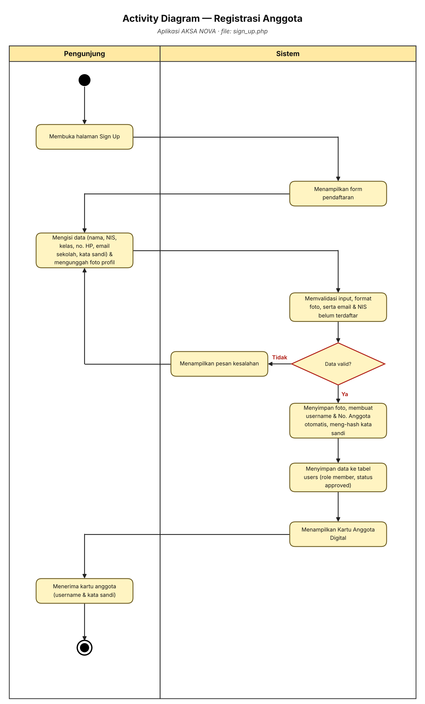
*Gambar 4.2: Activity Diagram Registrasi Anggota Mandiri*

2. **Login Pengguna (`02_activity_login.png`, `sign_in.php`, `logout.php`)**:
   - Swimlane: Pengguna (Anggota / Admin) dan Sistem.
   - Pengguna menginput username/email dan kata sandi. Sistem memvalidasi hash kata sandi via `password_verify()`.
   - *Decision 1*: Akun ada dan sandi benar? Jika tidak, tampilkan pesan kesalahan.
   - *Decision 2*: Akun disetujui dan kartu tidak dibekukan? Jika ya, inisialisasi sesi (`$_SESSION['user_id']`, `$_SESSION['role']`) dan arahkan ke Beranda sesuai peran.

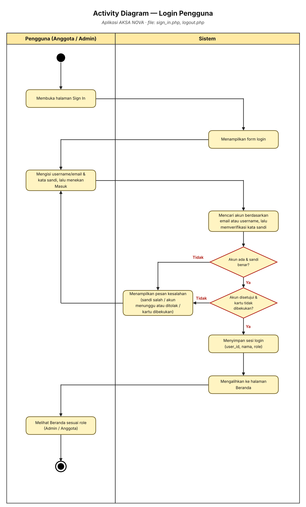
*Gambar 4.3: Activity Diagram Login Pengguna*

3. **Pengajuan Peminjaman Buku Daring (`03_activity_pengajuan_peminjaman_anggota.png`, `pengajuan_peminjaman.php`)**:
   - Swimlane: Anggota dan Sistem (Prasyarat: sudah login).
   - Anggota memilih buku di katalog, membuka form pengajuan (menampilkan stok dan lokasi rak fisik), mengisi kuantitas (maks. 3 eksemplar), batas tanggal pengembalian, memilih waktu ambil (sekarang/nanti), dan melampirkan berkas foto kartu anggota.
   - Sistem memvalidasi ketersediaan stok, rentang tanggal, dan berkas kartu (≤ 5 MB). Jika valid, rekaman tersimpan dengan status `menunggu`, dan sinyal notifikasi realtime dipancarkan ke admin.

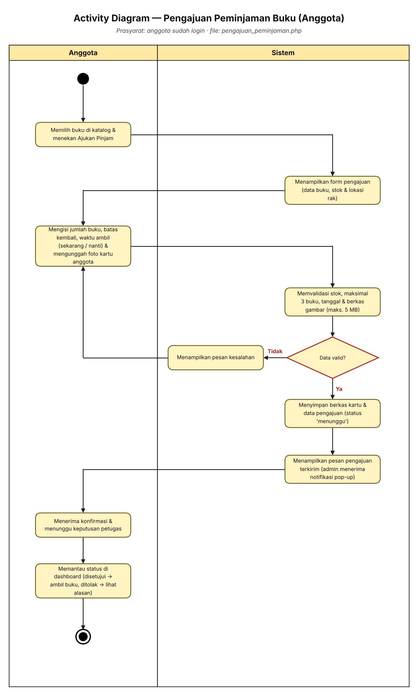
*Gambar 4.4: Activity Diagram Pengajuan Peminjaman Buku Daring*

4. **Persetujuan Pengajuan Peminjaman oleh Admin (`04_activity_persetujuan_pengajuan_admin.png`, `pengajuan_buku.php`)**:
   - Swimlane: Admin dan Sistem (Prasyarat: admin sudah login).
   - Admin membuka antrean pengajuan berstatus `menunggu`.
   - *Decision Cabang Tolak*: Admin memasukkan alasan penolakan, sistem memperbarui status pengajuan menjadi `ditolak`.
   - *Decision Cabang Setujui*: Sistem mengecek sisa stok buku. Jika mencukupi, sistem memotong stok buku secara atomik (`stok = stok - n`), membuat rekaman peminjaman baru berstatus `dipinjam` di tabel `peminjaman`, dan menandai pengajuan `disetujui`.

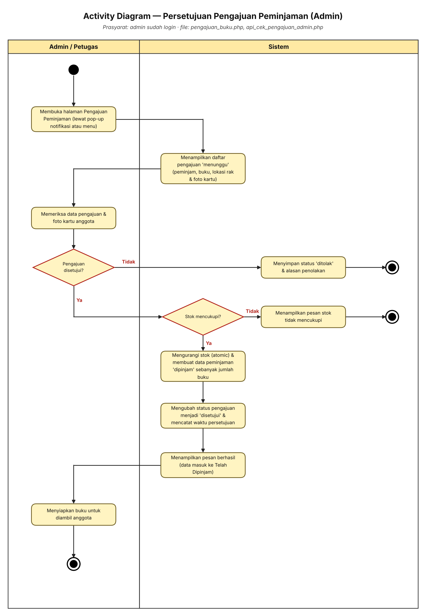
*Gambar 4.5: Activity Diagram Persetujuan Pengajuan Peminjaman oleh Admin*

5. **Peminjaman Langsung di Meja Layanan (`05_activity_peminjaman_langsung.png`, `pinjam_buku.php`)**:
   - Swimlane: Admin dan Sistem (Prasyarat: admin sudah login).
   - Admin membuka formulir sirkulasi langsung, memilih buku yang tersedia (stok > 0), memilih anggota aktif, dan menentukan tanggal jatuh tempo.
   - Sistem memvalidasi data terisi lengkap, anggota terdaftar aktif, dan stok mencukupi. Jika ya, sistem memotong stok 1 eksemplar dan mencatat transaksi berstatus `dipinjam`. Admin menyerahkan buku fisik secara langsung.

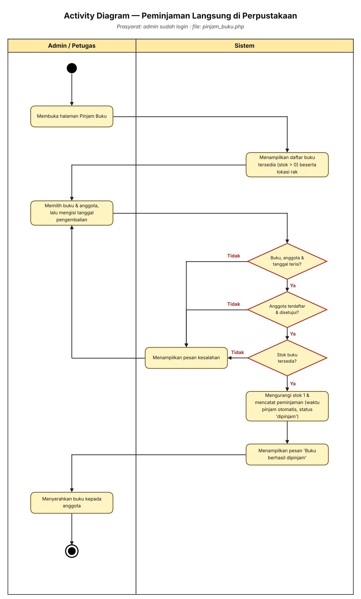
*Gambar 4.6: Activity Diagram Peminjaman Langsung di Meja Layanan*

6. **Pengembalian Buku dan Kalkulasi Denda (`06_activity_pengembalian_denda.png`, `telah_dipinjam.php`)**:
   - Swimlane: Admin dan Sistem (Prasyarat: admin sudah login).
   - Admin membuka daftar transaksi sirkulasi aktif dan menekan "Kembalikan".
   - Sistem mencatat waktu kembali aktual dan menghitung durasi keterlambatan serta denda (hari terlambat × tarif denda dari tabel `pengaturan` setelah masa tenggang *grace period*).
   - Jika terlambat dan denda > 0, transaksi ditandai `dikembalikan` dengan status denda `belum`. Jika tepat waktu, status denda `tidak_ada`.
   - Stok fisik buku dikembalikan (+1). Jika siswa melunasi denda di meja layanan, admin menekan tombol "Tandai Lunas" sehingga status denda berubah menjadi `lunas`.

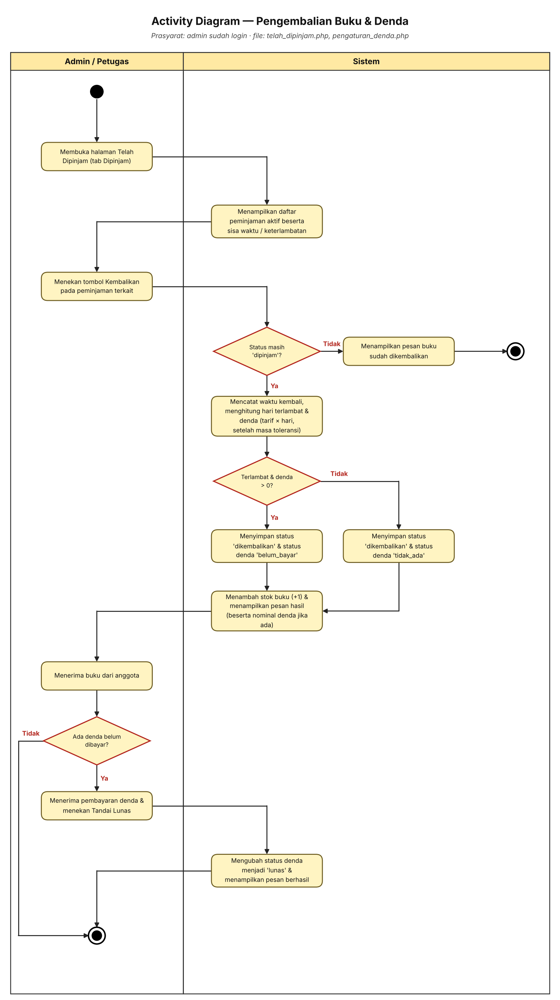
*Gambar 4.7: Activity Diagram Pengembalian Buku dan Kalkulasi Denda*

7. **Tambah Buku dengan Pencarian Otomatis ISBN (`07_activity_tambah_buku_isbn.png`, `halaman_admin.php`, `cari_isbn.php`)**:
   - Swimlane: Admin, Sistem, dan Layanan API Eksternal (Google Books & Open Library).
   - Admin memasukkan nomor ISBN pada formulir tambah buku.
   - Layanan ISBN mencari data buku ke Google Books (dengan fallback ke Open Library). Jika ditemukan, sistem otomatis mengisikan judul, penulis, genre, sinopsis, dan mengunduh gambar sampul buku.
   - Admin melengkapi kuantitas stok fisik dan kode lokasi rak buku di perpustakaan, lalu menekan Simpan. Sistem menyimpan buku ke tabel `buku`.

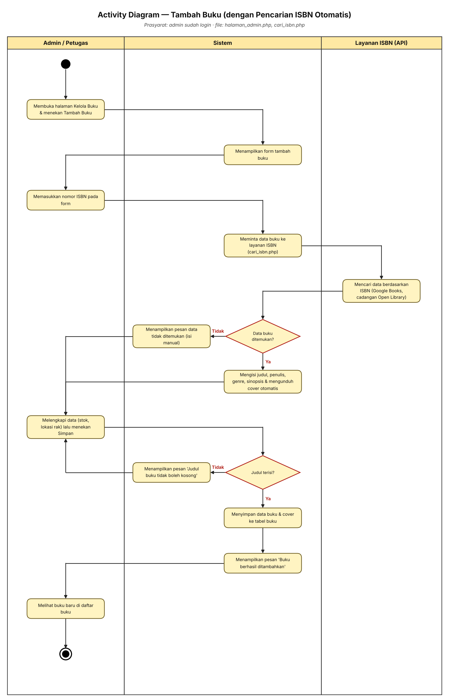
*Gambar 4.8: Activity Diagram Tambah Buku dengan Pencarian Otomatis ISBN*

#### 4.2.2 Inventaris 26 Activity Diagram Pelengkap
Seluruh 26 alur kerja pelengkap telah dimodelkan dan disimpan pada direktori dokumen pelengkap sistem:

| No | Berkas Diagram | Nama Alur Aktivitas | Aktor & Komponen Terkait |
|:---:|---|---|---|
| 8 | `activity_08_lupa_kartu.png` | Alur Pelaporan Lupa/Hilang Kartu | Siswa memasukkan NIS & email, kartu lama dibekukan, kartu baru diterbitkan. |
| 9 | `activity_09_edit_kartu_anggota.png` | Alur Perbaruan Data & Foto Kartu | Siswa memperbarui nama, nomor kontak, foto profil, dan kata sandi mandiri. |
| 10 | `activity_10_like_simpan_buku.png` | Alur Suka (*Like*) & Simpan Buku | Siswa menekan ikon suka atau simpan buku via AJAX handler. |
| 11 | `activity_11_rating_buku.png` | Alur Pemberian Rating Bintang Buku | Siswa memberikan ulasan rating 1–5; admin dicegah memberikan ulasan. |
| 12 | `activity_12_telusuri_katalog_detail.png` | Alur Penelusuran Katalog & Detail Rak | Pengguna menyaring kategori buku dan melihat posisi nomor rak fisik. |
| 13 | `activity_13_dashboard_anggota.png` | Alur Pemantauan Dashboard Siswa | Siswa memantau pinjaman aktif, riwayat pengembalian, dan tagihan denda. |
| 14 | `activity_14_status_akun_kartu_anggota.png` | Alur Validasi Keaktifan Akun | Sistem memeriksa status keaktifan keanggotaan dan pembekuan kartu saat login. |
| 15 | `activity_15_reset_sandi_anggota.png` | Alur Reset Kata Sandi Anggota oleh Admin | Admin mereset kata sandi siswa via modal (kustom / acak 🎲). |
| 16 | `activity_16_hapus_anggota.png` | Alur Penghapusan Rekaman Anggota | Admin menghapus anggota; riwayat peminjaman tetap utuh (`user_id = NULL`). |
| 17 | `activity_17_tambah_kelas.png` | Alur Penambahan Data Kelas | Admin mendaftarkan rombongan belajar baru untuk filter anggota. |
| 18 | `activity_18_hapus_kelas.png` | Alur Penghapusan Data Kelas | Admin menghapus nama kelas yang sudah tidak digunakan. |
| 19 | `activity_19_kenaikan_kelas.png` | Alur Kenaikan Kelas Siswa Massal | Admin memperbarui tingkatan kelas siswa secara kolektif di awal semester. |
| 20 | `activity_20_edit_buku.png` | Alur Penyuntingan Informasi Buku | Admin memperbarui metadata buku, stok eksemplar, maupun lokasi rak fisik. |
| 21 | `activity_21_hapus_buku.png` | Alur Penghapusan Koleksi Buku | Admin menghapus buku fisik dari inventaris perpustakaan sekolah. |
| 22 | `activity_22_hapus_riwayat_peminjaman.png` | Alur Pembersihan Riwayat Sirkulasi | Admin mengarsipkan/menghapus catatan peminjaman lama yang telah lunas. |
| 23 | `activity_23_pengaturan_denda.png` | Alur Konfigurasi Tarif Denda Harian | Admin mengubah nominal tarif per hari, status denda, dan masa toleransi. |
| 24 | `activity_24_pengingat_keterlambatan_wa.png`| Alur Penagihan Denda via WhatsApp | Admin mengklik tombol WA untuk membuka chat template penagihan ke siswa. |
| 25 | `activity_25_tambah_banner.png` | Alur Pengunggahan Banner Promosi | Admin mengunggah gambar, GIF animasi, atau video banner beranda. |
| 26 | `activity_26_ubah_banner.png` | Alur Penyuntingan Data Banner | Admin mengubah teks judul, subjudul, tautan tujuan, dan urutan banner. |
| 27 | `activity_27_atur_banner.png` | Alur Pengurutan & Status Aktif Banner | Admin mengaktifkan/menonaktifkan atau mengatur prioritas tampilan slide. |
| 28 | `activity_28_pengaturan_musik.png` | Alur Pengelolaan Musik Latar Audio | Admin mengunggah file musik MP3/OGG dan menetapkan lagu aktif beranda. |
| 29 | `activity_29_hapus_musik.png` | Alur Penghapusan Musik Audio | Admin menghapus file lagu pengiring dari penyimpanan server. |
| 30 | `activity_30_dashboard_admin_ekspor.png` | Alur Ekspor Laporan Excel Multilembar | Admin mengunduh berkas laporan bulanan dan rekapitulasi buku (.xls). |
| 31 | `activity_31_profil_sandi_admin.png` | Alur Pembaruan Profil & Sandi Admin | Admin mengganti nama profil, foto avatar, dan kata sandi dari modal samping. |
| 32 | `activity_32_logout.png` | Alur Terminasi Sesi Pengguna | Pengguna keluar dari sistem; seluruh rekaman sesi dihapus bersih dari server. |
| 33 | `activity_33_notifikasi_pengajuan.png` | Alur Penangkapan Notifikasi Realtime | Polling 4 detik mendeteksi pengajuan baru, membunyikan Web Audio chime. |

*Tabel 4.2: Inventaris 26 Activity Diagram Pelengkap*

---

### 4.3 Sequence Diagram (Alur Interaksi Antar Objek)

Sequence Diagram menggambarkan urutan pertukaran pesan dinamis antar objek menurut dimensi waktu. Pemodelan membagi arsitektur ke dalam 5 elemen baku: Aktor, Boundary, Control, Entity, Object, serta blok percabangan `alt` dan `opt`:

#### 4.3.1 Sequence Diagram Inti (7 Alur Interaksi Utama)

1. **Sequence Registrasi Anggota Mandiri (`10_sequence_registrasi_anggota.png`)**:
   - Aktor: Pengunjung → Boundary: `sign_up.php` → Control: Skrip Registrasi → Entity: `users`.
   - Pengunjung mengirim data pendaftaran melalui metode POST. Control memvalidasi format email `@student.smkn1rongga.sch.id` dan keunikan NIS.
   - Blok `alt`: Jika data duplikat/tidak valid, Boundary menampilkan pesan error. Jika valid, Control menyimpan berkas foto profil, meng-hash kata sandi, dan mengeksekusi `INSERT INTO users` dengan `role = 'member'` dan `status = 'approved'`. Halaman merespons dengan menampilkan kartu anggota digital.

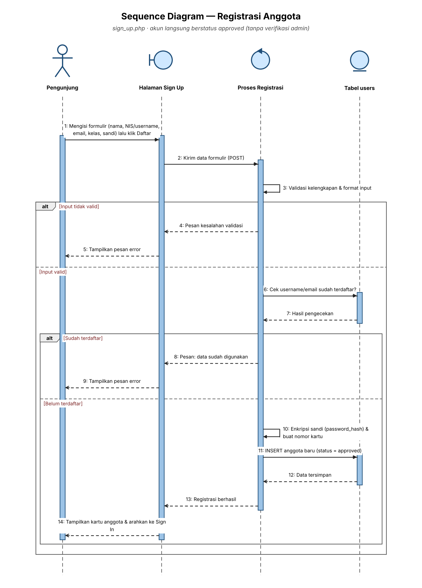
*Gambar 4.9: Sequence Diagram Registrasi Anggota Mandiri*

2. **Sequence Login Pengguna (`11_sequence_login.png`)**:
   - Aktor: Pengguna → Boundary: `sign_in.php` → Control: Skrip Login → Entity: `users`.
   - Pengguna menginputkan username/email dan sandi. Control mencari baris akun di tabel `users`.
   - Blok `alt` bersarang: Jika akun tidak ditemukan atau `password_verify()` bernilai `false`, sistem mengembalikan pesan kegagalan autentikasi. Jika benar namun kartu berstatus `frozen`, sistem menampilkan notifikasi kartu dibekukan. Jika lolos seluruh verifikasi, Control menginisialisasi sesi autentikasi dan meredireksi pengguna ke Beranda.

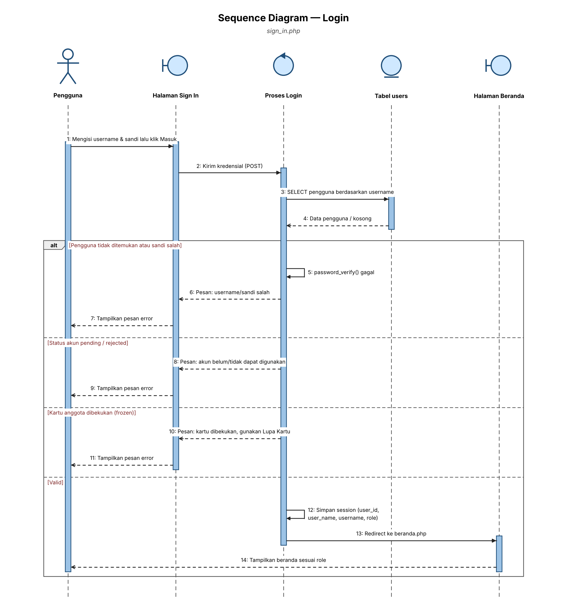
*Gambar 4.10: Sequence Diagram Login Pengguna*

3. **Sequence Pengajuan Peminjaman Daring (`12_sequence_pengajuan_peminjaman.png`)**:
   - Aktor: Anggota → Boundary: `pengajuan_peminjaman.php` → Control: Skrip Pengajuan → Entity: `buku`, `pengajuan_peminjaman`.
   - Anggota mengirim formulir peminjaman beserta lampiran kartu anggota. Control memvalidasi input tanggal dan batas maksimal eksemplar.
   - Blok `alt`: Jika stok buku di tabel `buku` bernilai 0, sistem menghentikan proses dengan pesan stok kosong. Jika stok tersedia, Control menyimpan berkas gambar kartu dan melakukan `INSERT INTO pengajuan_peminjaman` dengan status `menunggu`.

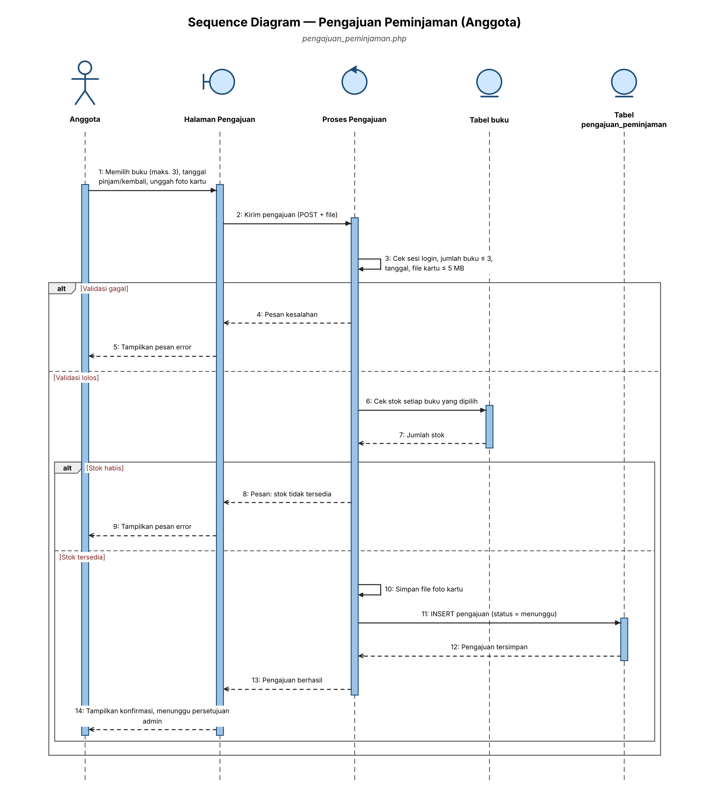
*Gambar 4.11: Sequence Diagram Pengajuan Peminjaman Daring*

4. **Sequence Persetujuan Pengajuan oleh Admin (`13_sequence_persetujuan_pengajuan.png`)**:
   - Aktor: Admin → Boundary: `pengajuan_buku.php` → Control: Skrip Persetujuan → Entity: `pengajuan_peminjaman`, `buku`, `peminjaman`.
   - Admin meninjau berkas kartu dan memilih opsi "Setujui" atau "Tolak".
   - Blok `alt (Tolak)`: Control mengupdate `status = 'ditolak'` beserta catatan alasan penolakan.
   - Blok `alt (Setujui)`: Control menjalankan kueri atomik `UPDATE buku SET stok = stok - n WHERE id = ? AND stok >= n`. Jika berhasil, Control memasukkan data ke tabel `peminjaman` berstatus `dipinjam` dan memperbarui status pengajuan menjadi `disetujui`.

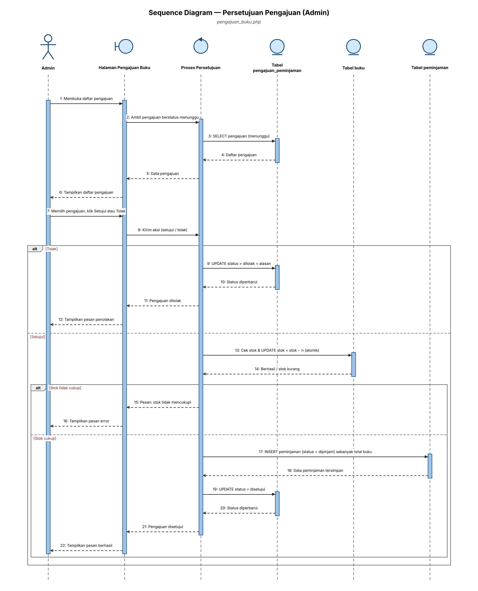
*Gambar 4.12: Sequence Diagram Persetujuan Pengajuan oleh Admin*

5. **Sequence Peminjaman Langsung di Meja Layanan (`14_sequence_peminjaman_langsung.png`)**:
   - Aktor: Admin → Boundary: `pinjam_buku.php` → Control: Skrip Sirkulasi Langsung → Entity: `users`, `buku`, `peminjaman`.
   - Admin memilih siswa peminjam dan koleksi buku.
   - Tiga blok `alt` berurutan memeriksa kelengkapan data, keaktifan akun siswa di `users`, dan ketersediaan stok fisik di `buku`. Jika seluruh syarat terpenuhi, sistem mengurangi stok 1 eksemplar dan membuat rekaman baru di tabel `peminjaman`.

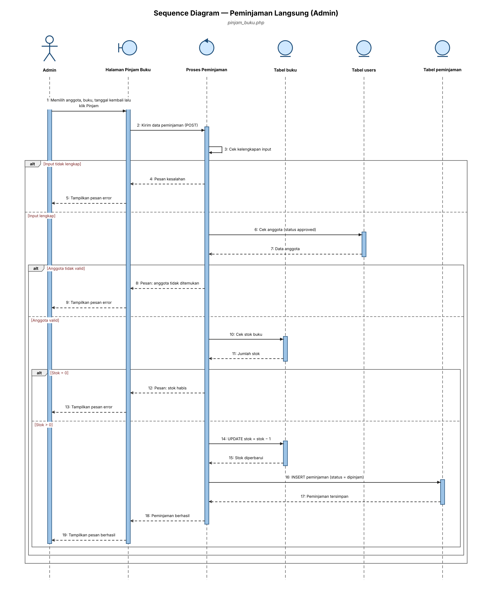
*Gambar 4.13: Sequence Diagram Peminjaman Langsung di Meja Layanan*

6. **Sequence Pengembalian Buku dan Denda Keterlambatan (`15_sequence_pengembalian_denda.png`)**:
   - Aktor: Admin → Boundary: `telah_dipinjam.php` → Control: Skrip Pengembalian → Entity: `peminjaman`, `pengaturan`, `buku`.
   - Admin menekan tombol "Kembalikan". Control membaca data batas tenggat di `peminjaman` dan membaca konfigurasi denda (`denda_aktif`, `denda_per_hari`, `denda_grace_period`) dari tabel `pengaturan`.
   - Control menghitung durasi keterlambatan dan besaran denda, memperbarui status peminjaman menjadi `dikembalikan`, dan menambahkan kembali stok buku (+1).
   - Blok `opt (Pelunasan Denda)`: Jika denda > 0 dan telah dibayar siswa, aksi `tandai_lunas` memperbarui `status_denda = 'lunas'`.

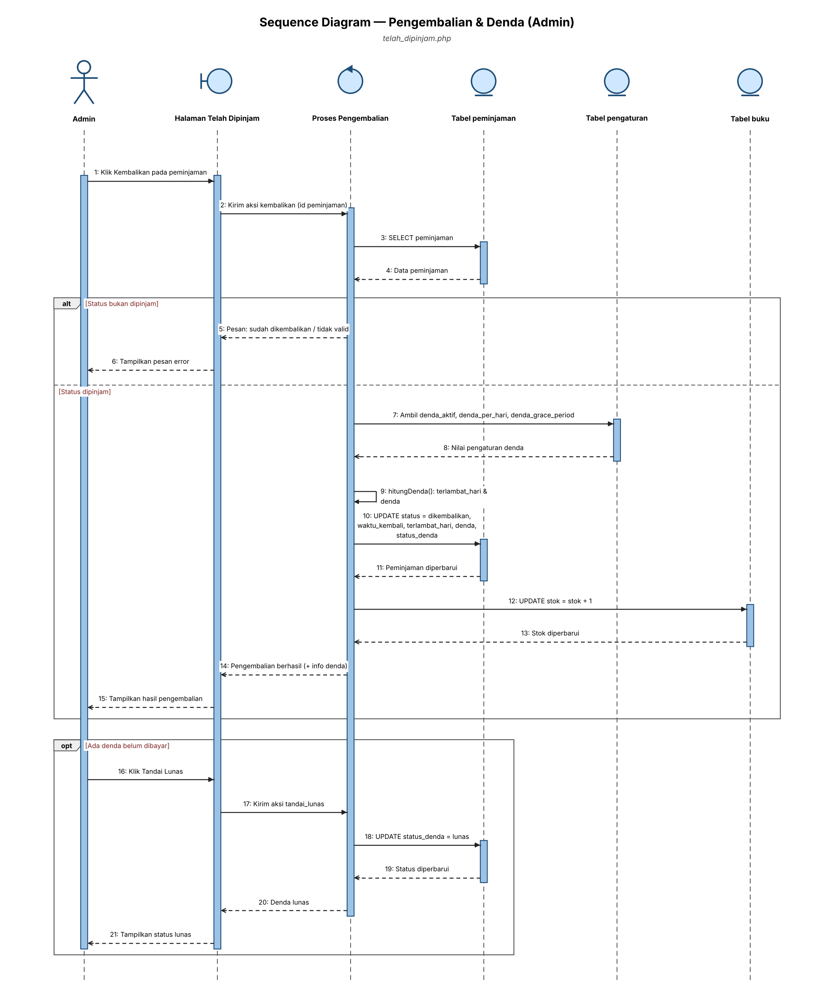
*Gambar 4.14: Sequence Diagram Pengembalian Buku dan Denda Keterlambatan*

7. **Sequence Tambah Buku via API Google Books / Open Library (`16_sequence_tambah_buku_isbn.png`)**:
   - Aktor: Admin → Boundary: `halaman_admin.php` → Control: `cari_isbn.php` → Object: Google Books API & Open Library API → Entity: `buku`.
   - Admin memasukkan ISBN; Control memanggil Google Books API. Blok `opt` menjalankan kueri cadangan ke Open Library jika Google Books tidak menemukan data.
   - Jika ditemukan, cover diunduh ke server dan form terisi otomatis. Admin memasukkan kuantitas stok dan lokasi rak buku fisik, kemudian menyimpan data ke tabel `buku`.

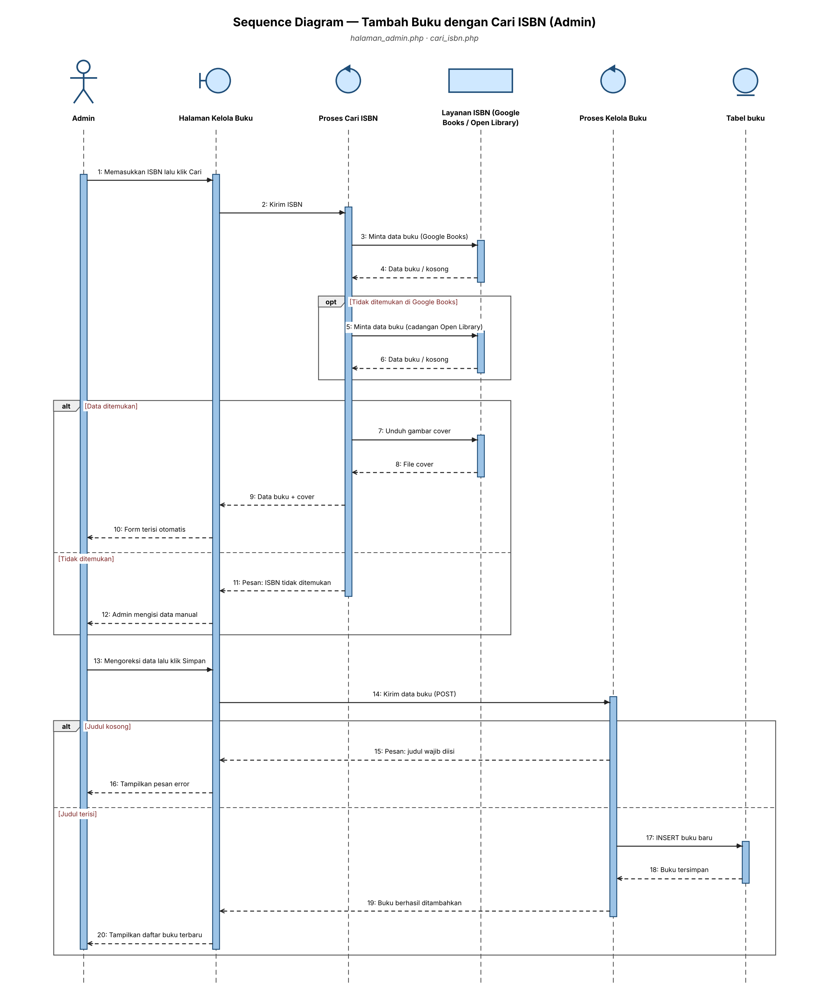
*Gambar 4.15: Sequence Diagram Tambah Buku via API Google Books / Open Library*

#### 4.3.2 Inventaris 26 Sequence Diagram Pelengkap
Seluruh 26 sequence diagram pelengkap (nomor `sequence_08_lupa_kartu.png` s/d `sequence_33_notifikasi_pengajuan.png`) mendokumentasikan interaksi pesan objek untuk fitur-fitur operasional pendukung seperti modul lupa kartu, penyuntingan kartu anggota berpenyamaran sandi aman, pemberian rating, pemfilteran katalog multi-genre, perbaruan kata sandi admin universal, serta ekspor laporan spreadsheet 3-sheet.

---

### 4.4 Class Diagram (Pemodelan Berorientasi Objek — 14 Kelas & 14 Relasi)

Sistem AKSA NOVA dimodelkan ke dalam **satu Class Diagram komprehensif** yang memetakan struktur objek sistem menjadi **14 Kelas** dan **14 Relasi Antar Kelas**:

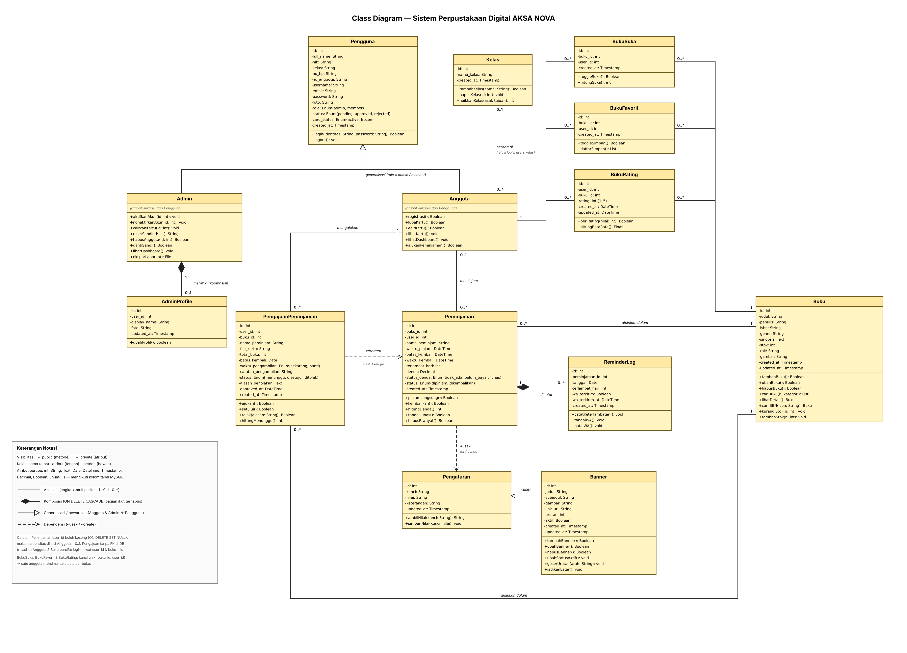
*Gambar 4.16: Class Diagram Sistem Informasi Perpustakaan Digital AKSA NOVA*

#### Matriks 14 Hubungan Antar Kelas Pemodelan AKSA NOVA

| No | Relasi Antar Kelas | Jenis Relasi | Multiplisitas | Landasan Kode & Basis Data |
|:---:|---|---|---|---|
| **1** | `Anggota` → `Pengguna` | Generalisasi | - | Kolom `role = 'member'` di tabel `users`. |
| **2** | `Admin` → `Pengguna` | Generalisasi | - | Kolom `role = 'admin'` di tabel `users`. |
| **3** | `Admin` ◆ `AdminProfile` | Komposisi | 1 : 0..1 | Foreign Key `user_id` unik di tabel `admin_profile` (`ON DELETE CASCADE`). |
| **4** | `Anggota` — `Kelas` | Asosiasi Logis | 0..* : 0..1 | Kolom `users.kelas` mereferensikan nama rombel di tabel `kelas`. |
| **5** | `Anggota` — `Peminjaman` | Asosiasi | 0..1 : 0..* | Foreign Key `user_id` berstatus `ON DELETE SET NULL` (riwayat tetap aman jika akun dihapus). |
| **6** | `Buku` — `Peminjaman` | Asosiasi | 1 : 0..* | Foreign Key `buku_id` berstatus `ON DELETE RESTRICT` (buku aktif tidak boleh terhapus). |
| **7** | `Anggota` — `PengajuanPeminjaman` | Asosiasi Logis | 1 : 0..* | Kolom `user_id` menghubungkan pemohon peminjaman daring. |
| **8** | `Buku` — `PengajuanPeminjaman` | Asosiasi Logis | 1 : 0..* | Kolom `buku_id` menghubungkan buku yang diajukan. |
| **9** | `PengajuanPeminjaman` ⇢ `Peminjaman` | Dependensi | «create» | Saat pengajuan disetujui, sistem menerbitkan baris sirkulasi aktif di tabel `peminjaman`. |
| **10**| `Peminjaman` ◆ `ReminderLog` | Komposisi | 1 : 0..* | Foreign Key `peminjaman_id` dengan `ON DELETE CASCADE`, unik per hari per transaksi. |
| **11**| `Anggota` — `BukuSuka` / `Favorit` / `Rating` | Asosiasi | 1 : 0..* | Foreign Key `user_id` dengan `ON DELETE CASCADE`. |
| **12**| `Buku` — `BukuSuka` / `Favorit` / `Rating` | Asosiasi | 1 : 0..* | Foreign Key `buku_id` dengan `ON DELETE CASCADE`. |
| **13**| `Peminjaman` ⇢ `Pengaturan` | Dependensi | «use» | Fungsi `hitungDenda()` membaca parameter `denda_per_hari` dan toleransi hari. |
| **14**| `Banner` ⇢ `Pengaturan` | Dependensi | «use» | Menetapkan banner latar beranda (`banner_background_id`). |

*Tabel 4.3: Matriks 14 Hubungan Antar Kelas Pemodelan Berorientasi Objek*

---

### 4.5 Perancangan Basis Data (ERD & Kamus Data Terstruktur)

Basis data relasional sistem AKSA NOVA diberi nama `aksa_nova` dengan engine penyimpanan **InnoDB** dan karakter set **utf8mb4**.

#### Visualisasi ERD
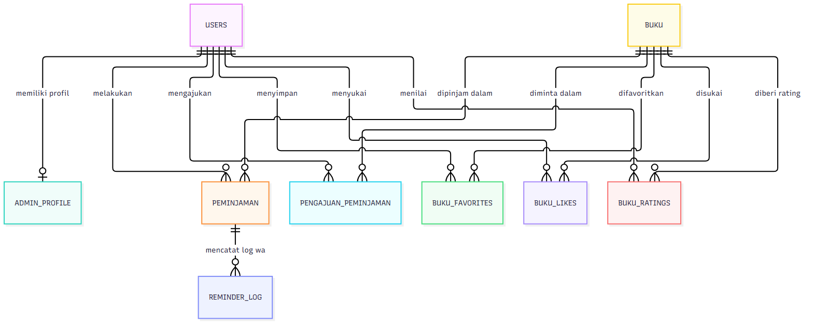
*Gambar 4.17: Entity Relationship Diagram (ERD) Basis Data Relasional*

#### Kamus Data Entitas Utama (Data Dictionary)

1. **Tabel `users`** (Data akun pengguna):
   * `id` (INT, PK, Auto Increment): ID unik pengguna.
   * `full_name` (VARCHAR 100): Nama lengkap siswa/admin.
   * `nik` (VARCHAR 20): Nomor Induk Siswa (NIS) atau NIK unik.
   * `kelas` (VARCHAR 30): Nama kelas (contoh: "XII RPL 1").
   * `no_hp` (VARCHAR 20): Nomor WhatsApp aktif untuk kontak dan tagihan.
   * `no_anggota` (VARCHAR 30, Unique): Nomor kartu perpustakaan resmi (format: `AN-YYYYMM-XXXX`).
   * `username` (VARCHAR 50, Unique): Kredensial masuk sistem.
   * `email` (VARCHAR 100, Unique): Alamat surel siswa/admin.
   * `password` (VARCHAR 255): Hash kata sandi terenkripsi (Bcrypt).
   * `plain_password` (VARCHAR 255): Nilai kata sandi terkelola untuk mekanisme reset sandi administratif aman.
   * `role` (ENUM: `'admin'`, `'member'`): Hak akses sistem.
   * `status` (ENUM: `'pending'`, `'approved'`, `'rejected'`): Status keanggotaan.
   * `card_status` (ENUM: `'active'`, `'frozen'`): Status keaktifan kartu anggota digital.
   * `foto` (VARCHAR 255): Lokasi berkas foto profil siswa.
   * `created_at` (TIMESTAMP): Waktu registrasi akun.

2. **Tabel `buku`** (Katalog inventaris buku):
   * `id` (INT, PK, Auto Increment): ID unik buku.
   * `judul` (VARCHAR 200): Judul buku.
   * `penulis` (VARCHAR 100): Penulis/pengarang buku.
   * `isbn` (VARCHAR 50): Kode standar buku internasional.
   * `genre` (VARCHAR 60): Kategori/genre buku.
   * `sinopsis` (TEXT): Ringkasan isi buku.
   * `stok` (INT): Jumlah eksemplar fisik yang tersedia (label "Kosong" bila 0).
   * `rak` (VARCHAR 50): Lokasi rak fisik buku di perpustakaan (contoh: "Rak B-1").
   * `gambar` (VARCHAR 255): Lokasi file sampul buku.

3. **Tabel `pengajuan_peminjaman`** (Antrean pengajuan pinjam daring):
   * `id` (INT, PK, Auto Increment): ID pengajuan.
   * `user_id` (INT): Siswa yang mengajukan peminjaman.
   * `buku_id` (INT): Buku yang diajukan.
   * `jumlah` (INT): Jumlah eksemplar yang diajukan (maks. 3).
   * `tgl_kembali` (DATE): Rencana batas pengembalian.
   * `file_kartu` (VARCHAR 255): Berkas upload foto kartu anggota siswa.
   * `status` (ENUM: `'menunggu'`, `'disetujui'`, `'ditolak'`): Status verifikasi admin.
   * `alasan_tolak` (VARCHAR 255): Keterangan apabila ditolak.
   * `created_at` (TIMESTAMP): Waktu pengajuan dikirim.

4. **Tabel `peminjaman`** (Transaksi sirkulasi aktif & riwayat pengembalian):
   * `id` (INT, PK, Auto Increment): ID transaksi sirkulasi.
   * `user_id` (INT, FK ke `users.id`, Nullable): Siswa peminjam.
   * `buku_id` (INT, FK ke `buku.id`): Buku yang dipinjam.
   * `tgl_pinjam` (DATE): Tanggal buku diserahkan.
   * `batas_kembali` (DATE): Tanggal tenggat pengembalian buku.
   * `tgl_dikembalikan` (DATETIME, Nullable): Tanggal riil buku dikembalikan.
   * `status` (ENUM: `'dipinjam'`, `'dikembalikan'`, `'terlambat'`): Status sirkulasi.
   * `terlambat_hari` (INT): Jumlah hari keterlambatan pengembalian.
   * `denda` (DECIMAL 10,2): Jumlah denda keterlambatan (Rp).
   * `status_denda` (ENUM: `'lunas'`, `'belum'`, `'tidak_ada'`): Status pembayaran denda.

5. **Tabel `reminder_log`** (Pencatatan pengiriman notifikasi WhatsApp):
   * `id` (INT, PK, Auto Increment): ID log pengingat.
   * `peminjaman_id` (INT, FK ke `peminjaman.id`): Relasi transaksi peminjaman.
   * `tanggal` (DATE): Tanggal pencatatan reminder (unik per transaksi per hari).
   * `terlambat_hari` (INT): Durasi hari keterlambatan saat log dicatat.
   * `wa_terkirim` (TINYINT 1): Flag status pengiriman (1 = Sudah, 0 = Belum).
   * `wa_terkirim_at` (DATETIME): Timestamp pengiriman pesan WhatsApp.

6. **Tabel `pengaturan`** (Konfigurasi dinamis sistem):
   * `id` (INT, PK, Auto Increment): ID pengaturan.
   * `kunci` (VARCHAR 50, Unique): Kunci identifikasi (contoh: `denda_per_hari`, `musik_file`).
   * `nilai` (TEXT): Nilai konfigurasi.
   * `keterangan` (VARCHAR 255): Deskripsi parameter.

---

### 4.6 Perancangan Antarmuka Pengguna (UI/UX Concept & Responsivitas Mobile)

1. **Konsep Visual Obsidian-Gold Luxury Theme**:
   - Palet Warna: Warna dasar gelap pekat (`--bg: #090c10`), warna kartu kontras (`--card: #121820`), teks utama terang (`--text: #eef3f4`), serta aksen emas kemilau (`--accent: #d8b878`) untuk tombol aksi primer dan sorotan status.
   - Tipografi: Menggunakan kombinasi font Google Font `Outfit` (modern, tegas, mudah dibaca) berpadu dengan `Nunito` untuk keterbacaan teks deskripsi.

2. **Standardisasi Lebar Sidebar 220px Bebas Scroll**:
   - Seluruh panel navigasi admin dan anggota distandardisasi dengan lebar `--sidebar-w: 220px`.
   - Ukuran avatar admin diatur pada 72px dan jarak tombol menu pada padding `7.5px 12px` berukuran font `.82rem` dengan ikon SVG 16px. Penataan ini memastikan seluruh tautan menu termuat utuh dalam satu layar vertikal tanpa memicu bilah penggulung vertikal pada resolusi monitor laptop standar.

3. **Perlindungan Privasi Kata Sandi (Password Masking)**:
   - Pada kartu anggota digital di `kartu_anggota.php`, editor kartu `edit_kartu.php`, dan mini-card di `dashboard_user.php`, kolom kata sandi ditampilkan selalu dalam bentuk titik-titik bertutup (`••••••••`).
   - Pustakawan di `daftar_anggota.php` dapat mereset kata sandi melalui modal sembulan tanpa adanya teks kata sandi terbuka pada baris tabel umum.

4. **Arsitektur Responsif Mobile Modern**:
   - Header terpadu dengan burger drawer menu, penataan badge genre terpisah, serta transformasi otomatis tabel data admin menjadi susunan kartu vertikal rapi pada layar ponsel tanpa memerlukan geser horizontal.

---

# BAB V: IMPLEMENTASI DAN PENGUJIAN SISTEM

### 5.1 Implementasi Lingkungan Pengembangan & Struktur File Program Modular

Sistem diimplementasikan secara modular pada lingkungan web server Apache dan basis data MySQL (Laragon / PHP 8.1):
* `index.php`: Halaman depan (*Landing Page*) interaktif dengan banner carousel media, audio latar persisten, dan profil sekolah.
* `sign_in.php` & `sign_up.php`: Modul autentikasi login dan registrasi anggota mandiri dengan verifikasi NIS unik.
* `beranda.php`: Katalog buku publik dengan live search AJAX, filter multi-genre, kartu rekomendasi, dan modal detail buku.
* `buku_detail.php`: Endpoint penyedia informasi detail buku, sinopsis, ketersediaan stok, dan nomor rak fisik.
* `buku_simpan.php`: Koleksi buku favorit siswa berfitur instant search.
* `kartu_anggota.php` & `edit_kartu.php`: Generator kartu anggota digital ber-QR Code dengan penyamaran sandi aman (`••••••••`).
* `lupa_kartu.php`: Penanganan mandiri pembekuan kartu hilang dan penerbitan kartu baru dengan input wrap seragam.
* `pengajuan_peminjaman.php`: Antarmuka pengajuan pinjaman daring dengan upload foto kartu anggota.
* `halaman_admin.php`: Modul manajemen katalog buku (CRUD, stok kosong, dan pencarian ISBN otomatis).
* `cari_isbn.php`: Layanan pemanggil API eksternal Google Books dan Open Library.
* `daftar_anggota.php`: Manajemen aktivasi keanggotaan, filter kelas, dan modal reset kata sandi (kustom & acak 🎲).
* `pengajuan_buku.php`: Antarmuka verifikasi pengajuan pinjaman daring siswa oleh admin dengan mobile card layout.
* `pinjam_buku.php`: Modul sirkulasi langsung di meja layanan fisik perpustakaan.
* `telah_dipinjam.php`: Modul pengembalian buku, kalkulasi denda otomatis, dan penagihan via tautan WhatsApp.
* `notifikasi_pengajuan_admin.php` & `api_cek_pengajuan_admin.php`: Polling AJAX berinterval 4 detik dan modal pop-up bersuara lonceng Web Audio.
* `export_excel_dashboard.php`: Engine ekspor laporan rekapitulasi data format Microsoft Excel 3-sheet.
* `pengaturan_denda.php` & `pengaturan_musik.php`: Modul konfigurasi tarif denda harian dan lagu pengiring beranda.
* `kelola_banner.php`: Modul pengelolaan slide media (gambar, GIF animasi, dan video MP4/WEBM).
* `modal_profil_admin.php`, `update_profil_admin.php`, `ganti_sandi_admin.php`: Modul profil universal admin.
* `settings_include.php` & `pengaturan_panel.php`: Pustaka terpusat CSS tokens, drawer responsif, dan engine audio *AksaAudio*.

### 5.2 Hasil Implementasi Antarmuka Pengguna & Cuplikan Kode Kunci

Berikut adalah hasil implementasi nyata antarmuka sistem informasi perpustakaan AKSA NOVA:

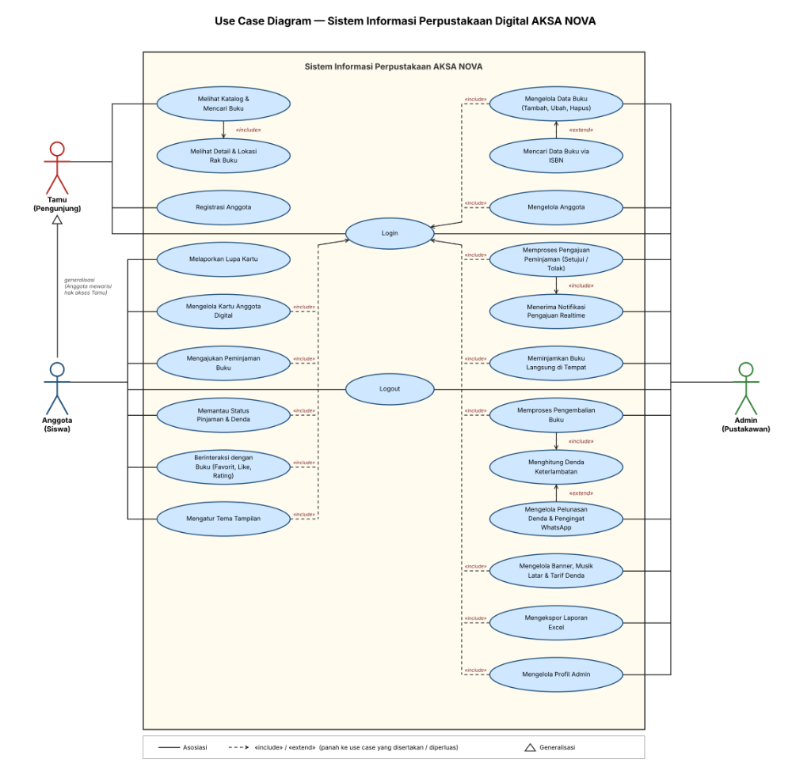
*Gambar 5.1: Antarmuka Halaman Depan & Katalog Buku (Landing Page)*

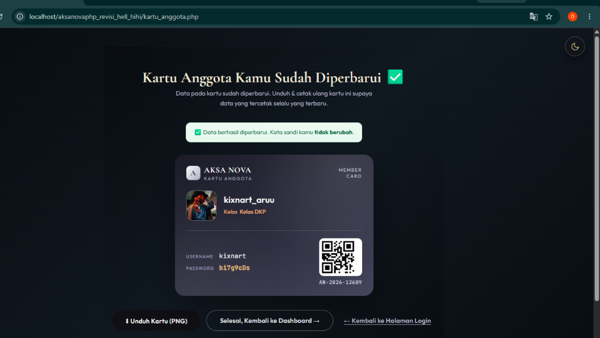
*Gambar 5.2: Antarmuka Kartu Anggota Digital ber-QR Code dengan Sandi Bertitik*

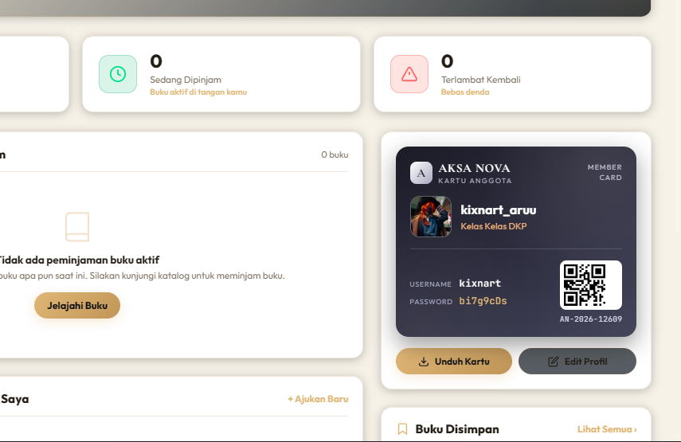
*Gambar 5.3: Antarmuka Dashboard Siswa & Pemantauan Sirkulasi*

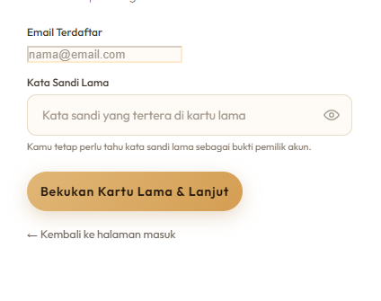
*Gambar 5.4: Antarmuka Pelaporan Mandiri Lupa Kartu Anggota*

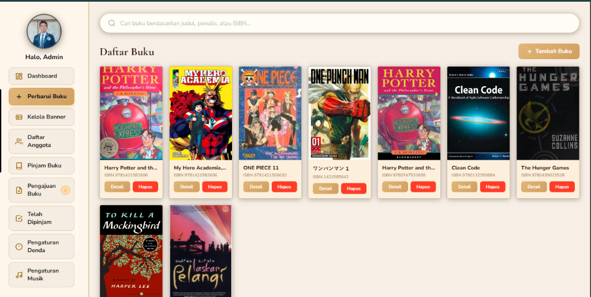
*Gambar 5.5: Antarmuka Dashboard Admin & Statistik Sirkulasi Perpustakaan*

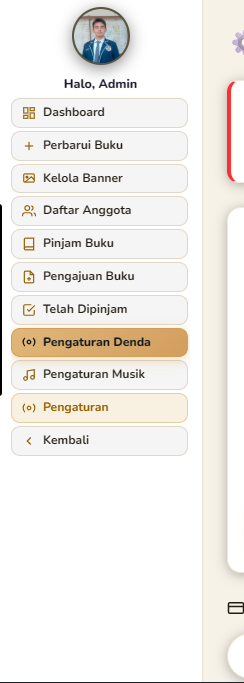
*Gambar 5.6: Antarmuka Modal Interaktif Ubah Sandi Anggota (Kustom & Acak)*

#### Cuplikan Kode Kunci Implementasi Sistem:

1. **Pengurangan Stok Buku Secara Atomik (`pengajuan_buku.php`)**:
```php
// Menjamin pengurangan stok buku konsisten tanpa risiko minus akibat race condition
$stmt = mysqli_prepare($conn, "UPDATE buku SET stok = stok - ? WHERE id = ? AND stok >= ?");
mysqli_stmt_bind_param($stmt, "iii", $jumlah, $buku_id, $jumlah);
mysqli_stmt_execute($stmt);
if (mysqli_stmt_affected_rows($stmt) > 0) {
    // Stok berhasil dipotong secara aman
}
```

2. **Penyamaran Sandi pada Kartu Anggota Digital (`kartu_anggota.php`)**:
```html
<!-- Menampilkan username asli tetapi menyamarkan kata sandi demi privasi dan keamanan -->
<div class="cred-row">
  <span class="cred-label">Username</span>
  <span class="cred-value"><?= htmlspecialchars($d["username"]) ?></span>
</div>
<div class="cred-row">
  <span class="cred-label">Password</span>
  <span class="cred-value" style="letter-spacing:3px;font-size:.85rem;color:rgba(216,184,120,.75);">••••••••</span>
</div>
```

3. **Perhitungan Denda Keterlambatan Otomatis (`telah_dipinjam.php`)**:
```php
// Menghitung hari keterlambatan dan denda setelah masa tenggang (grace period)
$tgl_kembali = new DateTime($row['tgl_dikembalikan']);
$batas_tgl   = new DateTime($row['batas_kembali']);
if ($tgl_kembali > $batas_tgl) {
    $selisih = $batas_tgl->diff($tgl_kembali)->days;
    $hari_denda = max(0, $selisih - $denda_grace_period);
    $total_denda = $hari_denda * $denda_per_hari;
}
```

### 5.3 Rencana Pengujian (Testing Strategy — 6 Area Pengujian)
Pengujian sistem dilakukan dengan teknik **Black Box Testing** (Pengujian Kotak Hitam) yang mencakup 6 modul area pengujian terstruktur:
1. **Area 1 — Modul Autentikasi & Akun**: Menguji pendaftaran siswa dengan validasi NIS, login berbasis peran, dan blokir akun nonaktif/kartu dibekukan.
2. **Area 2 — Modul Keamanan & Privasi Kredensial**: Menguji penyamaran kata sandi pada kartu anggota fisik/PNG, kartu mini dashboard, dan fungsionalitas modal reset kata sandi kustom/acak.
3. **Area 3 — Modul Ergonomi & Tata Letak Antarmuka**: Menguji keandalan tata letak sidebar lebar 220px tanpa bilah penggulung vertikal dan transformasi tabel ke format card view pada layar seluler.
4. **Area 4 — Modul Manajemen Inventaris Buku**: Menguji keakuratan pencarian metadata via ISBN API Google Books dan penayangan status stok kosong.
5. **Area 5 — Modul Sirkulasi Peminjaman & Pengembalian**: Menguji alur pengajuan daring, notifikasi pop-up realtime admin, pemotongan stok atomik, dan kalkulasi denda otomatis.
6. **Area 6 — Modul Multimedia & Pelaporan**: Menguji kelangsungan audio latar (*AksaAudio persistent playback*) dan keberhasilan ekspor berkas Excel 3-sheet.

### 5.4 Hasil Pengujian Fungsionalitas (Black Box Testing — 18 Parameter Uji)

| No | Modul Uji | Prosedur Uji | Hasil yang Diharapkan | Hasil Uji Riil | Status |
|:---:|---|---|---|---|:---:|
| **1** | Pendaftaran Anggota (`sign_up.php`) | Menginput NIS duplikat atau NIS kurang dari 3 digit angka. | Sistem menolak pendaftaran dan memunculkan pesan validasi NIS. | Pendaftaran ditolak; pesan "NIS sudah terdaftar" muncul. | **VALID (PASSED)** |
| **2** | Autentikasi Login (`sign_in.php`) | Memasukkan username/email dan password yang benar. | Sistem mengarahkan pengguna ke Beranda sesuai hak akses role. | Berhasil masuk ke sistem dengan sesi peran yang valid. | **VALID (PASSED)** |
| **3** | Blokir Akses Anggota Dibekukan | Login menggunakan akun yang status kartunya `frozen`. | Sistem menampilkan peringatan kartu sedang dibekukan demi keamanan. | Pengguna dicegah bertransaksi sebelum mencairkan status kartu. | **VALID (PASSED)** |
| **4** | Masking Kata Sandi pada Kartu Anggota (`kartu_anggota.php`) | Mengakses kartu anggota dan menekan tombol "Unduh Kartu (PNG)". | Kolom kata sandi pada kartu dan file PNG hasil unduhan selalu bertitik `••••••••`. | Kata sandi tertutup rapat dengan karakter titik-titik; tidak ada teks bocor. | **VALID (PASSED)** |
| **5** | Masking Kata Sandi Dashboard Siswa (`dashboard_user.php`) | Membuka pratinjau mini-card anggota di dashboard siswa. | Kolom password pada card mini menampilkan `••••••••`. | Password tersamar sempurna sebagai titik-titik keemasan. | **VALID (PASSED)** |
| **6** | Modal Ubah Sandi Anggota (`daftar_anggota.php`) | Admin menekan tombol "Ubah Sandi" dan mencoba opsi kustom serta generator acak 🎲. | Modal popup muncul; sandi baru tersimpan; tabel umum tidak menampilkan teks sandi. | Kata sandi berhasil diperbarui; tabel daftar anggota bersih dari kredensial. | **VALID (PASSED)** |
| **7** | Standardisasi Sidebar Bebas Scroll | Membuka seluruh modul admin pada resolusi monitor 1366x768 piksel. | Sidebar lebar 220px dengan menu compact tidak memicu scroll vertikal. | Seluruh menu admin muat rapi dalam satu layar vertikal tanpa scrollbar. | **VALID (PASSED)** |
| **8** | Pencarian ISBN Otomatis (`cari_isbn.php`) | Admin mengetikkan nomor ISBN buku lalu menekan Cari ISBN. | Metadata judul, penulis, sinopsis, dan gambar cover terisi otomatis dari API. | Formulir buku terisi instan dari server API Google Books. | **VALID (PASSED)** |
| **9** | Label Status Stok Kosong | Melihat buku dengan jumlah stok eksemplar = 0. | Tampil label status tegas bertuliskan "Kosong" (bukan "Habis"). | Label "Kosong" tampil seragam di katalog dan modal detail. | **VALID (PASSED)** |
| **10** | Pengajuan Pinjam Daring (`pengajuan_peminjaman.php`) | Siswa mengajukan pinjaman tanpa melampirkan berkas foto kartu anggota. | Sistem menolak pengajuan dan mewajibkan unggah berkas kartu. | Pengajuan ditolak dengan peringatan "Foto kartu anggota wajib diunggah". | **VALID (PASSED)** |
| **11** | Notifikasi Realtime Admin (`notifikasi_pengajuan_admin.php`) | Siswa mengirimkan pengajuan peminjaman baru. | Modal pop-up keemasan muncul dan berbunyi lonceng seketika di layar admin. | Modal pop-up muncul otomatis dalam waktu ≤ 1 detik tanpa muat ulang halaman. | **VALID (PASSED)** |
| **12** | Sirkulasi Stok Atomik | Admin menyetujui pengajuan peminjaman buku. | Data masuk ke tabel peminjaman dan stok fisik buku berkurang secara konsisten. | Status pengajuan berubah disetujui; stok buku berkurang secara atomik. | **VALID (PASSED)** |
| **13** | Proteksi Rating Buku Admin (`rating_handler.php`) | Akun dengan role `admin` mencoba memberikan rating buku. | Input bintang disembunyikan di antarmuka dan API backend menolak aksi. | Admin dicegah memberikan ulasan rating buku. | **VALID (PASSED)** |
| **14** | Kalkulasi Denda Otomatis (`telah_dipinjam.php`) | Memproses pengembalian buku terlambat 3 hari (tarif Rp 1.000/hari). | Sistem otomatis menghitung akumulasi denda keterlambatan sebesar Rp 3.000. | Denda terhitung tepat Rp 3.000 dengan status denda tercatat 'belum'. | **VALID (PASSED)** |
| **15** | Integrasi Tagihan WhatsApp | Admin menekan tombol WhatsApp pada data peminjaman terlambat. | Membuka WhatsApp Web dengan pesan tagihan terformat rapi memuat nama dan denda. | Tautan wa.me terbuka sempurna dengan rincian keterlambatan siswa. | **VALID (PASSED)** |
| **16** | Ekspor Laporan Excel 3-Sheet (`export_excel_dashboard.php`) | Admin menekan tombol "Ekspor Excel" pada dashboard perpustakaan. | Sistem mengunduh berkas `.xls` 3-sheet (Rekap Bulanan, Ringkasan, Buku Terpopuler). | Berkas spreadsheet terunduh sempurna dan terbaca rapi di Microsoft Excel. | **VALID (PASSED)** |
| **17** | Kelangsungan Audio Latar (*AksaAudio*) | Pengguna berpindah modul halaman kerja. | Musik latar audio terus berputar kontinu tanpa jeda atau reset awal lagu. | Musik berputar secara persisten (*seamless persistent playback*). | **VALID (PASSED)** |
| **18** | Transformasi Tabel Mobile ke Card View | Membuka modul kerja admin pada layar ponsel cerdas (≤ 768px). | Tabel sirkulasi dan anggota bertransformasi menjadi susunan kartu vertikal rapi. | Seluruh kolom tersaji nyaman tanpa memerlukan geser horizontal (*no overflow*). | **VALID (PASSED)** |

*Tabel 5.1: Hasil Pengujian Fungsionalitas Sistem (Black Box Testing 18 Parameter)*

---

# BAB VI: PENUTUP

### 6.1 Kesimpulan
Berdasarkan seluruh tahapan analisis, perancangan, implementasi, dan pengujian yang telah dilaksanakan pada proyek pembangunan **Sistem Informasi Perpustakaan Digital (AKSA NOVA)**, dapat disimpulkan bahwa:
1. **Penyelesaian Masalah Sirkulasi**: Sistem berhasil mendigitalkan seluruh siklus sirkulasi buku di SMK Negeri 1 Rongga, baik melalui pengajuan daring mandiri oleh siswa maupun transaksi peminjaman langsung di meja sirkulasi fisik secara cepat dan tercatat otomatis.
2. **Otomatisasi Denda dan Notifikasi WhatsApp**: Sistem berhasil menerapkan formula perhitungan denda keterlambatan secara otomatis berdasarkan durasi hari terlambat dan tarif harian setelah masa tenggang (*grace period*), serta menyediakan integrasi pesan pengingat ke nomor WhatsApp siswa secara akurat.
3. **Keamanan Identitas dan Perlindungan Sandi**: Penerapan kartu perpustakaan digital ber-QR Code dengan penyamaran kata sandi bertitik (`••••••••`), peniadaan teks sandi pada tabel anggota, serta fasilitas modal ubah sandi (kustom/acak) terbukti efektif melindungi kerahasiaan akun siswa dari potensi pencurian kredensial.
4. **Notifikasi Realtime Pustakawan**: Implementasi polling AJAX berinterval 4 detik yang dipadukan dengan Web Audio API berhasil memunculkan modal pop-up bersuara lonceng seketika di seluruh modul kerja admin saat ada pengajuan pinjaman baru.
5. **Kemudahan Pelaporan**: Fitur ekspor laporan SpreadsheetML Microsoft Excel 3-sheet (Rekap Bulanan, Ringkasan Perpustakaan, dan Buku Terpopuler) berhasil menggantikan rekapitulasi manual buku besar dan mempercepat pelaporan administratif bulanan.
6. **Kesahihan Pengujian**: Pengujian fungsional menggunakan metode *Black Box Testing* pada 18 parameter uji menunjukkan tingkat keberhasilan 100% (Valid), membuktikan bahwa seluruh spesifikasi kebutuhan fungsional dan non-fungsional sistem telah terpenuhi dengan baik.

### 6.2 Saran & Pengembangan Lanjutan
Untuk pengembangan sistem AKSA NOVA di masa mendatang, disarankan beberapa inovasi lanjutan:
1. **Pemindai Barcode/QR Code Fisik Terintegrasi**: Mengintegrasikan webcam komputer atau kamera smartphone langsung pada meja sirkulasi admin untuk membaca kartu anggota fisik secara otomatis tanpa ketik manual.
2. **Katalog Buku Elektronik (E-Book Reader)**: Menyediakan modul pembaca dokumen PDF digital terenkripsi dengan proteksi *watermark* untuk mendukung peminjaman buku elektronik legal langsung di peramban web.
3. **Pemberitahuan Otomatis WhatsApp Gateway**: Mengimplementasikan koneksi webhook WhatsApp API (*cron task scheduler*) agar pesan peringatan jatuh tempo terkirim secara terjadwal otomatis H-1 sebelum batas pengembalian tanpa klik manual.

---

# DAFTAR PUSTAKA

1. Pressman, R. S., & Maxim, B. R. (2020). *Software Engineering: A Practitioner's Approach* (9th ed.). New York: McGraw-Hill Education.
2. Sommerville, I. (2016). *Software Engineering* (10th ed.). Boston: Pearson Education.
3. Fowler, M. (2004). *UML Distilled: A Brief Guide to the Standard Object Modeling Language* (3rd ed.). Boston: Addison-Wesley Professional.
4. Object Management Group (OMG). (2017). *OMG Unified Modeling Language (OMG UML), Version 2.5.1*. Needham: OMG Document formal/2017-12-05.
5. Connolly, T. M., & Begg, C. E. (2015). *Database Systems: A Practical Approach to Design, Implementation, and Management* (6th ed.). Boston: Pearson.
6. The PHP Group. (2024). *PHP Manual: PHP 8.1 Documentation*. Diakses dari https://www.php.net/manual/en/
7. Oracle Corporation. (2024). *MySQL 8.0 Reference Manual*. Diakses dari https://dev.mysql.com/doc/refman/8.0/en/
8. Google Developers. (2024). *Google Books APIs Documentation*. Diakses dari https://developers.google.com/books
9. Mozilla Developer Network (MDN). (2024). *Web Audio API & HTML5 Canvas Documentation*. Diakses dari https://developer.mozilla.org/

---

# LAMPIRAN

### Lampiran 1: Panduan Pengoperasian Sistem (User Guide Singkat)

#### A. Alur Kerja untuk Pustakawan (Admin)
1. Akses alamat web sistem melalui peramban: `http://localhost/aksanovaphp_revisi_hell_hihi/sign_in.php`.
2. Masukkan kredensial masuk akun admin perpustakaan.
3. **Menambah Koleksi Buku**: Buka menu **Perbarui Buku** → Masukkan nomor ISBN lalu klik tombol **Cari ISBN** untuk mengisi metadata otomatis dari Google Books API → Lengkapi jumlah eksemplar stok fisik dan kode lokasi rak buku → Klik **Simpan Buku**.
4. **Mengelola Anggota & Reset Sandi**: Buka menu **Daftar Anggota** → Saring anggota berdasarkan rombel kelas → Jika siswa lupa kata sandi, klik tombol **Ubah Sandi** untuk mengetikkan kata sandi baru atau menekan tombol dadu (🎲) untuk menghasilkan sandi acak aman.
5. **Memverifikasi Pengajuan Daring**: Saat mendengar nada lonceng pop-up notifikasi atau membuka menu **Pengajuan Buku** → Periksa data peminjam dan foto kartu anggota → Klik **Setujui** (stok buku berkurang otomatis) atau klik **Tolak** dengan menyertakan alasan.
6. **Sirkulasi Peminjaman Langsung**: Buka menu **Pinjam Buku** untuk mencatat transaksi siswa yang meminjam buku langsung di meja layanan fisik perpustakaan.
7. **Sirkulasi Pengembalian & Denda**: Buka menu **Telah Dipinjam** → Klik tombol **Kembalikan** pada transaksi siswa → Jika terlambat, sistem otomatis menghitung denda keterlambatan → Klik ikon **WhatsApp** untuk mengirim rincian tagihan denda ke nomor siswa → Klik **Tandai Lunas** setelah denda dibayarkan.
8. **Mengekspor Laporan Bulanan**: Buka menu **Dashboard** → Klik tombol **Export Excel** untuk mengunduh rekapitulasi data 3-sheet (.xls).

#### B. Alur Kerja untuk Siswa (Anggota)
1. Buka halaman utama perpustakaan → Klik menu **Daftar (Sign Up)** jika belum memiliki akun.
2. Isi formulir pendaftaran: Nama Lengkap, NIS, Kelas, Nomor WhatsApp, Email sekolah (`@student.smkn1rongga.sch.id`), Kata Sandi, dan Foto Profil.
3. Akun otomatis disetujui; masuk ke sistem melalui halaman **Sign In**.
4. Buka menu **Kartu Anggota** untuk mengunduh dan mencetak kartu perpustakaan digital ber-QR Code dengan kata sandi terlindungi (`••••••••`).
5. Cari buku yang diminati pada katalog **Beranda** atau **Daftar Buku** → Klik kartu buku untuk membaca sinopsis dan memeriksa posisi nomor rak fisik di perpustakaan.
6. Klik tombol **Ajukan Peminjaman** → Tentukan batas tanggal kembali dan unggah foto kartu perpustakaan digital → Tunggu konfirmasi persetujuan petugas.
7. Pantau status pengajuan pada menu **Dashboard Siswa** → Ambil buku fisik di perpustakaan sekolah sesuai jadwal pengambilan.

### Lampiran 2: Katalog Inventaris 26 Diagram Pelengkap
Seluruh berkas diagram pelengkap tersimpan secara terstruktur pada direktori proyek (`UML/Activty/Lengkap/` dan `UML/Squence/Lengkap/`), mencakup pemodelan detail skenario operasional:
1. `activity_08_lupa_kartu.png` & `sequence_08_lupa_kartu.png`: Skenario pelaporan lupa/hilang kartu anggota mandiri.
2. `activity_09_edit_kartu_anggota.png` & `sequence_09_edit_kartu_anggota.png`: Skenario perbaruan data identitas dan foto profil siswa.
3. `activity_10_like_simpan_buku.png` & `sequence_10_like_simpan_buku.png`: Skenario interaksi suka (*like*) dan simpan buku favorit.
4. `activity_11_rating_buku.png` & `sequence_11_rating_buku.png`: Skenario pemberian ulasan rating bintang 1–5 oleh siswa.
5. `activity_12_telusuri_katalog_detail.png` & `sequence_12_telusuri_katalog_detail.png`: Skenario penelusuran katalog multi-genre dan info nomor rak buku.
6. `activity_13_dashboard_anggota.png` & `sequence_13_dashboard_anggota.png`: Skenario pemantauan transaksi sirkulasi aktif pada dashboard siswa.
7. `activity_14_status_akun_kartu_anggota.png` & `sequence_14_status_akun_kartu_anggota.png`: Skenario validasi status keaktifan akun dan pembekuan kartu.
8. `activity_15_reset_sandi_anggota.png` & `sequence_15_reset_sandi_anggota.png`: Skenario modal reset kata sandi anggota oleh admin (kustom/acak).
9. `activity_16_hapus_anggota.png` & `sequence_16_hapus_anggota.png`: Skenario penghapusan data anggota dengan integritas riwayat pinjam aman.
10. `activity_17_tambah_kelas.png` & `sequence_17_tambah_kelas.png`: Skenario pendaftaran rombongan belajar kelas baru.
11. `activity_18_hapus_kelas.png` & `sequence_18_hapus_kelas.png`: Skenario penghapusan rombongan belajar kelas lama.
12. `activity_19_kenaikan_kelas.png` & `sequence_19_kenaikan_kelas.png`: Skenario pembaruan tingkatan kelas siswa secara massal di awal tahun ajaran.
13. `activity_20_edit_buku.png` & `sequence_20_edit_buku.png`: Skenario penyuntingan informasi metadata dan ketersediaan stok buku.
14. `activity_21_hapus_buku.png` & `sequence_21_hapus_buku.png`: Skenario penghapusan buku fisik dari katalog perpustakaan.
15. `activity_22_hapus_riwayat_peminjaman.png` & `sequence_22_hapus_riwayat_peminjaman.png`: Skenario pengarsipan data sirkulasi lama yang telah selesai.
16. `activity_23_pengaturan_denda.png` & `sequence_23_pengaturan_denda.png`: Skenario konfigurasi besaran tarif denda harian dan masa tenggang.
17. `activity_24_pengingat_keterlambatan_wa.png` & `sequence_24_pengingat_keterlambatan_wa.png`: Skenario penagihan denda keterlambatan via WhatsApp URL.
18. `activity_25_tambah_banner.png` & `sequence_25_tambah_banner.png`: Skenario pengunggahan banner promosi beranda (gambar/GIF/video).
19. `activity_26_ubah_banner.png` & `sequence_26_ubah_banner.png`: Skenario penyuntingan teks dan tautan banner beranda.
20. `activity_27_atur_banner.png` & `sequence_27_atur_banner.png`: Skenario pengaturan urutan dan status aktif slide carousel.
21. `activity_28_pengaturan_musik.png` & `sequence_28_pengaturan_musik.png`: Skenario pengelolaan lagu pengiring dan audio latar beranda.
22. `activity_29_hapus_musik.png` & `sequence_29_hapus_musik.png`: Skenario penghapusan berkas musik audio dari penyimpanan server.
23. `activity_30_dashboard_admin_ekspor.png` & `sequence_30_dashboard_admin_ekspor.png`: Skenario pengunduhan laporan spreadsheet Microsoft Excel 3-sheet.
24. `activity_31_profil_sandi_admin.png` & `sequence_31_profil_sandi_admin.png`: Skenario pembaruan profil nama, foto avatar, dan kata sandi admin.
25. `activity_32_logout.png` & `sequence_32_logout.png`: Skenario terminasi sesi pengguna dan pembersihan data otorisasi server.
26. `activity_33_notifikasi_pengajuan.png` & `sequence_33_notifikasi_pengajuan.png`: Skenario penangkapan sinyal AJAX notifikasi realtime bersuara lonceng.
