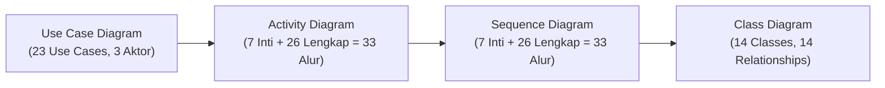
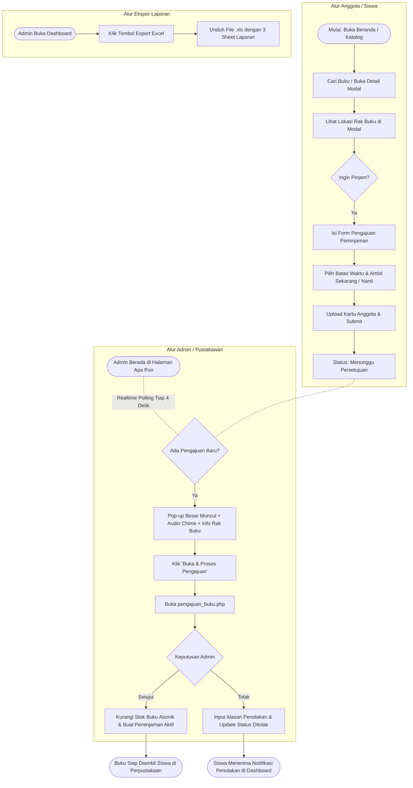

# Product Requirements Document (PRD)
## Sistem Informasi Perpustakaan Digital — AKSA NOVA

> **Versi:** 2.5 | **Terakhir Diperbarui:** 11 Oktober 2026 | **Sekolah:** SMK Negeri 1 Rongga, Bandung Barat

---

## 1. Executive Summary & Overview

### 1.1 Latar Belakang & Visi Produk
**AKSA NOVA** adalah sistem informasi perpustakaan digital modern berbasis web yang dirancang untuk mendigitalkan seluruh ekosistem perpustakaan **SMK Negeri 1 Rongga**, mulai dari sirkulasi buku (peminjaman & pengembalian), penagihan denda keterlambatan terintegrasi WhatsApp, manajemen keanggotaan berbasis kartu digital, hingga interaksi literasi (like, favorit, rating).

Aplikasi mengusung identitas visual premium **Obsidian-Gold Luxury Theme** (gelap elegan beraksen emas `#d8b878` dan mode terang adaptif), dilengkapi musik latar persisten (*seamless persistent background audio* dengan loop otomatis), serta sistem banner dinamis yang mendukung **gambar statis, GIF animasi, dan video (MP4/WEBM)**.

Pada pembaruan versi 2.5, sistem memperkuat aspek **keamanan privasi data kata sandi** (penyamaran sandi pada seluruh kartu fisik dan dashboard, pembersihan kebocoran kredensial di tabel admin, serta modal pengaturan sandi kustom/acak), serta **standardisasi tata letak antarmuka** (lebar sidebar 220px bebas scroll vertikal dan responsivitas penuh).

### 1.2 Tujuan Produk (Product Goals)
- **Efisiensi Pustakawan**: Mengurangi beban kerja administratif manual melalui pencatatan sirkulasi digital, kalkulasi denda otomatis, notifikasi pop-up besar realtime saat ada pengajuan baru, pencarian ISBN otomatis, manajemen anggota modern, dan **ekspor laporan Excel 3-sheet**.
- **Kenyamanan & Privasi Anggota**: Memberikan pengalaman mandiri bagi siswa/anggota dalam mencari katalog buku, melihat **lokasi rak fisik buku** langsung dari modal detail, mengajukan peminjaman online (*Ambil Sekarang* / *Ambil Nanti*), menyimpan buku favorit, memberikan ulasan rating, serta memiliki kartu anggota digital dengan kata sandi terlindungi (*masked password*).
- **Transparansi & Akuntabilitas**: Menghindari sengketa keterlambatan pengembalian buku dengan pencatatan `waktu_pinjam`, `batas_kembali`, `terlambat_hari`, status denda, serta riwayat pengingat WhatsApp (`reminder_log`).

---

## 2. Stakeholders & User Personas

| Persona | Hak Akses (Role) | Karakteristik & Kebutuhan Utama |
|---|---|---|
| **Admin / Pustakawan** | `role: admin` | • Mengelola katalog buku (tambah, edit, stok, ISBN fetch, **lokasi rak buku**, status stok kosong). • Memvalidasi pendaftaran anggota & pengajuan peminjaman. • Memproses sirkulasi peminjaman, pengembalian, & pelunasan denda. • Mereset kata sandi anggota melalui modal interaktif (kustom/acak) tanpa mengekspos kata sandi di tabel umum. • Mengatur banner beranda (gambar, GIF, video), tarif denda, musik latar, dan profil admin. • Menerima notifikasi pop-up realtime saat ada siswa mengajukan pinjaman. • **Mengekspor laporan bulanan dalam format Excel 3-sheet**. |
| **Anggota / Siswa** | `role: member` | • Menelusuri buku berdasarkan genre, judul, atau penulis. • Melihat **lokasi rak fisik buku** di modal detail buku. • Mengajukan peminjaman buku dari mana saja secara online. • Memiliki kartu anggota digital resmi ber-QR Code dengan kata sandi terlindungi (`••••••••`). • Melaporkan lupa/hilang kartu melalui form mandiri dengan verifikasi NIS & email. • Menyimpan buku ke daftar simpanan dan menyukai buku. • Memberikan rating bintang (1–5) pada buku yang telah dibaca. • Memeriksa riwayat pinjaman aktif, tenggat waktu, dan denda personal. |
| **Pengunjung / Tamu** | `guest` | • Melihat katalog umum, informasi buku, dan banner promosi (termasuk video/GIF). • Diarahkan untuk mendaftar (`sign_up.php`) atau masuk (`sign_in.php`) saat hendak melakukan aksi peminjaman atau interaksi. |

---

## 3. Fitur Utama & Kebutuhan Fungsional (Functional Requirements)

### 3.1 Manajemen Autentikasi & Akun
- **FR-AUTH-01 (Pendaftaran Anggota Mandiri)**: Pengguna dapat mendaftar dengan menginput Nama Lengkap, **NIS (Nomor Induk Siswa)**, Kelas, No. WhatsApp, Username, Email (harus domain `@student.smkn1rongga.sch.id`), Kata Sandi, dan Foto Profil. Akun langsung berstatus aktif/disetujui.
- **FR-AUTH-02 (Nomor Anggota Otomatis)**: Sistem otomatis men-generate Nomor Anggota unik (format: `AN-YYYYMM-XXXX`).
- **FR-AUTH-03 (Verifikasi & Manajemen Anggota)**: Admin dapat memantau status anggota, mengaktifkan/menonaktifkan akun, menyaring anggota per kelas, serta mengelola status kartu di `daftar_anggota.php`.
- **FR-AUTH-04 (Kartu Anggota Digital & Masking Kata Sandi)**:
  - Anggota dapat melihat dan mengunduh Kartu Anggota Perpustakaan dengan QR Code identitas lengkap (`kartu_anggota.php`, `edit_kartu.php`, dan mini-card di `dashboard_user.php`).
  - **Prinsip Privasi**: Kolom kata sandi pada seluruh kartu fisik, preview web, maupun hasil unduhan file gambar (PNG) **selalu disamarkan dengan titik-titik (`••••••••`)** demi mencegah pencurian kredensial saat kartu dicetak atau diperlihatkan.
- **FR-AUTH-05 (Modal Ubah Sandi Anggota oleh Admin)**:
  - Pada panel `daftar_anggota.php`, display kata sandi di bawah username anggota dihapus sepenuhnya dari tabel umum.
  - Admin dapat mereset sandi anggota melalui modal interaktif "Ubah Sandi" dengan opsi mengetik kata sandi kustom baru atau menghasilkan kata sandi acak aman (generator 🎲).
- **FR-AUTH-06 (Lupa Kartu / Freeze Card Mandiri)**: Mekanisme pelaporan kartu hilang/lupa (`lupa_kartu.php`) yang membekukan status kartu lama (`card_status = 'frozen'`), menyinkronkan email & input wrap seragam, serta menyediakan toggle pengintip kata sandi (*eye peek toggle*).
- **FR-AUTH-07 (Profil & Ganti Sandi Admin Universal)**: Admin dapat mengubah display name, foto avatar, dan mengganti kata sandi secara aman dari modal universal (`modal_profil_admin.php`) di seluruh halaman kerja admin.

### 3.2 Katalog & Inventaris Buku
- **FR-BOOK-01 (Katalogisasi & Metadata Lengkap)**: Buku memiliki judul, penulis, ISBN, genre/kategori, sinopsis, jumlah stok fisik, gambar sampul, dan **lokasi rak buku**.
- **FR-BOOK-02 (Pencarian ISBN Otomatis)**: Admin dapat mencari data buku dan mengunduh cover otomatis menggunakan Google Books / Open Library API (`cari_isbn.php`).
- **FR-BOOK-03 (Pencarian Live & Filter Genre)**: Pengguna dapat mencari buku secara instan (*debounced live search*) dan memfilter berdasarkan multi-genre.
- **FR-BOOK-04 (Stok Atomic & Label Stok Kosong)**: Sistem menjamin pengurangan dan penambahan stok secara atomik. Jika stok buku bernilai 0, sistem menampilkan label **"Kosong"** yang tegas dan seragam di katalog maupun modal pinjam.
- **FR-BOOK-05 (Lokasi Rak Fisik Buku)**: Setiap buku memiliki informasi lokasi rak fisik (misal: "Rak A-1 (Fiksi)", "Rak B-2", dsb.) yang dapat diatur admin dan tampil di modal detail buku untuk semua pengguna guna mempermudah pencarian fisik di ruangan perpustakaan.

### 3.3 Alur Pengajuan & Sirkulasi Peminjaman
- **FR-LOAN-01 (Pengajuan Online oleh Anggota)**:
  - Anggota memilih buku, melihat **lokasi rak buku**, menentukan jumlah eksemplar, batas kembali (maksimal 7–14 hari), serta opsi waktu pengambilan (*Ambil Sekarang* / *Ambil Nanti*).
  - Mengunggah bukti kartu anggota sebagai validasi; data tersimpan dengan status `menunggu`.
- **FR-LOAN-02 (Notifikasi Pop-up Besar Realtime Admin)**:
  - Setiap ada pengajuan buku baru, pop-up modal beranimasi keemasan muncul seketika di layar admin di halaman mana pun pustakawan berada.
  - Menampilkan detail buku termasuk **lokasi rak buku** dan nama peminjam, disertai audio chime harmonik (*Web Audio API*) dan badge berkedip.
  - Menyediakan tombol cepat **"Buka & Proses Pengajuan"** menuju `pengajuan_buku.php`.
- **FR-LOAN-03 (Persetujuan & Penolakan Pengajuan)**:
  - Admin dapat menyetujui pengajuan jika stok mencukupi (otomatis masuk ke tabel `peminjaman` dan stok buku berkurang atomik).
  - Jika ditolak, admin menyertakan alasan penolakan yang dapat dilihat siswa di dashboard mereka.
- **FR-LOAN-04 (Peminjaman Langsung di Meja Layanan)**:
  - Admin dapat langsung membuat transaksi peminjaman langsung bagi siswa yang datang ke meja sirkulasi (`pinjam_buku.php`) dengan informasi lokasi rak buku.

### 3.4 Pengembalian Buku & Denda Keterlambatan
- **FR-RET-01 (Pencatatan Pengembalian)**: Admin memproses pengembalian buku di `telah_dipinjam.php`. Sistem mencatat `waktu_kembali` dan mengembalikan stok fisik buku (+1).
- **FR-RET-02 (Perhitungan Denda Otomatis)**: Jika `waktu_kembali > batas_kembali`, sistem menghitung selisih hari (`terlambat_hari`) dikalikan tarif denda harian setelah masa tenggang (*grace period*) dan mencatat `status_denda = 'belum'`.
- **FR-RET-03 (Pelunasan Denda)**: Admin dapat memvalidasi pembayaran denda dan mengubah status menjadi `lunas`.
- **FR-RET-04 (Pengingat WhatsApp Otomatis)**: Integrasi template pengingat via WhatsApp URL kepada nomor siswa yang terlambat, tercatat di `reminder_log`.

### 3.5 Interaksi Anggota (Social & Engagement)
- **FR-ENG-01 (Buku Favorit / Simpan)**: Anggota dapat menyimpan buku untuk dibaca nanti (`buku_favorites`) dan mengelolanya di `buku_simpan.php`.
- **FR-ENG-02 (Suka / Like)**: Anggota dapat menyukai buku (`buku_likes`) dengan counter like interaktif.
- **FR-ENG-03 (Rating Bintang 1–5)**: Anggota dapat memberikan rating 1–5 bintang beserta pembaruan rata-rata rating buku. Role `admin` diblokir dari memberi rating demi objektivitas ulasan pembaca.
- **FR-ENG-04 (Rekomendasi Pintar "Bingung Mau Baca Apa?")**: Widget kartu interaktif di beranda untuk membantu siswa menemukan buku acak berkualitas secara instan.

### 3.6 Konfigurasi Sistem, Multimedia & Desain UI
- **FR-CFG-01 (Kelola Banner Beranda)**: Mendukung gambar statis (JPG, PNG, WEBP), GIF animasi, dan Video (MP4, WEBM) autoplay muted loop di beranda (`kelola_banner.php`).
- **FR-CFG-02 (Pengaturan Denda & Masa Tenggang)**: Konfigurasi tarif per hari dan masa toleransi tersimpan di tabel `pengaturan` (`pengaturan_denda.php`).
- **FR-CFG-03 (Musik Latar Audio Persisten)**: Musik audio latar berputar mulus tanpa jeda saat berpindah halaman (*seamless playback*), tersinkronisasi via storage key terpadu, dan otomatis berulang (loop) saat lagu selesai.
- **FR-CFG-04 (Panel Preferensi Tema & Tipografi)**: Pengguna dapat menyesuaikan font (Outfit, Poppins, dll.), tema aksen warna, dan dark/light mode (`pengaturan_panel.php`).
- **FR-CFG-05 (Standardisasi Sidebar Bebas Scroll)**:
  - Lebar sidebar admin dan pengguna dikunci pada `--sidebar-w: 220px`.
  - Ukuran avatar admin 72px, tombol navigasi `7.5px 12px`, font `.82rem` untuk memastikan seluruh menu navigasi admin muat rapi di satu layar vertikal tanpa memicu *vertical scrollbar*.

### 3.7 Pelaporan & Ekspor Data
- **FR-RPT-01 (Ekspor Laporan Excel Multilembar)**: Admin dapat mengekspor laporan perpustakaan format SpreadsheetML Excel (.xls) dari dashboard admin (`dashboard.php` $\rightarrow$ `export_excel_dashboard.php`) yang terdiri atas:
  - **Sheet 1 — Rekap Bulanan**: Tren peminjaman per bulan.
  - **Sheet 2 — Ringkasan Perpustakaan**: Total buku, anggota, sirkulasi aktif, buku terlambat, denda.
  - **Sheet 3 — Buku Terpopuler**: Daftar 20 buku yang paling sering dipinjam.

---

## 4. Kebutuhan Non-Fungsional (Non-Functional Requirements)

| Aspek | Spesifikasi & Kriteria Keberhasilan |
|---|---|
| **Performa & Realtime** | • Polling background admin berinterval 4 detik dengan payload ringan (< 1 KB JSON). • Pemuatan halaman utama < 1.2 detik pada server lokal Laragon. • Audio chime lokal via Web Audio API (0 ms latency). • Video banner streaming langsung dengan `preload="auto"`. |
| **Keamanan (Security) & Privasi** | • Password dienkripsi dengan `password_hash()` BCRYPT bawaan PHP. • **Pencegahan Kebocoran Sandi**: Password tidak ditampilkan polos di tabel daftar anggota maupun kartu fisik/digital (selalu bertitik `••••••••`). • Semua kueri database menggunakan prepared statements (`mysqli_prepare`) untuk mencegah SQL Injection. • Sanitasi input XSS via `htmlspecialchars()`. • Otorisasi ganda berbasis peran (`$_SESSION['role'] === 'admin'`). • Email pendaftaran wajib berdomain `@student.smkn1rongga.sch.id`. |
| **Integritas Data** | • Pengurangan stok buku secara atomik (`UPDATE buku SET stok = stok - ? WHERE id = ? AND stok >= ?`). • Relasi foreign key `ON DELETE CASCADE` untuk data riwayat/anak, dan `ON DELETE SET NULL` pada sirkulasi historis. |
| **Konsistensi UI/UX** | • Skema warna Obsidian-Gold (`--bg: #090c10`, `--accent: #d8b878`, `--card: #121820`). • Sidebar 220px proporsional tanpa *vertical scroll* pada desktop/laptop. • Universal Mobile Topbar Header dan transformasi tabel ke format *card layout* pada layar ponsel ($\le 768px$). |
| **Kompatibilitas** | • PHP 8.1+ & MySQL 8.0 / MariaDB 10.4+. • Modern Chromium Browsers (Google Chrome, Microsoft Edge), Firefox, Safari. |

---

## 5. Pemodelan Sistem Berorientasi Objek (UML Architecture)

Sistem Informasi AKSA NOVA dimodelkan secara komprehensif ke dalam 4 pilar diagram UML standar industri:

### 5.1 Use Case Diagram (23 Use Case)
- **3 Aktor**: Tamu (Pengunjung), Anggota (Siswa), Admin (Pustakawan).
- **Relasi Khusus**:
  - `Melihat Katalog` $\ll\text{include}\gg$ `Melihat Detail & Lokasi Rak Buku`.
  - `Memproses Pengajuan` $\ll\text{include}\gg$ `Menerima Notifikasi Realtime`.
  - `Pengembalian Buku` $\ll\text{include}\gg$ `Menghitung Denda Keterlambatan`.
  - `Mencari via ISBN` $\ll\text{extend}\gg$ `Mengelola Data Buku`.
  - `Pelunasan Denda & WhatsApp` $\ll\text{extend}\gg$ `Menghitung Denda Keterlambatan`.

### 5.2 Activity Diagram (33 Alur Lengkap)
- **7 Alur Inti**:
  1. Registrasi Anggota (`sign_up.php`)
  2. Login Pengguna (`sign_in.php`, `logout.php`)
  3. Pengajuan Peminjaman Anggota (`pengajuan_peminjaman.php`)
  4. Persetujuan Pengajuan Admin (`pengajuan_buku.php`, `api_cek_pengajuan_admin.php`)
  5. Peminjaman Langsung di Tempat (`pinjam_buku.php`)
  6. Pengembalian Buku & Denda (`telah_dipinjam.php`, `pengaturan_denda.php`)
  7. Tambah Buku ISBN Auto-lookup (`halaman_admin.php`, `cari_isbn.php`)
- **26 Alur Pelengkap**: Tersimpan di direktori `UML/Activty/Lengkap/` mencakup lupa kartu, edit kartu, like, rating, filter katalog, reset sandi modal, kenaikan kelas, manajemen banner/musik, profil admin, dan notifikasi pengajuan.

### 5.3 Sequence Diagram (33 Alur Lengkap)
- **7 Alur Inti**: Memetakan interaksi temporal antara Aktor, Boundary (file PHP), Control (logika PHP), Entity (tabel database), dan Object (API eksternal) dengan penanganan fragmen `alt` dan `opt`.
- **26 Alur Pelengkap**: Tersimpan di direktori `UML/Squence/Lengkap/` mencakup seluruh detail skenario edge-case dan operasional pustakawan.

### 5.4 Class Diagram (14 Kelas & 14 Relasi)
- **14 Kelas**: `Pengguna`, `Anggota`, `Admin`, `AdminProfile`, `Kelas`, `Buku`, `Peminjaman`, `PengajuanPeminjaman`, `ReminderLog`, `BukuSuka`, `BukuFavorit`, `BukuRating`, `Pengaturan`, `Banner`.
- **Relasi Pemodelan**: 2 Generalisasi (Anggota $\rightarrow$ Pengguna, Admin $\rightarrow$ Pengguna), 2 Komposisi (Admin $\blacklozenge$ AdminProfile, Peminjaman $\blacklozenge$ ReminderLog), 8 Asosiasi, dan 2 Dependensi (`PengajuanPeminjaman \dashrightarrow Peminjaman \ll\text{create}\gg` dan `Peminjaman \dashrightarrow Pengaturan \ll\text{use}\gg`).

---

## 6. Alur Pengguna Utama (Key User Flows)

---

## 7. Release & Roadmap Pengembangan

- **Fase 1 (Selesai)**: Core catalog, membership, direct borrowing, online loan request, fine management, theme obsidian-gold.
- **Fase 2 (Selesai)**: Penstabilan UI admin, perbaikan kontras teks/tombol pada mode gelap dan terang, pencegahan jitter profil admin, serta notifikasi pop-up besar realtime lintas halaman untuk pengajuan pinjaman baru.
- **Fase 3 (Selesai)**:
  - Loop musik otomatis saat lagu selesai diputar.
  - Rename field NIK $\rightarrow$ NIS di halaman edit profil anggota.
  - Ekspor laporan Excel 3 sheet dari dashboard admin.
  - Dukungan GIF animasi & Video (MP4/WEBM) sebagai banner beranda.
  - Peta lokasi Google Maps mengarah ke SMK Negeri 1 Rongga, Bandung Barat.
  - Fitur Lokasi Rak Buku — tampil di semua modal detail buku, form pinjam, dan notifikasi admin.
- **Fase 3.1 (Selesai)**:
  - Input wajib NIS dan validasi keunikan pada halaman registrasi (`sign_up.php`).
  - Sinkronisasi audio latar persisten (`AksaAudio`) antar modul dan landing page.
  - Proteksi role Admin dari pemberian rating buku di `beranda.php`.
  - Integrasi modal notifikasi pengajuan buku realtime di `beranda.php` untuk Admin.
- **Fase 3.2 (Pembaruan Terkini — Oktober 2026)**:
  - ✅ **Privasi Kata Sandi Kartu**: Masking kata sandi di kartu anggota (`kartu_anggota.php`) dan dashboard user (`dashboard_user.php`) menjadi titik-titik (`••••••••`), termasuk pada hasil unduhan PNG.
  - ✅ **Keamanan Daftar Anggota**: Penghapusan display kata sandi di bawah username pada tabel `daftar_anggota.php`, serta penambahan Modal "Ubah Sandi" (kustom & acak 🎲).
  - ✅ **Penyempurnaan Form Lupa Kartu**: Harmonisasi input wrap email & kata sandi baru serta eye peek toggle di `lupa_kartu.php`.
  - ✅ **Standardisasi Sidebar Bebas Scroll**: Penerapan `--sidebar-w: 220px`, avatar admin 72px, tombol `7.5px 12px` untuk mencegah vertical scrollbar pada layar standar.
  - ✅ **Konsistensi Label Stok**: Status stok bernilai 0 berlabel tegas "Kosong".
  - ✅ **Harmonisasi Dokumentasi UML**: Sinkronisasi 23 Use Cases, 33 Activity Diagrams, 33 Sequence Diagrams, dan 14 Class Diagrams ke seluruh dokumen proyek & Laporan UKK.
- **Fase 4 (Masa Depan / Rekomendasi)**:
  - Integrasi Barcode/QR Scanner fisik berbasis webcam saat siswa mengambil buku fisik di meja sirkulasi.
  - Webhook WhatsApp API resmi (Fonnte / Wablas) untuk auto-blast notifikasi pengingat tanpa klik manual.
  - Ekspor laporan dalam format PDF berformat resmi dinas pendidikan.
